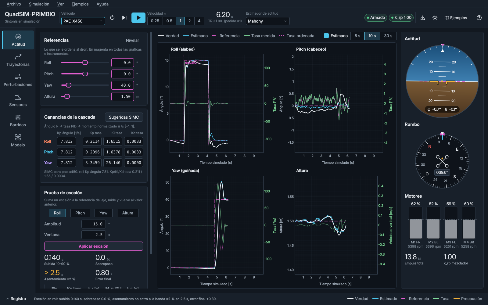
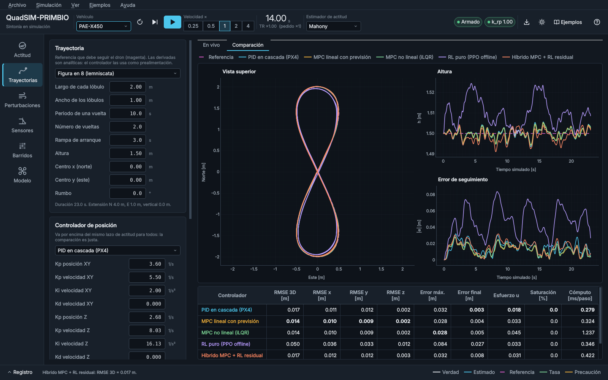
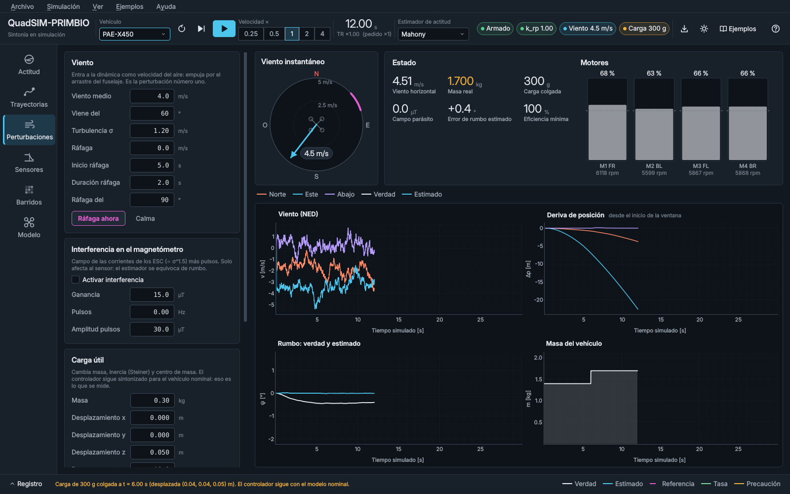
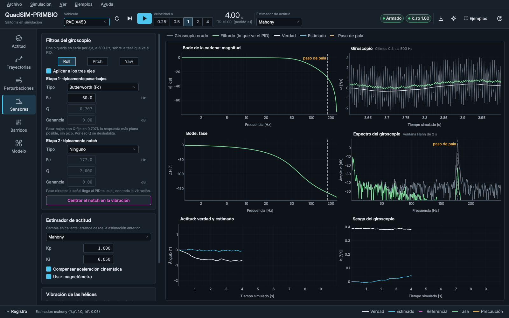
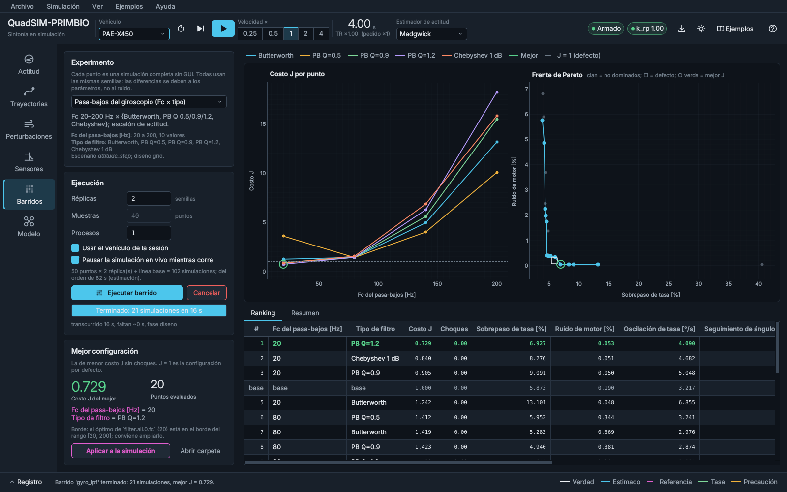
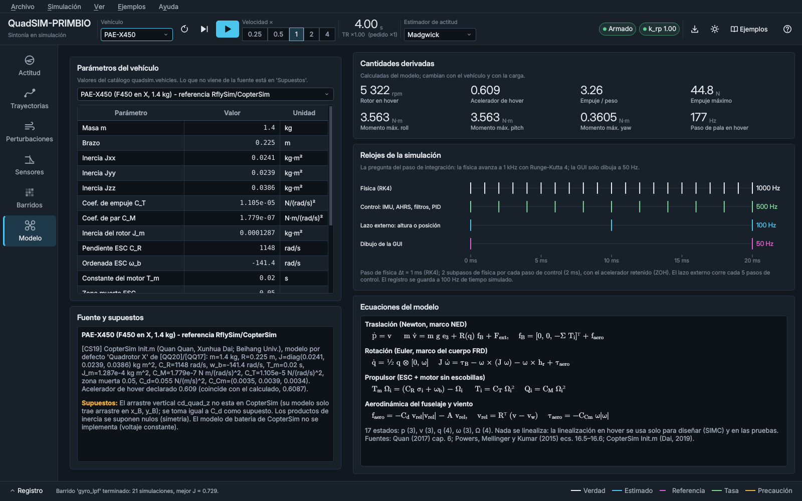
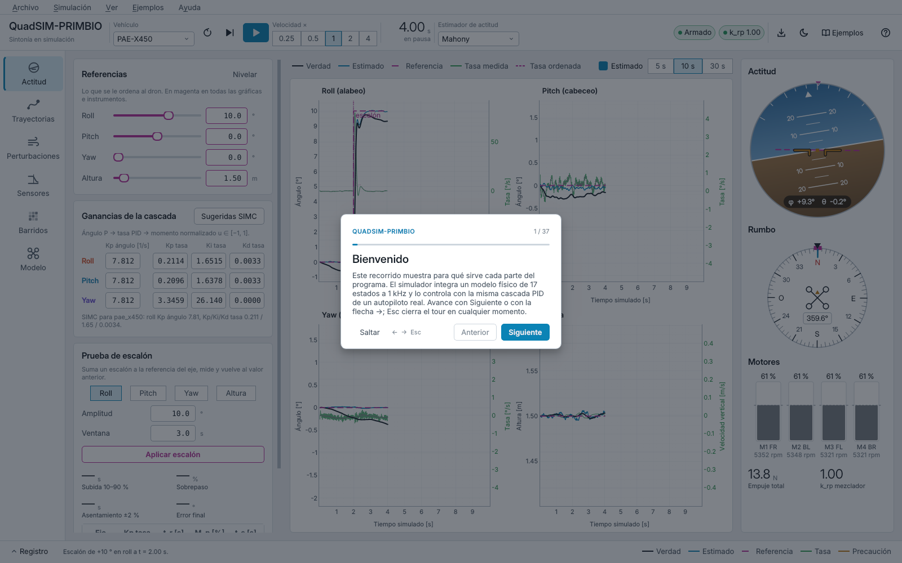
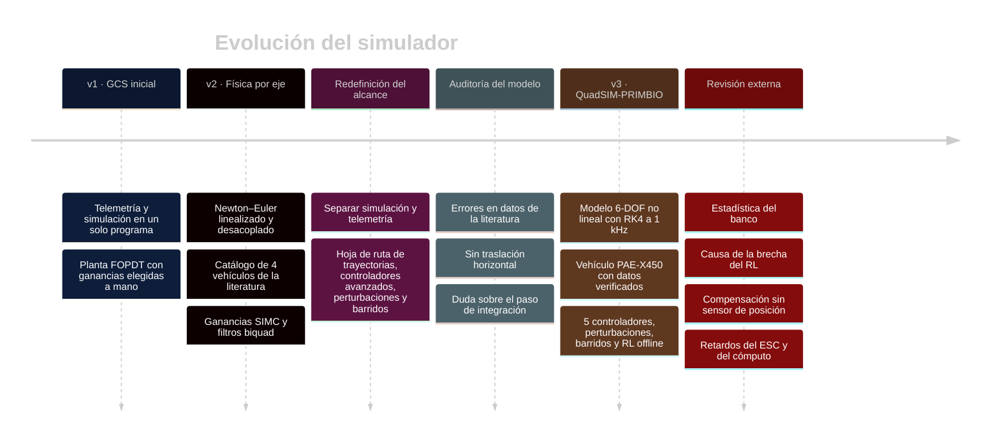
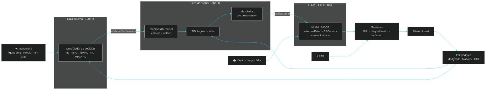

<div align="center">



<br/>


<a href="https://primbiolab.org/"></a>


<br/><br/>

**Simulador de cuadricóptero para sintonizar controladores en un entorno simulado,**<br/>
**como punto de partida para sintonizar drones reales.**

[`Modelo matemático (PDF)`](docs/Modelo_Matematico_Simulador_3ra_Edicion.pdf) ·
[`Ruta de presentación`](docs/RUTA_PRESENTACION.md) ·
[`Guía de la interfaz`](docs/GUI.md) ·
[`Barridos`](docs/BARRIDOS.md) ·
[`Aprendizaje por refuerzo`](docs/RL.md) ·
[`Dataset de vuelo`](docs/DATASET.md)

</div>


## ◈ Qué es

**QuadSIM-PRIMBIO** (versión 3.1.0; el repositorio conserva el nombre `PAE-Quadcopter-SIM`) es
el simulador de un **Proyecto Académico Especial (PAE)** de Ingeniería Mecatrónica de la
**Universidad Nacional de Colombia, Sede La Paz** (Valledupar), desarrollado dentro del
**Semillero de Investigación [PRIMBIO](https://primbiolab.org/)** (*Plataformas Robóticas
Inteligentes Interconectadas*), adscrito al Grupo de Investigación **IAM-NANO**.

Sintonizar un dron en hardware es lento y arriesgado: se ajusta una ganancia, se compila, se
carga el firmware, se prueba en el banco y, si algo sale mal, se rompe una hélice. Este simulador
invierte el orden: **primero se sintoniza en un modelo físico detallado, rápido y verificable**,
y al dron real llega una sintonía que ya funciona en simulación. La línea de investigación del
proyecto lo dice así: *técnicas de sintonía en entornos simulados como punto de partida en la
sintonía de drones reales*. Lo de "punto de partida" va en serio. La sección
[Límites de validez](#-límites-de-validez-y-datos-pendientes) lista lo que todavía hay que medir
en el dron antes de suponer que una sintonía transfiere tal cual.

El simulador sirve para tres cosas:

| | Para quién | Qué hace |
|---|---|---|
| 🎓 **Didáctico** | estudiantes | ver en vivo qué hace cada ganancia, filtro y estimador |
| 🔬 **Investigación** | el semillero | comparar 5 controladores de trayectoria bajo las mismas condiciones, con resultados reproducibles |
| 🛠️ **Ingeniería** | el dron del proyecto | encontrar ganancias y filtros iniciales antes de volar |


## ◈ Lo que puede hacer

<table>
<tr>
<td width="50%"><br/><b>01 · Sintonía de actitud.</b> PID en cascada ángulo → tasa por eje y lazo de altura (Kp de altura y PID de velocidad vertical), ganancias sugeridas por SIMC a partir del modelo, pruebas de escalón con métricas automáticas, horizonte, brújula y motores.</td>
<td width="50%"><br/><b>02 · Trayectorias y controladores.</b> 7 trayectorias (figura en 8, círculo, hélice, <i>minimum-snap</i>…) y 5 controladores de posición comparados con el mismo ruido y la misma turbulencia. La cámara 3D sigue al dron, se ajusta a la trayectoria o queda fija.</td>
</tr>
<tr>
<td><br/><b>03 · Perturbaciones.</b> Viento (medio + turbulencia de Dryden + ráfaga), interferencia en el magnetómetro, carga útil que cambia masa e inercia, falla de motor y efecto suelo.</td>
<td><br/><b>04 · Sensores, filtros y estimadores.</b> La vibración de las hélices aparece en el espectro del giroscopio (~177 Hz); filtros biquad con su Bode en vivo; Madgwick, Mahony y Kalman extendido intercambiables en vuelo.</td>
</tr>
<tr>
<td><br/><b>05 · Barridos de sensibilidad.</b> Búsqueda automática (rejilla, hipercubo latino, refinamiento) de filtros, estimadores y ganancias, con frente de Pareto, reanudable para corridas nocturnas.</td>
<td><br/><b>06 · Vehículo y modelo.</b> Cada parámetro con su unidad y su fuente bibliográfica, cantidades derivadas y las tasas de simulación.</td>
</tr>
</table>

**Dataset de vuelo para modelos dinámicos.** *Simulación → Generar dataset de vuelo…* (o
`experiments/generar_dataset.py`) produce vuelos variados del PAE-X450 con el PWM de los cuatro
motores, el estado real, sus derivadas, la lectura de cada sensor y las perturbaciones, en CSV, con
la partición entrenamiento / validación / prueba hecha por vuelo. Los motores se excitan con una
señal APRBS para que el PWM no quede determinado por el controlador. Pensado para entrenar redes
neuronales que aprendan la dinámica del dron. Formato, columnas y verificación en
[`docs/DATASET.md`](docs/DATASET.md).

### Primeros pasos dentro del programa

Nadie tiene que leer un manual para empezar. La primera vez que se abre, el programa ofrece un
**tour guiado** que recorre cada parte de la ventana paso a paso; se repite cuando se quiera con
`F1`, con el botón **?** de la barra superior o desde **Ayuda → Tour guiado**, y `Mayús+F1`
explica solo la página visible. La **galería de ejemplos** (`F2` o menú **Ejemplos**) trae
**11 escenarios listos para cargar**, del primer vuelo con escalón de roll hasta la interferencia
magnética con PID frente a MPC y un barrido rápido del pasa-bajos; cada uno deja el simulador
configurado, abre la página que corresponde y dice qué resultado esperar.

<table>
<tr>
<td width="50%"><br/><b>Tour guiado.</b> Primer paso del recorrido; flechas para avanzar, Esc para salir.</td>
<td width="50%"><br/><b>Galería de ejemplos.</b> Once escenarios por nivel (básico, intermedio, avanzado).</td>
</tr>
</table>

El menú **Archivo** abre y guarda escenarios propios (`.json`) y exporta la corrida a CSV. El
menú **Ayuda** reúne el tour, la galería, la lista de atajos y la ventana *Acerca de*.


## ◈ Cómo se desarrolló

El proyecto pasó por tres versiones del modelo. Cada una corrigió lo que la anterior no podía
defender con datos.



**1. Separar lo que no debía estar junto.** La primera estación terrena mezclaba la telemetría del
dron real (ESP32, radio NRF24) con la simulación, y un cambio en una parte podía romper la otra.
Se separaron: la simulación vive en este repositorio y la telemetría en otro proyecto.

**2. Auditar el modelo antes de construir encima.** La versión 2 usaba parámetros de la
literatura, pero al revisarlos contra las fuentes originales aparecieron problemas. Uno de los
vehículos tenía una masa incoherente con su propio coeficiente de empuje (1.474 kg declarados
frente a 1.321 kg implícitos) y un bastidor equivocado. El modelo además estaba linealizado por
eje y no tenía traslación horizontal, así que no servía para seguir trayectorias.

**3. Un vehículo de referencia con datos verificables.** El vehículo por defecto, **PAE-X450**,
es un cuadricóptero en X de clase 450 mm y 1.4 kg, con motores brushless y ESC. Sus parámetros
son los del modelo de referencia de **CopterSim/RflySim** (Quan Quan y colaboradores, Beihang
University; libros de Springer 2017 y 2020), comparados dígito por dígito con el archivo
original. Los datos son coherentes entre sí: el acelerador de vuelo estacionario calculado
(0.608) coincide con el declarado por la fuente (0.609).

**4. Construir encima, verificando cada bloque.** Sobre ese núcleo se agregaron sensores con
vibración real de las hélices, tres estimadores, cinco controladores de posición, perturbaciones,
barridos automáticos y aprendizaje por refuerzo offline. Ningún resultado se reporta sin
ejecutarlo: 230 pruebas automáticas y un script de verificación numérica respaldan las
cifras del documento del modelo.

**5. Pedir que alguien busque los errores.** En octubre de 2026 una revisión técnica
independiente leyó el código y los resultados con la consigna de encontrar fallas. Encontró
varias, y este texto cambió por ellas: la causa atribuida a la brecha del RL, la forma de leer las
negritas del banco, la compensación del acelerómetro cuando no hay sensor de posición y el peso
de los retardos del ESC y del cómputo. Lo que se pudo corregir en el código se corrigió: la
compensación del acelerómetro, la corrección del magnetómetro (ahora solo sobre el rumbo), la base
de tiempo, la validación de nombres de estimadores y ganancias, la regularización del MPC no lineal
y el costo de evaluar la referencia, que hacía correr la simulación más lento de lo necesario. Lo
que depende de medir el dron real quedó escrito como límite.


## ◈ Arquitectura



La pantalla se dibuja a 50 Hz, pero eso no cambia la simulación: la física avanza a **1 kHz con
Runge–Kutta de 4.º orden**. El documento del modelo muestra la evidencia: orden de convergencia
medido de 4.19, deriva de energía de 10⁻¹⁴ en rotación libre y la inestabilidad del eje intermedio
(efecto Dzhanibekov) reproducida.


## ◈ El modelo en cuatro ecuaciones

Estado de 17 componentes: posición, velocidad, cuaternión de actitud, velocidad angular y la
velocidad de los cuatro rotores. Marcos NED/FRD, igual que PX4.

$$m\,\dot{\mathbf v} = m g\,\mathbf e_3 + \mathbf R(\mathbf q)\big(\mathbf f_{aero} - \textstyle\sum_i T_i\,\mathbf e_3\big) \qquad
\mathbf J\dot{\boldsymbol\omega} = \boldsymbol\tau - \boldsymbol\omega\times\mathbf J\boldsymbol\omega - \boldsymbol\omega\times\mathbf h_r + \boldsymbol\tau_{aero}$$

$$\dot{\mathbf q} = \tfrac12\,\mathbf q\otimes[0,\ \boldsymbol\omega] \qquad
T_m\,\dot\Omega_i = (C_R\,\sigma_i + \omega_b) - \Omega_i,\quad T_i = C_T\Omega_i^2,\quad Q_i = C_M\Omega_i^2$$

La derivación completa, cada parámetro con su fuente y la verificación numérica de cada bloque
están en el **[modelo matemático, 3.ª edición (60 págs.)](docs/Modelo_Matematico_Simulador_3ra_Edicion.pdf)**.


## ◈ Resultados: cinco controladores, mismas condiciones

Error medio de seguimiento (RMSE 3D, cm), media ± desviación estándar muestral de 3 semillas,
PAE-X450, estimador Mahony. **La negrita marca la media más baja de la fila y nada más**: abajo se
explica por qué no equivale a "ganador".

| Trayectoria · escenario | PID | MPC | MPC no lineal | RL puro | MPC + RL |
|---|:-:|:-:|:-:|:-:|:-:|
| Figura en 8 (10 s) · nominal | 1.83 ± 0.28 | **1.50 ± 0.36** | 1.58 ± 0.41 | 4.56 ± 0.19 | 1.79 ± 0.37 |
| Figura en 8 · viento | 1.84 ± 0.44 | **1.66 ± 0.42** | 1.71 ± 0.46 | 5.36 ± 0.45 | 1.88 ± 0.44 |
| Figura en 8 · carga de 300 g | 2.23 ± 0.28 | **1.85 ± 0.32** | 2.05 ± 0.37 | 4.66 ± 0.42 | 2.06 ± 0.29 |
| Figura en 8 · interferencia magnética | 5.90 ± 2.82 | **3.00 ± 0.14** | 3.03 ± 0.18 | 6.27 ± 0.09 | 3.13 ± 0.16 |
| Figura en 8 rápida (5 s) · nominal | 6.22 ± 0.10 | **2.53 ± 0.24** | 2.87 ± 0.27 | 9.36 ± 0.23 | 3.07 ± 0.20 |
| Figura en 8 rápida · interferencia magnética | 19.15 ± 2.90 | 16.27 ± 0.49 | **15.23 ± 0.41** | 138.91 ± 8.76 | 16.78 ± 0.50 |
| Escalones (caja de 1 m) · nominal | 28.13 ± 0.20 | **8.87 ± 0.06** | 9.02 ± 0.07 | 20.88 ± 0.09 | 8.99 ± 0.05 |

<table>
<tr>
<td width="50%"></td>
<td width="50%"></td>
</tr>
</table>

**Cómo leer la tabla.** Con tres semillas los rangos ± del MPC, el MPC no lineal y el MPC + RL
se solapan en todas las filas de figura en 8 y círculo, de modo que esas columnas, por sí solas,
no permiten afirmar cuál es mejor. Sirve más comparar por semilla, porque cada semilla da a todos
los controladores el mismo ruido y la misma turbulencia. Así, el MPC queda por debajo del PID en
las 48 parejas del banco (16 filas por 3 semillas) y por debajo del MPC no lineal en las tres
semillas de 13 de las 16 filas. En círculo con viento y en la figura en 8 con interferencia
magnética una semilla invierte el orden por centésimas de centímetro, y en la figura en 8 rápida
con interferencia el no lineal gana en las tres. Tres de tres sigue siendo poco: una prueba de
signos da p = 0.25 (bilateral). Son tendencias consistentes, no diferencias probadas.

**Lo que muestran los datos**

- ▸ **El MPC lineal tiene la media más baja en 15 de las 16 filas** y el MPC no lineal en la restante. En la figura en 8 rápida el MPC reduce el error del PID en 59 %, porque anticipa la referencia en lugar de reaccionar a ella.
- ▸ **La interferencia magnética es la prueba más dura.** El rumbo estimado se desvía y todos empeoran: en la figura en 8, el PID pasa de 1.8 a 5.9 cm y el MPC de 1.5 a 3.0 cm; en la figura en 8 rápida los controladores clásicos quedan entre 15 y 19 cm. Con escalones de 1 m el PID entra en un ciclo límite (133 cm) y los MPC no (14 cm).
- ▸ **El filtro de navegación decide buena parte de ese resultado.** Su compuerta de innovación rechaza una medida de posición solo si es improbable (más de 5 σ) y además grande (más de 25 cm). Con el rumbo desviado, la predicción del filtro queda sesgada; una compuerta puramente estadística descartaría medidas buenas una tras otra y el filtro derivaría. Con ella, el MPC llega a 1.6 m de RMSE en la figura en 8 rápida con interferencia; con el piso, a 16 cm.
- ▸ **El RL puro, entrenado offline, no alcanza al MPC**: en las 15 filas en que no pierde la trayectoria, su RMSE medio va de 1.6 a 4.4 veces el del MPC (por semilla, hasta 4.6). En la figura en 8 rápida con interferencia magnética sí la pierde, en las tres semillas (139 cm de RMSE y hasta 3.7 m de error, frente a 16 cm del MPC). Tampoco es siempre el último: supera al PID en 5 de las 16 filas (las cuatro de escalones y el círculo con interferencia magnética).
- ▸ **La brecha del RL puro viene casi toda de la política, no del simulador de entrenamiento.** En su propio modelo sustituto, el rápido donde se entrenó, la política ya comete 4.25 cm de RMSE en la figura en 8, contra 0.14 cm del MPC; en el 6-DOF comete 4.56 cm. Más de nueve décimas partes del error ya estaban donde aprendió. Qué dinámicas faltan en el sustituto es todavía una hipótesis (la comparación cambia muchos factores a la vez y se hizo con el núcleo anterior).
- ▸ **El residuo RL empeora al MPC, también en su sustituto.** Allí, el MPC + RL da 0.48 cm frente a 0.14 cm del MPC solo. El punto guardado de la red se eligió por costo, y el costo premia el esfuerzo suave además del error: durante el entrenamiento el costo bajó mientras el RMSE de evaluación subía. En el 6-DOF el híbrido queda por encima del MPC en las 48 parejas.

Detalles y limitaciones del estudio de RL en [`docs/RL.md`](docs/RL.md). Tablas completas, con
escalones y círculo: [`experiments/results/benchmark_final/summary.md`](experiments/results/benchmark_final/summary.md).

**Condiciones del banco que hay que tener presentes**

- Las ganancias del PID y los pesos del MPC y del MPC no lineal se afinaron con una rejilla sobre la figura en 8 y el círculo, escenario nominal, **semilla 1**, que es también una de las tres semillas reportadas; el integral horizontal del PID se eligió mirando el caso con interferencia magnética. El RL se entrenó sin ver esas trayectorias exactas. La comparación favorece a los controladores clásicos en esas filas.
- El RL puro trabaja con otra previsión (0.25 y 0.5 s, frente a 1 s del MPC), observaciones con escalas fijas sin normalizar, salida no estructurada como corrección sobre la aceleración de referencia y un límite de inclinación en cono de 30°; PID, MPC y MPC no lineal usan una caja por eje que en diagonal permite algo más.
- Hubo un solo entrenamiento PPO por política (semilla 0), cortado a los 50 M de pasos cuando la curva todavía bajaba. El "±" de la tabla mide la variación entre semillas del simulador, no entre entrenamientos.
- El círculo y la figura en 8 son casos particulares de la familia de referencias de entrenamiento, y la figura en 8 rápida queda en su borde. Probarlos mide interpolación dentro de esa familia, no generalización.
- Las políticas y el sustituto se identificaron y entrenaron con el núcleo anterior (Madgwick). Repetir hoy la identificación da otros rezagos (unos 75 ms y 40 ms frente a 82.5 ms y 32 ms), así que la receta de `docs/RL.md` no reproduce exactamente los archivos de `models/`.


## ◈ Límites de validez y datos pendientes

El simulador sirve para sintonizar *en simulación*. Que esa sintonía vuele igual en el dron
depende de cosas que todavía no se midieron en el hardware del proyecto:

| Pendiente | Por qué importa | Qué hace hoy el simulador |
|---|---|---|
| Protocolo y frecuencia del ESC (PWM, OneShot, DShot) | con PWM de 50 Hz el margen de fase del lazo de tasa baja de 58.7° a 39.6° y la ganancia admisible de 5.4× a 2.4× | `esc_rate_hz` y `esc_pulse_delay_s` opcionales; por defecto el ESC responde de forma continua |
| Retardo de cómputo del firmware | un periodo de 2 ms baja el margen de fase a 55.4° y la ganancia admisible a 4.3× | `compute_delay_samples` opcional; por defecto 0 |
| Constante de tiempo del motor medida en banco | $T_m$ = 20 ms viene de CopterSim; el lazo es más sensible a ella que a los retardos (con 30 ms el margen cae a unos 48°) | valor de la literatura, igual al subir y al bajar |
| Resolución del acelerador (LEDC del ESP32) | pocos escalones de PWM pueden causar ciclos límite | `throttle_levels` opcional; por defecto continuo |
| Modo y tasa reales del BMP180 | el ruido de 0.17 m corresponde a un modo de alta resolución que no llega a 40 Hz | 40 Hz y 0.17 m, pendientes de contrastar con el firmware |
| Sistema de posicionamiento (captura de movimiento, RTK o ninguno) y su latencia | sin posición absoluta la compensación del acelerómetro es autorreferente: en vuelo estacionario solo con barómetro el error de inclinación llegaba a 15.2° en 30 s | la compensación solo actúa con una corrección horizontal de posición en los últimos 0.2 s (ahora 1.46° en el mismo caso); `pos_link_delay_s` opcional para la latencia del enlace |

Los márgenes salen de [`experiments/delay_margins.py`](experiments/delay_margins.py) (lazo lineal y
simulación completa, [`resultados`](experiments/results/delay_margins/delay_margins.md)); el de
$T_m$ = 30 ms es de la revisión externa.

Los valores por defecto conservan el comportamiento con el que se identificaron los rezagos y se
afinaron los controladores, para que los resultados publicados sigan siendo reproducibles; las
opciones nuevas se activan cuando haya datos reales del ESC y del firmware. Lo mismo pasa con las
ganancias: por defecto se calculan con la cadena nominal ($\theta$ = 16.0 ms), y
`SimConfig.gains_from_chain = True` las recalcula con los filtros, el cómputo y el ESC
configurados ($\theta$ = 16.6 ms con los valores por defecto). Otros límites conocidos: el error
de actitud se calcula en ángulos de Euler (válido con el límite de 30°, no para maniobras
acrobáticas), el efecto suelo escala el empuje pero no el par de los rotores, el lazo es
perfectamente periódico (sin *jitter* del sistema operativo del ESP32) y el retardo de 2 ms de la
IMU es un supuesto pendiente de medir. La lista completa está en la sección 17 del
[modelo matemático](docs/Modelo_Matematico_Simulador_3ra_Edicion.pdf).


## ◈ Instalación y uso

### Ejecutable para Windows (sin instalar Python)

1. Descarga `QuadSIM-PRIMBIO-win64.zip` desde la sección **Releases** del repositorio (una por
   versión publicada) o, para la última compilación, desde la pestaña **Actions** (artefacto del
   flujo *Ejecutable Windows*).
2. Descomprímelo completo. Queda la carpeta `QuadSIM-PRIMBIO/` con `QuadSIM-PRIMBIO.exe` y la
   subcarpeta `_internal/`, que trae Python, las bibliotecas, los 11 ejemplos, los modelos de RL y
   el PDF del modelo. El ejecutable necesita esa carpeta: no lo saques de ahí.
3. Abre `QuadSIM-PRIMBIO.exe`. La primera vez Windows puede mostrar «Windows protegió su PC»,
   porque el ejecutable no está firmado: «Más información» → «Ejecutar de todas formas». Los
   resultados de los barridos se guardan en `Documentos/QuadSIM-PRIMBIO/barridos`.

Para compilarlo en tu propio equipo Windows con Python 3.10+, basta con hacer doble clic en
`build_exe.bat`: crea un entorno virtual, instala las dependencias y PyInstaller, compila con
[`packaging/QuadSIM-PRIMBIO.spec`](packaging/QuadSIM-PRIMBIO.spec) (modo de una carpeta) y deja
`QuadSIM-PRIMBIO-win64.zip`. El flujo
[`.github/workflows/build-windows.yml`](.github/workflows/build-windows.yml) hace lo mismo en una
máquina Windows de GitHub Actions: corre un subconjunto de pruebas, compila, ejecuta
`QuadSIM-PRIMBIO.exe --autoprueba` sobre la pantalla real de Windows (revisa que carguen los
cinco controladores y los barridos, que los 76 campos numéricos muestren su valor y que ningún
paso del tour quede recortado), abre el ejecutable con un ejemplo en marcha y comprueba que
siga vivo a los 20 s, y publica el zip como artefacto (y en *Releases* cuando se etiqueta una
versión `v*`). La misma autoprueba se puede correr en cualquier equipo:
`QuadSIM-PRIMBIO.exe --autoprueba informe.txt` deja el resultado en `informe.txt`.

**Cambios de la versión 3.1.0.** Generador de datasets de vuelo para entrenar modelos dinámicos
(*Simulación → Generar dataset de vuelo…*, `experiments/generar_dataset.py`,
[`docs/DATASET.md`](docs/DATASET.md)).

**Cambios de la versión 3.0.1.** Corrige tres fallas que solo aparecían en el ejecutable de
Windows: los controladores de posición y los barridos no se incluían en el paquete (la lista de
controladores y la de experimentos quedaban vacías); con PySide6 6.12 los campos numéricos se
veían vacíos; y la tarjeta del tour recortaba la primera y la última línea. Además, todos los
campos usan punto decimal sin importar la configuración regional del equipo.

### Desde el código fuente

```bash
git clone https://github.com/JesusJacome18/PAE-Quadcopter-SIM.git
cd PAE-Quadcopter-SIM
python -m venv .venv
.venv\Scripts\activate            # Windows   (Linux/macOS: source .venv/bin/activate)
pip install -r requirements.txt
python main.py                    # interfaz (tema oscuro)
python main.py --light            # tema claro, mejor para proyector
python main.py --example 05       # abre directamente el ejemplo 05
python main.py --tour             # arranca con el tour guiado
```

| Atajo | Acción |
|---|---|
| `F1` / `Mayús+F1` | tour guiado / tour de la página visible |
| `F2` | galería de ejemplos |
| `F5` / `F6` | correr–pausar / avanzar 0.1 s |
| `Ctrl+R` | reiniciar la corrida |
| `Ctrl+1…6` | cambiar de página |
| `Ctrl+O` / `Ctrl+Mayús+S` | abrir / guardar escenario |
| `Ctrl+E` | exportar la corrida a CSV |
| `Ctrl+T` | tema claro / oscuro |
| `Ctrl+L` | mostrar u ocultar el registro de eventos |

Para presentar el simulador paso a paso, con qué configurar y qué se espera ver en cada caso:
**[`docs/RUTA_PRESENTACION.md`](docs/RUTA_PRESENTACION.md)**. Para revisarlo a mano antes de una
presentación, en el mismo equipo donde se va a mostrar:
**[`docs/PROTOCOLO_PRUEBAS.md`](docs/PROTOCOLO_PRUEBAS.md)**, con 89 casos de prueba manuales
(qué tocar, qué debe aparecer y qué indica un defecto).

### Reproducir los resultados

Las corridas usan semillas fijas, así que los números se repiten idénticos.

```bash
# Windows: set PYTHONPATH=.      Linux/macOS: export PYTHONPATH=.
python -m pytest -q                                   # 230 pruebas (+4 de tiempo de cómputo: PERF_TESTS=1)
python experiments/model_verification.py              # evidencia numérica del modelo (~1 min)
python experiments/benchmark_controllers.py \
  --trajectories lemniscate circle lemniscate_fast step_waypoints \
  --scenarios nominal wind payload mag_emi --seeds 1 2 3   # banco de controladores (~25 min)
python experiments/sweep_cli.py --help                # barridos de sensibilidad
python experiments/generar_dataset.py                 # dataset de vuelo: 100 vuelos a 100 Hz (~5 min)
bash docs/modelo/build.sh --verify                    # recompila el PDF (requiere XeLaTeX)
```


## ◈ Estructura

```text
PAE-Quadcopter-SIM/
├── quadsim/                  núcleo de simulación (solo numpy, sin interfaz)
│   ├── dynamics.py           modelo 6-DOF Newton–Euler + RK4
│   ├── vehicles.py           catálogo de vehículos con fuentes (PAE-X450 por defecto)
│   ├── propulsion.py         ESC + motor brushless, mezclador con desaturación
│   ├── sensors.py            IMU, magnetómetro, barómetro, vibración de hélices
│   ├── estimators.py         Madgwick, Mahony, EKF, navegación
│   ├── disturbances.py       viento de Dryden, ráfagas, EMI, carga útil, fallas
│   ├── trajectories.py       7 generadores con derivadas analíticas
│   ├── control/              PID de actitud, SIMC y 5 controladores de posición
│   ├── rl/                   entorno rápido, PPO en numpy, políticas
│   ├── sweeps.py             motor de barridos de sensibilidad
│   └── dataset.py            generador de datasets de vuelo (y dataset_verificacion.py)
├── gui/  ·  main.py          interfaz PySide6 (6 páginas, tour guiado, galería de ejemplos)
├── packaging/  ·  build_exe.bat   compilación del ejecutable de Windows (PyInstaller)
├── examples/                 11 escenarios de ejemplo (.json)
├── experiments/              banco de controladores, barridos, RL, dataset, verificación del modelo
├── models/                   pesos de las políticas RL entrenadas
├── docs/                     modelo matemático (PDF/LaTeX), guías, capturas y documentos de registro
└── tests/                    234 pruebas automáticas (4 de tiempo de cómputo, opcionales)
```


## ◈ Créditos

<table>
<tr>
<td width="90" align="center"><a href="https://primbiolab.org/"></a></td>
<td>
<b>Autor:</b> Jesús Daniel Jácome — estudiante de Ingeniería Mecatrónica, UNAL Sede La Paz<br/>
<b>Director:</b> Francisco Javier Burgos Flórez<br/>
<b>Semillero:</b> <a href="https://primbiolab.org/">PRIMBIO</a> · Plataformas Robóticas Inteligentes Interconectadas · Grupo de Investigación IAM-NANO<br/>
<b>Modalidad:</b> Proyecto Académico Especial (PAE)<br/>
<b>Referencias del semillero:</b> tesis UNAL de Quitián Niño (2022), Larotta Mariño (2024) y Casallas Moreno (2025), citadas en el documento del modelo.
</td>
</tr>
</table>

**Datos del vehículo de referencia:** Quan, Q. (2017), *Introduction to Multicopter Design and
Control*, Springer; Quan, Q., Dai, X. y Wang, S. (2020), *Multicopter Design and Control
Practice*, Springer; repositorio [CopterSim](https://github.com/XunhuaDai/CopterSim).

### Citar

```bibtex
@misc{quadsim_primbio_2026,
  author       = {Jácome, Jesús Daniel and Burgos Flórez, Francisco Javier},
  title        = {QuadSIM-PRIMBIO: simulador 6-DOF para sintonía de controladores de cuadricóptero},
  version      = {3.1.0},
  year         = {2026},
  howpublished = {Proyecto Académico Especial, Semillero PRIMBIO, Grupo IAM-NANO, Universidad Nacional de Colombia, Sede La Paz},
  url          = {https://github.com/JesusJacome18/PAE-Quadcopter-SIM}
}
```

<div align="center">
<br/>
<sub>◈ QuadSIM-PRIMBIO · PRIMBIO // IAM-NANO · Universidad Nacional de Colombia · Sede La Paz · 2026 ◈</sub>
</div>
