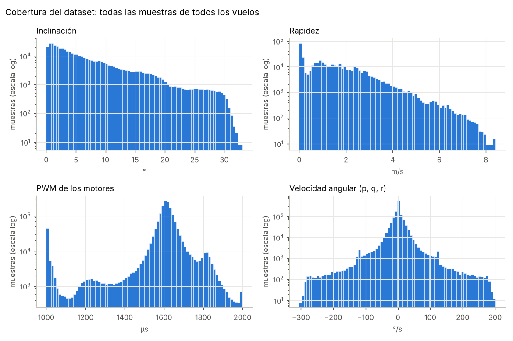
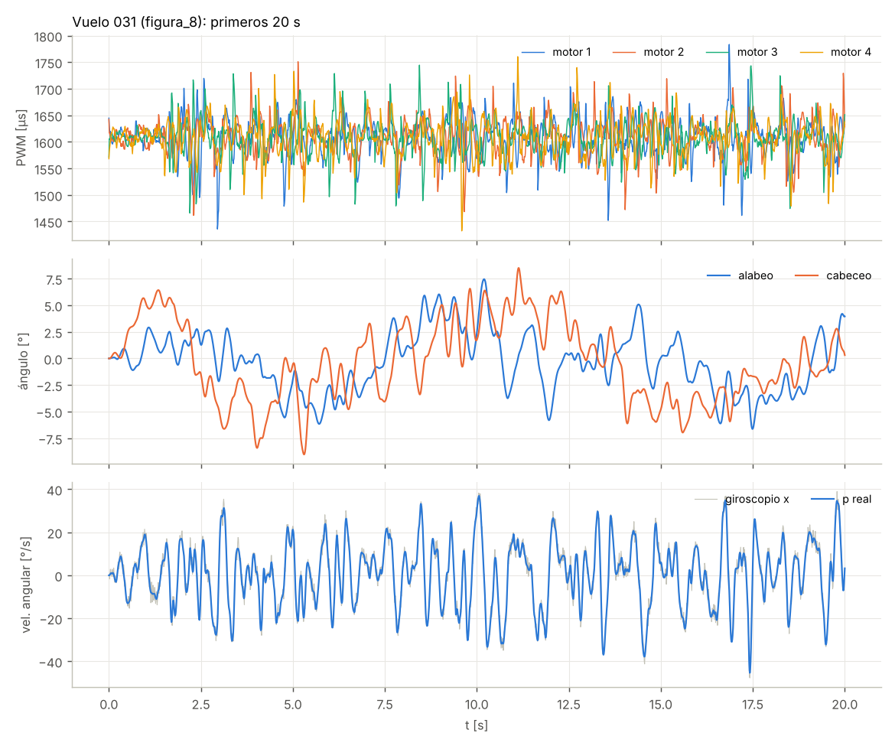
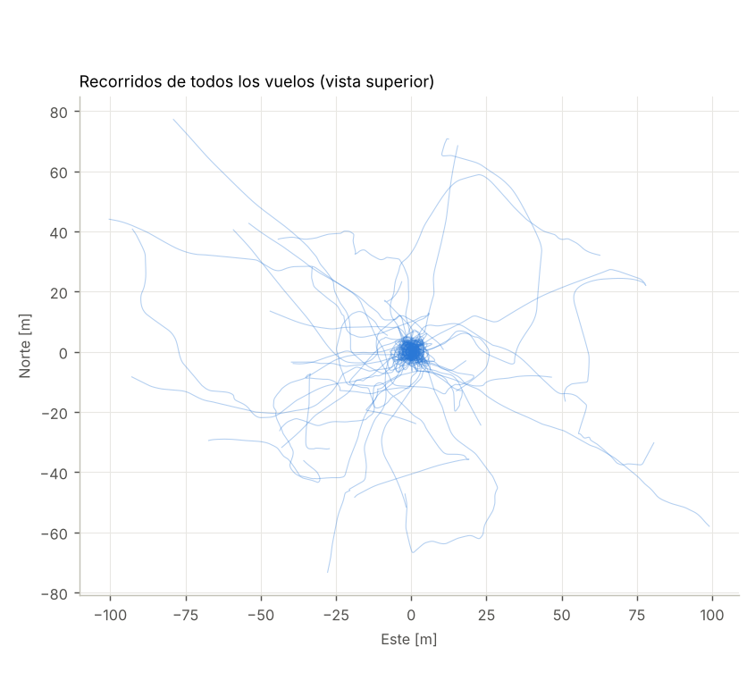

# Dataset de vuelo simulado del cuadricóptero PAE-X450

Vuelos simulados con QuadSIM-PRIMBIO para entrenar modelos dinámicos basados en datos
(redes neuronales, identificación de sistemas). Cada vuelo trae, a 100 Hz, el PWM de los
cuatro motores, el estado real del vehículo, sus derivadas, la lectura de cada sensor y las
perturbaciones que actuaron.

Autor: Jesús Daniel Jácome · Director: Francisco Javier Burgos Flórez · Semillero PRIMBIO,
Grupo IAM-NANO, Universidad Nacional de Colombia, Sede La Paz.

## Qué hay en la carpeta

| Archivo | Contenido |
|---|---|
| `vuelos/vuelo_NNN_tipo.csv` | Un vuelo por archivo, una fila por instante de muestreo |
| `vuelos.csv` | Índice: tipo, partición, controlador, duración, viento, carga y estadísticas de cada vuelo |
| `columnas.csv` | Nombre, unidad, marco y descripción de cada columna |
| `metadatos.json` | Parámetros del vehículo, modelo usado, convenciones y la especificación completa de cada vuelo (semilla, trayectoria, perturbaciones) |
| `verificacion.md`, `verificacion.json` | Resultado de las revisiones automáticas (sección «Verificación») |
| `figuras/` | Cobertura del dataset, recorridos y un vuelo de ejemplo |
| `cargar_dataset.py` | Lectura de los vuelos y armado de pares (x[k], u[k]) → x[k+1]; solo necesita numpy |

## El vehículo

PAE-X450: cuadricóptero en X de clase F450, 1.4 kg, brazo de 0.225 m, con ESC y motores
brushless. Los parámetros son los del modelo «Quadrotor X» de CopterSim (RflySim, Beihang
University; Quan y Dai), que a su vez se identificaron en un F450 real:

| Parámetro | Valor |
|---|---|
| Masa | 1.4 kg |
| Inercia (Jxx, Jyy, Jzz) | 0.0241, 0.0239, 0.0386 kg·m² |
| Coeficiente de empuje Ct | 1.105e-5 N/(rad/s)² |
| Coeficiente de par Cm | 1.779e-7 N·m/(rad/s)² |
| ESC + motor (régimen) | ω = 1148 · acelerador − 141.4 rad/s |
| Constante de tiempo del motor | 0.02 s |
| Acelerador de estacionario | 0.609 (PWM ≈ 1609 µs, 5322 rpm) |
| Relación empuje/peso | 3.26 |

`metadatos.json` trae el resto (arrastre, amortiguamiento, posición de los motores).

## Cómo se generaron los vuelos

El simulador integra un modelo Newton-Euler de 6 grados de libertad con cuaterniones (RK4 a
1 kHz). Cada motor responde al acelerador con una dinámica de primer orden, y el empuje y el
par crecen con el cuadrado de su velocidad. El autopiloto simulado corre a 500 Hz con un PID
en cascada de actitud y tasa, sobre la actitud que estima un filtro de Mahony a partir de los
sensores ruidosos. El lazo de posición corre a 100 Hz.

Hay siete tipos de vuelo, con parámetros sorteados en cada uno (altura, tamaño, velocidad,
rumbo, periodo):

| Tipo | Vuelos | Qué cubre |
|---|---|---|
| `estacionario` | 10 | Estacionario a altura y rumbo aleatorios |
| `puntos_aleatorios` | 20 | Curva de mínimo snap por 8 a 12 puntos dentro de una caja de 8 × 8 × 3.5 m, hasta ~6 m/s |
| `figura_8` | 14 | Lemniscata de tamaño y periodo aleatorios, de lenta a agresiva |
| `helice` | 10 | Círculo, o hélice que sube o baja |
| `escalones` | 12 | Escalones de posición: respuesta de lazo cerrado con saturación de motores |
| `actitud_libre` | 20 | Consignas aleatorias de alabeo y cabeceo (hasta ±25°), escalones de rumbo y de altura |
| `despegue_aterrizaje` | 14 | Desde el suelo con motores apagados, vuelo y aterrizaje; incluye efecto suelo |

Tres decisiones hacen que los datos sirvan para aprender la dinámica y no solo un
controlador:

1. **Excitación en los motores.** A la salida del mezclador se suma, en cada motor por
   separado, una señal APRBS: escalones de amplitud aleatoria (±3 a ±9 % de acelerador,
   según el vuelo) y duración aleatoria (20 a 300 ms). Es la excitación estándar para
   identificar sistemas no lineales. Sin ella, el PWM sería casi una función del estado (lo
   que decide el controlador) y una red no podría separar el efecto de la entrada del
   efecto del estado. Con ella, una regresión lineal del PWM sobre el estado explica solo
   cerca del 80 % de su varianza (ver «Verificación»).
2. **Dos controladores distintos.** Los vuelos con trayectoria los pilota al azar un PID en
   cascada o un MPC lineal, para que los datos no queden atados a una sola ley de control.
3. **Referencias factibles.** Cada trayectoria se muestrea antes de aceptarla y se sortea de
   nuevo si baja de 0.8 m o pide más de 5 m/s² horizontales, 4 m/s² verticales o 6 m/s.
   Una referencia imposible produce choques, no datos útiles.

Perturbaciones, siempre etiquetadas en cada fila:

- **Viento** en el 35 % de los vuelos: medio de 0.5 a 4 m/s desde una dirección
  aleatoria, turbulencia de Dryden de 0.2 a 1.2 m/s y, en la mitad de esos vuelos, una
  ráfaga de 1 a 4 m/s. Columnas `viento_n`, `viento_e`, `viento_d`.
- **Carga útil** en el 15 % de los vuelos con trayectoria o actitud libre: de 100 a 350 g,
  descentrada hasta 4 cm, enganchada entre los 8 y 25 s y, en la mitad de los casos,
  soltada después. Cambia la masa, la inercia y el centro de masa. Columnas `masa` y
  `carga`.

La partición entrenamiento / validación / prueba (70 / 15 / 15 %) se hizo **por vuelo** y
estratificada por tipo: las muestras de un mismo vuelo nunca quedan en dos particiones.
Está en `vuelos.csv`.

## Convenciones

- **Marco del mundo NED**: x al norte, y al este, z hacia abajo. La altura es `-pos_d`.
- **Marco del cuerpo FRD**: x hacia adelante, y a la derecha, z hacia abajo.
- **Cuaternión** `(q_w, q_x, q_y, q_z)`: rota vectores del cuerpo al mundo. Los ángulos de
  Euler son ZYX (rumbo, cabeceo, alabeo), en radianes.
- **Motores**, numeración PX4 «Quad X»:

| Motor | Posición | Giro (visto desde arriba) |
|---|---|---|
| 1 | delantero derecho | antihorario |
| 2 | trasero izquierdo | antihorario |
| 3 | delantero izquierdo | horario |
| 4 | trasero derecho | horario |

- **PWM**: `pwm = 1000 + 1000 · acelerador` µs, con el acelerador en [0, 1]. Por debajo
  de 1050 µs el motor no gira (zona muerta del ESC). Cada `pwm_i` es el **promedio del PWM
  aplicado entre t y t + dt**, que es exactamente la entrada que lleva el estado de la fila k
  al de la fila k + 1.
- **Sensores**: el acelerómetro mide fuerza específica (en reposo marca cerca de −9.8 m/s²
  en z). Giroscopio y acelerómetro tienen ruido, sesgo inicial, deriva del sesgo, vibración
  de las hélices a la frecuencia de paso de pala y 2 ms de retardo. El magnetómetro llega a
  100 Hz, y el barómetro (BMP180) a unos 40 Hz con 30 ms de retardo, 0.17 m de ruido y
  deriva lenta. Las columnas `mag_nuevo` y `baro_nuevo` marcan las filas con muestra nueva.
  Entre muestras se repite la última, como en un autopiloto.

## Columnas

| Columna | Unidad | Marco | Descripción |
|---|---|---|---|
| `t` | s | - | Tiempo desde el inicio del vuelo |
| `pwm_1` | us | - | Ancho de pulso del motor 1 (1000 = apagado, 2000 = máximo), promedio del aplicado entre t y t + dt |
| `pwm_2` | us | - | Ancho de pulso del motor 2 (1000 = apagado, 2000 = máximo), promedio del aplicado entre t y t + dt |
| `pwm_3` | us | - | Ancho de pulso del motor 3 (1000 = apagado, 2000 = máximo), promedio del aplicado entre t y t + dt |
| `pwm_4` | us | - | Ancho de pulso del motor 4 (1000 = apagado, 2000 = máximo), promedio del aplicado entre t y t + dt |
| `rpm_1` | rpm | - | Velocidad real del rotor 1 |
| `rpm_2` | rpm | - | Velocidad real del rotor 2 |
| `rpm_3` | rpm | - | Velocidad real del rotor 3 |
| `rpm_4` | rpm | - | Velocidad real del rotor 4 |
| `pos_n` | m | NED | Posición real, norte |
| `pos_e` | m | NED | Posición real, este |
| `pos_d` | m | NED | Posición real, abajo (altura = -pos_d) |
| `vel_n` | m/s | NED | Velocidad real, norte |
| `vel_e` | m/s | NED | Velocidad real, este |
| `vel_d` | m/s | NED | Velocidad real, abajo |
| `vel_u` | m/s | FRD | Velocidad real en ejes cuerpo, adelante |
| `vel_v` | m/s | FRD | Velocidad real en ejes cuerpo, derecha |
| `vel_w` | m/s | FRD | Velocidad real en ejes cuerpo, abajo |
| `q_w` | - | NED->FRD | Cuaternión de actitud real (parte escalar) |
| `q_x` | - | NED->FRD | Cuaternión, componente x |
| `q_y` | - | NED->FRD | Cuaternión, componente y |
| `q_z` | - | NED->FRD | Cuaternión, componente z |
| `roll` | rad | - | Alabeo real (Euler ZYX) |
| `pitch` | rad | - | Cabeceo real |
| `yaw` | rad | - | Rumbo real, en (-pi, pi] |
| `p` | rad/s | FRD | Velocidad angular real, eje x |
| `q` | rad/s | FRD | Velocidad angular real, eje y |
| `r` | rad/s | FRD | Velocidad angular real, eje z |
| `acc_n` | m/s^2 | NED | Aceleración lineal real instantánea, norte |
| `acc_e` | m/s^2 | NED | Aceleración lineal real instantánea, este |
| `acc_d` | m/s^2 | NED | Aceleración lineal real instantánea, abajo (incluye gravedad) |
| `dp` | rad/s^2 | FRD | Aceleración angular real instantánea, eje x |
| `dq` | rad/s^2 | FRD | Aceleración angular real instantánea, eje y |
| `dr` | rad/s^2 | FRD | Aceleración angular real instantánea, eje z |
| `empuje` | N | FRD | Empuje total de los rotores (hacia -z del cuerpo) |
| `tau_x` | N m | FRD | Momento de los rotores, eje x |
| `tau_y` | N m | FRD | Momento de los rotores, eje y |
| `tau_z` | N m | FRD | Momento de los rotores, eje z |
| `gyro_x` | rad/s | FRD | Giroscopio (ruido, sesgo, vibración, retardo de 2 ms) |
| `gyro_y` | rad/s | FRD | Giroscopio, eje y |
| `gyro_z` | rad/s | FRD | Giroscopio, eje z |
| `acc_x` | m/s^2 | FRD | Acelerómetro: fuerza específica (en reposo mide -g en z) |
| `acc_y` | m/s^2 | FRD | Acelerómetro, eje y |
| `acc_z` | m/s^2 | FRD | Acelerómetro, eje z |
| `mag_x` | uT | FRD | Magnetómetro (última muestra disponible) |
| `mag_y` | uT | FRD | Magnetómetro, eje y |
| `mag_z` | uT | FRD | Magnetómetro, eje z |
| `mag_nuevo` | 0/1 | - | 1 si llegó una muestra nueva del magnetómetro desde la fila anterior |
| `baro_alt` | m | - | Altura del barómetro BMP180 (ruido, deriva, retardo de 30 ms) |
| `baro_nuevo` | 0/1 | - | 1 si llegó una muestra nueva del barómetro desde la fila anterior |
| `viento_n` | m/s | NED | Velocidad del viento (medio + turbulencia + ráfaga), norte |
| `viento_e` | m/s | NED | Velocidad del viento, este |
| `viento_d` | m/s | NED | Velocidad del viento, abajo |
| `masa` | kg | - | Masa total en ese instante (cambia si hay carga) |
| `carga` | kg | - | Masa de la carga útil enganchada (0 sin carga) |
| `en_suelo` | 0/1 | - | 1 si el dron está apoyado en el suelo |
| `tramo` | - | - | Fase de la maniobra (ver metadatos) |

`tramo` identifica la fase de la maniobra:

- En `despegue_aterrizaje`: 0 en tierra, 1 subida, 2 vuelo, 3 bajada y 4 en tierra tras
  aterrizar.
- En `escalones`: la consigna vigente.
- En `puntos_aleatorios`: el segmento de la curva.
- En los demás tipos vale 0.

## Cómo usarlo para entrenar un modelo dinámico

`cargar_dataset.py` lee los vuelos y arma los pares de entrenamiento:

```python
from cargar_dataset import cargar_vuelos, pares, ESTADO, ENTRADA

train = cargar_vuelos(".", particion="entrenamiento")
val = cargar_vuelos(".", particion="validacion")
X, U, Y = pares(train, ESTADO, ENTRADA, ESTADO, delta=True)   # Y = x[k+1] - x[k]
```

`python cargar_dataset.py --npz pares.npz` deja los tres conjuntos en un solo archivo.

Recomendaciones:

- **Estado en ejes del cuerpo.** `ESTADO` usa la velocidad en el cuerpo (`vel_u`, `vel_v`,
  `vel_w`), el cuaternión, la velocidad angular y las rpm. La física no depende de la
  posición ni del rumbo, y la red generaliza mejor si no los ve. Si se usa el cuaternión,
  conviene renormalizarlo en cada paso de la predicción.
- **Predecir el incremento**, x[k+1] − x[k], y normalizar cada columna con la media y la
  desviación del conjunto de entrenamiento.
- **Entrada:** los 4 PWM. Las rpm reales están en el dataset, pero un dron sin sensor de
  rpm no las tiene. Para un modelo «de PWM a movimiento», se quitan del estado y la red
  aprende también la dinámica del motor (constante de tiempo de 20 ms, dos muestras).
- **Derivadas para modelos de tiempo continuo:** `acc_n/e/d` y `dp/dq/dr` son la
  aceleración instantánea que calcula el simulador. `empuje` y `tau_x/y/z` sirven para un
  modelo híbrido (red que aprende solo las fuerzas).
- **Filas en el suelo:** `pares()` las descarta por defecto (`en_suelo = 1`), porque ahí
  el contacto fija el estado.
- **Viento y carga:** son perturbaciones que el dron no mide. Se pueden dejar como ruido
  de proceso, darlas como entrada extra (`viento_*`, `masa`) o excluir esos vuelos con
  `cargar_vuelos(..., sin_viento=True, sin_carga=True)`.
- **Validar en predicción de varios pasos**, no solo un paso adelante: se encadenan las
  predicciones durante 1 a 2 s sobre los vuelos de prueba y se compara con la trayectoria
  real.
- **Solo sensores:** para entrenar con lo que mediría el dron real (`SENSORES` en el
  cargador), la verdad (`p`, `q`, `r`, `roll`…) queda como objetivo de comparación.

## Verificación

`verificacion.md` reúne las revisiones automáticas que se corren al generar el dataset:

- completitud: sin valores no finitos, ningún vuelo abortado, ningún choque;
- coherencia física: la derivada numérica de la velocidad registrada coincide con la
  aceleración registrada y el cuaternión es unitario;
- sensores contra verdad;
- PWM de estacionario contra el teórico;
- cuánto del PWM explica el estado;
- cobertura de inclinación, velocidad, PWM y velocidad angular.

Resultados del dataset entregado:

| Revisión | Valor |
|---|---|
| Valores no finitos | 0 |
| Vuelos abortados | 0 |
| Vuelos que tocan el suelo sin deber | 0 |
| dv/dt contra aceleración registrada (RMS) | 0.0083 m/s² (la aceleración misma: 1.028 m/s²) |
| dω/dt contra aceleración angular registrada (RMS) | 0.12 rad/s² (la aceleración angular misma: 6.459 rad/s²) |
| Error máximo de la norma del cuaternión | 7.49e-07 |
| Giroscopio − verdad: media / desviación | [0.0006, 0.0003, 0.0003] / [0.0478, 0.048, 0.0458] rad/s |
| Acelerómetro medio en estacionario | [0.024, -0.051, -9.804] m/s² |
| Magnetómetro: norma media / tasa | 32.8 µT / 100.0 Hz |
| Barómetro: error RMS / tasa | 0.17 m / 38.5 Hz |
| PWM de estacionario medido / teórico | 1607.6 / 1608.7 µs |
| R² del PWM explicado linealmente por el estado | [0.817, 0.819, 0.819, 0.818] |
| Desviación del PWM por combinación (empuje, alabeo, cabeceo, guiñada) | [43.7, 35.7, 36.1, 90.8] µs |
| Inclinación p50 / p95 / máx. | 4.25 / 19.36 / 33.1° |
| Velocidad p50 / p95 / máx. | 1.15 / 3.87 / 8.41 m/s |
| PWM p1 / p50 / p99, fracción saturada | 1000.0 / 1610.77 / 1837.39 µs, 2.43 % |
| Velocidad angular p95 / máx. | 0.83 / 5.33 rad/s |
| Vuelos con viento / con carga | 33 / 9 |
| Partición entrenamiento / validación / prueba | 68 / 16 / 16 vuelos |



La figura muestra la cobertura del dataset completo:

- inclinaciones hasta 33°;
- rapidez hasta 8 m/s;
- PWM de 1000 a 2000 µs (el 2.4 % de las muestras toca un límite);
- velocidades angulares hasta 300 °/s.

El grueso de los datos está cerca del estacionario, como en un vuelo real, pero las colas
están bien pobladas.



En el vuelo de ejemplo (figura en 8 con PID) se ve la excitación en los cuatro PWM, la
actitud que resulta y el giroscopio (gris) contra la velocidad angular real (azul).



Los vuelos con trayectoria quedan dentro de unos 10 m del origen. Los de actitud libre se
alejan hasta 100 m, porque nadie controla la posición: es el vuelo «en modo estabilizado»
de un piloto.

## Limitaciones

Es un dataset simulado. El modelo usa parámetros identificados en un F450 real, pero deja
fuera efectos que un vuelo real sí tiene:

- caída de voltaje de la batería (se supone voltaje constante);
- par de reacción por aceleración de los rotores;
- aleteo de las palas y arrastre inducido de los rotores;
- interacción aerodinámica entre hélices;
- flexión del bastidor;
- retardos y cuantización del ESC real (el acelerador se aplica de forma continua).

Una red entrenada aquí aprende la dinámica del modelo, no la de un dron particular. Para
usarla en un dron físico hay que ajustarla con datos reales (Sim2Real). El formato de
columnas permite poner vuelos reales en los mismos archivos.

## Cómo regenerarlo o ampliarlo

Desde la interfaz: **Simulación → Generar dataset de vuelo…** (número de vuelos, tasa de
registro, semilla y carpeta).

Desde la consola, en la carpeta del simulador:

```bash
python experiments/generar_dataset.py                          # 100 vuelos a 100 Hz
python experiments/generar_dataset.py --vuelos 300 --hz 250 --salida otro_dataset
```

Con la misma semilla se obtiene exactamente el mismo dataset. El código está en
`quadsim/dataset.py` (generador) y `quadsim/dataset_verificacion.py` (revisiones).

## Cómo citarlo

Jácome, J. D., y Burgos Flórez, F. J. (2026). *Dataset de vuelo simulado del cuadricóptero
PAE-X450* [conjunto de datos], generado con QuadSIM-PRIMBIO 3.1.0. Semillero PRIMBIO,
Universidad Nacional de Colombia, Sede La Paz.
https://github.com/JesusJacome18/PAE-Quadcopter-SIM
