# Guía de la interfaz gráfica — QuadSIM-PRIMBIO

Esta guía describe la GUI de QuadSIM-PRIMBIO 3.0, el simulador del
repositorio PAE Quadcopter SIM: cómo arrancarla, qué hace cada área de
trabajo y qué conviene mirar en cada gráfica. Está pensada para dos lectores. El
estudiante de Mecatrónica que va a sintonizar su primer PID en cascada, y quien
presenta el proyecto ante evaluadores y necesita mostrar, con datos del propio
simulador, de dónde sale cada número.

Todas las capturas de este documento salen de corridas reales del simulador
(física 1 kHz RK4, control 500 Hz), generadas sin pantalla con
`docs/screenshots/make_screenshots.py` y `docs/screenshots/make_doc_figures.py`.
Ninguna curva está dibujada a mano.

Quien abre el programa por primera vez no necesita leer esto antes: la
ventana trae un tour guiado (tecla F1) y una galería de ejemplos listos para
cargar (tecla F2). Los dos se describen más abajo, en "Tour guiado" y
"Ejemplos".


## Arranque

```bash
pip install -r requirements.txt
python main.py                 # tema oscuro
python main.py --light         # tema claro (mejor para proyector)
python main.py --vehicle luukkonen --play
python main.py --example 05          # abre el ejemplo 05 de examples/
python main.py --scenario mio.json   # abre un escenario guardado
python main.py --tour                # arranca directamente el tour guiado
python main.py --no-welcome          # sin la ventana de bienvenida
```

La primera vez que se abre, el programa muestra una bienvenida que ofrece el
tour o la galería de ejemplos. Si se marca "No volver a mostrar", la
preferencia queda guardada (en el registro de Windows, o en `~/.config` en
Linux) y la bienvenida no vuelve a salir; el tour sigue a mano con F1.

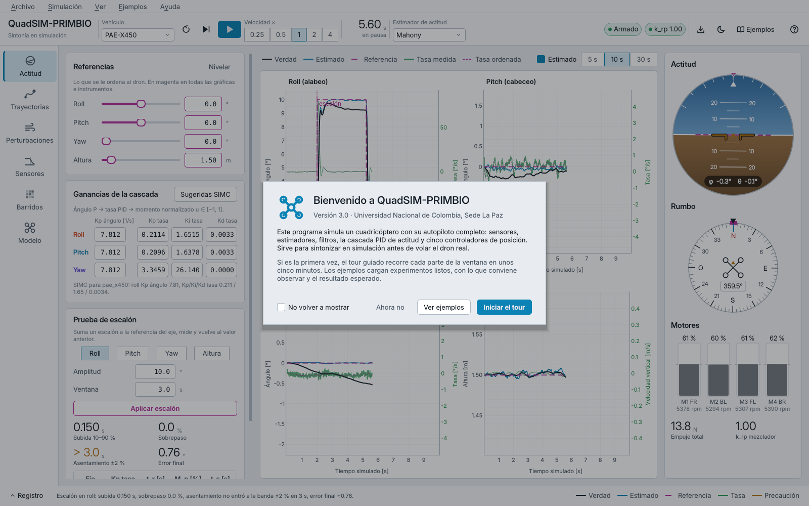

En Windows basta con Python 3.10 o posterior. La vista 3D usa OpenGL a través de
PyOpenGL; si la máquina no tiene un contexto OpenGL (escritorio remoto, máquina
virtual sin aceleración) la GUI no se cae: dibuja una proyección isométrica 2D
y lo avisa dentro de la propia vista. Con `PAE_NO_GL=1` se fuerza ese modo.

## La ventana

**Menús.** Encima de la barra superior están Archivo, Simulación, Ver,
Ejemplos y Ayuda; se describen en la sección "Menús".

**Barra superior.** De izquierda a derecha: selector de vehículo (catálogo de
`quadsim.vehicles`; cambiarlo reinicia la corrida y recalcula las ganancias
SIMC del modelo nuevo), reiniciar, avanzar 0.1 s, iniciar o pausar, y la
velocidad pedida respecto al tiempo real (×0.25 a ×4). El reloj grande es el
tiempo simulado. Debajo aparece **TR**, el factor de tiempo real *medido*:
segundos simulados por segundo de reloj. Si la computadora no da abasto, TR
queda por debajo del valor pedido y la simulación se vuelve más lenta, pero la
ventana nunca se congela. Después viene el estimador de actitud y los chips de
estado: armado, desaturación del mezclador `k_rp`, y dos chips que solo
aparecen cuando hay algo que avisar (viento y carga colgada). Si la ventana es
angosta y no caben, esos dos se ocultan antes que el resto, en vez de obligar
a la ventana a crecer. Siguen dos botones que exportan la corrida a CSV y
alternan entre tema oscuro y claro. Al final, **Ejemplos** abre la galería y
**?** inicia el tour guiado.

**Riel de navegación.** Las seis áreas de trabajo; `Ctrl+1` a `Ctrl+6` saltan
directo a cada una.

**Registro.** Abajo, plegable (`Ctrl+L`). La línea visible muestra el último
evento; los avisos salen en ámbar y los errores en rojo. Un error abre el
registro solo. A la derecha está la clave de colores, que vale para todo el
programa.

### Un solo código de colores

El color no decora: significa. Se tomó la convención de las pantallas de vuelo
de cabina de avión (PFD), donde cada color tiene un sentido fijo:

| Color | Significado | Ejemplo |
|---|---|---|
| blanco | lo que el dron **está haciendo** (verdad del simulador) | ángulo real, trayectoria real |
| cian | lo que **cree** el estimador | actitud de Madgwick/Mahony/EKF, altura estimada |
| magenta, punteado | lo que se le **ordena** | referencias, trayectoria deseada, horizonte ordenado |
| verde | tasas angulares (eje derecho) y estado correcto | tasa medida, chip "Armado" |
| ámbar | precaución | paso de pala, sobrepaso > 20 %, mezclador saturado |
| rojo | alarma o error | error de seguimiento, falla de motor |

Quien aprende a leer una gráfica ya sabe leerlas todas. La distancia entre la
curva magenta y la blanca es el error de control; entre la blanca y la cian,
el error de estimación.

## 1. Sintonía de actitud


A la izquierda están las referencias (roll, pitch, yaw en grados; altura en
metros) con deslizador y caja numérica sincronizados. Debajo, las ganancias de
la cascada por eje: Kp del lazo de ángulo [1/s] y Kp, Ki, Kd del lazo de tasa,
que entrega un momento normalizado `u ∈ [−1, 1]` (convención PX4). El botón
**Sugeridas SIMC** devuelve los tres ejes a la sintonía calculada con las
reglas SIMC (Skogestad, 2003) a partir de la inercia, el momento máximo y los
retardos del vehículo. Es un punto de partida razonable, no un óptimo.

Debajo de los tres ejes está la fila **Altura**, el lazo vertical del modo
actitud: el Kp de altura [1/s], que convierte el error de altura en una
velocidad vertical ordenada (limitada a ±2.5 m/s), y el PID de velocidad
vertical (Kp [1/s], Ki [1/s²] y Kd), que entrega la aceleración vertical.
Sugeridas SIMC también la devuelve a su valor de diseño (1.43; 5.71, 8.16 y 0
para el PAE-X450). Como el resto de la tarjeta, se conserva al reiniciar, se
recalcula al cambiar de vehículo y se guarda en los escenarios. En modo
trayectoria no actúa: ahí la altura la maneja el controlador de posición.

Cada gráfica muestra los dos lazos a la vez. El ángulo va en el eje izquierdo:
verdad, estimado y referencia. La tasa va en el eje derecho, en verde, junto
a la tasa ordenada por el lazo externo en magenta fino. El eje vertical
nunca baja de ±2° (±0.1 m en altura). Sin ese piso, en vuelo estacionario el
autoescalado convertía un ruido de centésimas de grado en una "oscilación"
que llenaba la gráfica.

**Prueba de escalón.** Se elige el eje, la amplitud y la ventana de
observación. El escalón se suma a la referencia actual, se mide y la
referencia vuelve a su valor anterior. Las métricas salen de
`quadsim.metrics.step_metrics`: subida 10–90 %, sobrepaso, asentamiento en la
banda ±2 % y error final. Si la respuesta no entra a la banda dentro de la
ventana, el asentamiento se muestra como `> 2.5 s` en ámbar en lugar de un
guion. La tabla de abajo guarda los últimos escalones con su Kp de tasa para
comparar sintonías.

A la derecha: horizonte artificial (con la línea magenta del horizonte
ordenado), rosa de rumbos (marca magenta = rumbo ordenado, marca cian = rumbo
estimado) y barras de los cuatro motores con el acelerador σ, las rpm y la
línea del acelerador de hover.

> Algo para observar: en la captura, tras el escalón de 15° en roll el ángulo
> verdadero (blanco) se queda cerca de 14° mientras el estimado (cian) marca
> 15°. El lazo cumple con lo que *cree* el estimador. En modo actitud, un dron
> inclinado acelera de lado sin parar, el acelerómetro deja de apuntar a la
> gravedad y el estimador se equivoca casi 1°, aun con la compensación de
> aceleración activa. Con el estimador "Ideal" el error final desaparece
> (verificado con el núcleo actual, 2 s después del escalón: roll verdadero
> 14.29° con Mahony, el estimador por defecto, y 14.14° con Madgwick, contra
> 14.95° con el ideal). La captura se tomó con Madgwick, el estimador por
> defecto de entonces. Es un buen ejemplo de por qué la estimación también se
> sintoniza.

## 2. Trayectorias y controladores

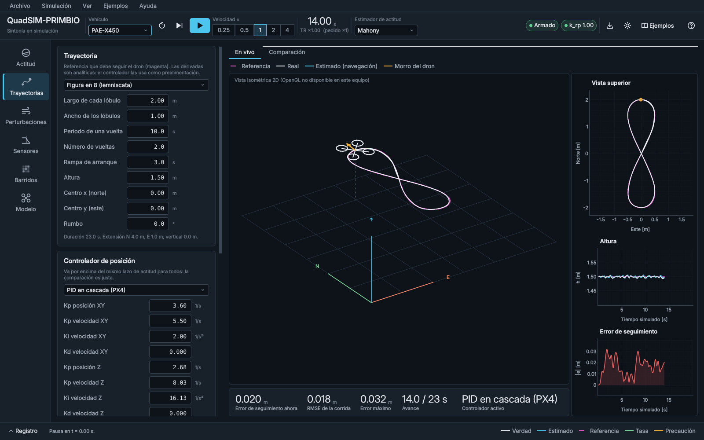

Los formularios se generan solos a partir del esquema `PARAMS` de cada
trayectoria (`quadsim.trajectories.TRAJECTORIES`) y de cada controlador de
posición (`quadsim.control.position.CONTROLLERS`), con su unidad y sus
límites. Si alguien agrega un parámetro en el código, aparece en la GUI sin
tocarla. **Volar trayectoria** reinicia la corrida en el punto inicial de la
trayectoria con `quadsim.scenarios.prepare_tracking_sim`, la misma función que
usa el banco de comparación; así lo que se ve en vivo y lo que se compara
arrancan igual. Con "Aplicar cambios en vuelo" marcado, editar un parámetro
del controlador activo lo cambia sin reiniciar.

En vivo se ven la escena 3D (referencia magenta, trayectoria real blanca, dron
orientado según su actitud), la vista superior, la altura y el error de
seguimiento, más el error instantáneo, el RMSE y el error máximo de la corrida.

El selector **Cámara** decide cómo se mueven la escena 3D y la vista superior.
*Seguir dron* (el modo por defecto) desplaza la vista lo justo para que el dron
no se aleje del centro más del 15 % del ancho visible, sin tocar el zoom ni el
ángulo que el usuario haya elegido con el ratón. *Ajustar a trayectoria*
encuadra la referencia, el recorrido volado y el dron. *Fija* deja la cámara
donde el usuario la ponga. En los tres modos el piso cuadriculado se extiende y
se recentra para cubrir la referencia y la posición del dron, con un paso de
cuadrícula que crece con la distancia (1, 2, 5, 10 o 50 m). Así, con viento
fuerte en modo actitud o con una trayectoria lejos del origen, el dron nunca
sale del cuadro ni del piso.

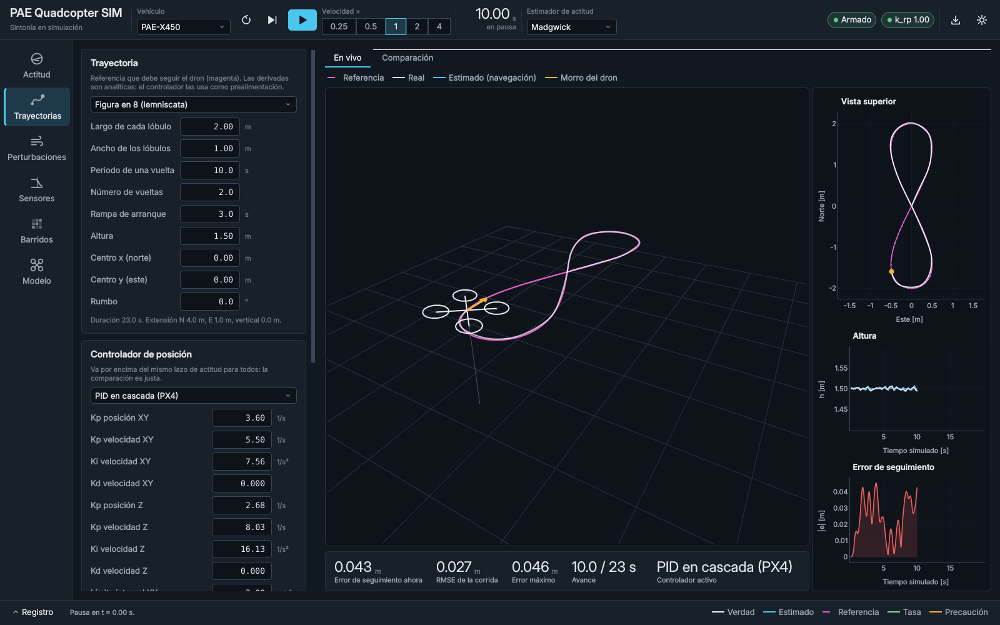

**Comparar controladores** corre cada controlador marcado sin GUI, en un hilo
aparte, sobre la misma trayectoria y con una copia exacta de la configuración
actual: vehículo, filtros, estimador, perturbaciones, semilla de ruido y
ganancias de actitud. Misma semilla significa mismo ruido de sensores y misma
turbulencia para todos, de modo que las diferencias vienen del controlador.


La tabla usa `quadsim.metrics.tracking_metrics` (RMSE 3D y por eje, error
máximo y final, esfuerzo de control, porcentaje de tiempo con el mezclador
saturado) y agrega el costo de cómputo en milisegundos por paso de control,
que importa para el MPC no lineal. En negrita, el mejor de cada columna. Los
controladores de aprendizaje (`rl`, `mpc_rl`) aparecen solo si su módulo
importa bien. Si un controlador falla al construirse (por ejemplo, porque no
encuentra los pesos de la red), el registro muestra el error y la simulación
vuelve al modo actitud; el resto sigue funcionando.

## 3. Perturbaciones


Todo se aplica en caliente sobre `sim.cfg.disturbances`:

- **Viento**: medio (rapidez y dirección *de la que sopla*, convención
  meteorológica), turbulencia de Dryden con su σ y una ráfaga discreta
  1-coseno con amplitud, inicio, duración y dirección propias. "Ráfaga ahora"
  la programa 0.1 s en el futuro.
- **Interferencia en el magnetómetro**: campo parásito proporcional a σ^1.5
  de los ESC más pulsos aleatorios. Solo afecta al sensor: el estimador se
  equivoca de rumbo y la gráfica "Rumbo: verdad y estimado" lo muestra.
- **Carga útil**: masa y posición en el cuerpo (FRD). Se puede colgar o soltar
  en el acto o programar a un tiempo. Cambia masa, inercia (Steiner) y centro
  de masa; el controlador sigue sintonizado para el vehículo nominal, y eso es
  justamente lo que se quiere medir.
- **Falla de motor**: eficiencia de empuje de un rotor, ya o programada.
- **Efecto suelo** (Cheeseman y Bennett).

El dial muestra el vector de viento instantáneo sobre una rosa con el norte
arriba y el arco magenta de la dirección del viento medio. Las barras de
motores están en esta página porque ahí se ve el costo de la perturbación: más
acelerador para sostener la carga, asimetría con viento o con un motor débil.

> Ojo con la "Deriva de posición" de la captura: en modo actitud el dron
> sostiene ángulos, no posición, así que con 4 m/s de viento se va 25 m en
> 12 s. Con un controlador de posición (página 2) se queda en su sitio.

## 4. Sensores, filtros y estimadores


El experimento central de esta página es la vibración de las hélices. El
giroscopio crudo (gris) trae un tono a la frecuencia de paso de pala, unos
177 Hz en hover para el PAE-X450. El espectro (ventana Hann de 1024 muestras
a 500 Hz) lo muestra como un pico, marcado en ámbar. La misma marca aparece en
el Bode de la cadena de filtros, que se calcula con `Biquad.response` de los
filtros que realmente usa el simulador.

Cada eje tiene dos biquads en serie. El editor habilita solo los campos que el
tipo usa: Butterworth deshabilita Q (fijo en 0.7071), Chebyshev cambia
"Ganancia" por "Rizado", "Ninguno" deshabilita todo. **Centrar el notch en la
vibración** pone la etapa 2 como notch en la frecuencia medida en ese momento.
El pico desaparece del espectro filtrado (verde) y las lecturas muestran el
precio: atenuación en el tono y retardo de grupo a 20 Hz, cerca del ancho de
banda del lazo de tasa.

El estimador se cambia en caliente y arranca desde la estimación anterior. Sus
ganancias se editan aquí: β de Madgwick, Kp y Ki de Mahony, y las cuatro
desviaciones del EKF (ruido del giroscopio, deriva del sesgo, acelerómetro y
magnetómetro). Dos casillas controlan la compensación de aceleración
cinemática (como `ATT_ACC_COMP` de PX4) y el uso del magnetómetro. Abajo se
comparan actitud verdadera contra estimada y sesgo del giroscopio verdadero
contra estimado.

## 5. Barridos


Interfaz sobre `quadsim.sweeps`. Se elige un barrido predefinido
(`PRESETS`: pasa-bajos del giroscopio, notch, β de Madgwick, Mahony, ruidos
del EKF, PID de tasa, pasa-bajos bajo turbulencia, nocturno conjunto), el
número de réplicas (semillas) y de procesos. La página estima cuántas
simulaciones hará y cuánto puede tardar; la estimación se pone en ámbar por
encima de 15 minutos. El barrido corre en un hilo aparte (por defecto con un
solo proceso, porque la CPU es compartida), con progreso, tiempo restante y
cancelación. Cada corrida terminada se agrega a `runs.jsonl` en
`experiments/results/sweeps/<nombre>_<fecha>/` ("Abrir carpeta" la muestra),
así que cancelar no pierde lo hecho. La GUI abre una carpeta nueva por
ejecución; para reanudar un barrido largo interrumpido (por ejemplo el
nocturno) se usa `experiments/sweep_cli.py --out <carpeta>`, que salta las
corridas ya guardadas.

La gráfica principal depende de la forma del barrido. Con un parámetro
numérico (y quizá uno de categorías, como Fc × tipo de filtro) dibuja el costo
J contra el parámetro, una curva por categoría. Con dos parámetros dibuja un
mapa de calor (viridis: oscuro es mejor) con el mejor punto enmarcado en
magenta. Con más de dos, la sensibilidad de cada parámetro como |ρ de
Spearman|. Al lado va el frente de Pareto entre los dos objetivos del
escenario. J = 1 es la configuración por defecto; J < 1 es mejor.

**Aplicar a la simulación** copia la mejor configuración a la simulación en
vivo con `quadsim.sweeps.apply_params`, para verla volar. Las rutas
`pid.*.*_scale` se aplican sobre la sintonía SIMC (que es la línea base del
barrido), no sobre la ganancia que haya en ese momento; aplicarlo dos veces da
el mismo resultado. El aviso "Borde" indica que el óptimo cayó en el extremo
del rango barrido y conviene ampliarlo.

## 6. Vehículo y modelo


Responde las preguntas típicas de los evaluadores. La tabla lista cada parámetro con
su unidad; el cuadro "Fuente y supuestos" copia la fuente declarada en el
catálogo y, en ámbar, lo que es supuesto. Las cantidades derivadas (rpm y
acelerador de hover, relación empuje/peso, momentos máximos, frecuencia de
paso de pala) se recalculan con el vehículo elegido. El diagrama de relojes
muestra, en una ventana de 20 ms, cuántas veces corre cada lazo: física RK4 a
1 kHz, control (IMU, AHRS, filtros, PID) a 500 Hz, lazo externo a 100 Hz y el
dibujo de la GUI a 50 Hz, que no afecta a la simulación. Debajo están las
ecuaciones del modelo de 17 estados.

## Tour guiado


El tour recorre la ventana parte por parte. Una capa oscurece todo menos el
elemento que se explica, rodeado por un anillo del color de foco, y al lado
aparece una tarjeta con el título, dos a cuatro frases de explicación, el
contador ("11 / 37") y los botones Anterior, Siguiente y Saltar. Con el
teclado, → o Intro avanzan, ← retrocede y Esc cierra. Mientras el tour está
abierto la ventana no recibe clics; al cerrarlo, las columnas con scroll
vuelven a donde estaban.

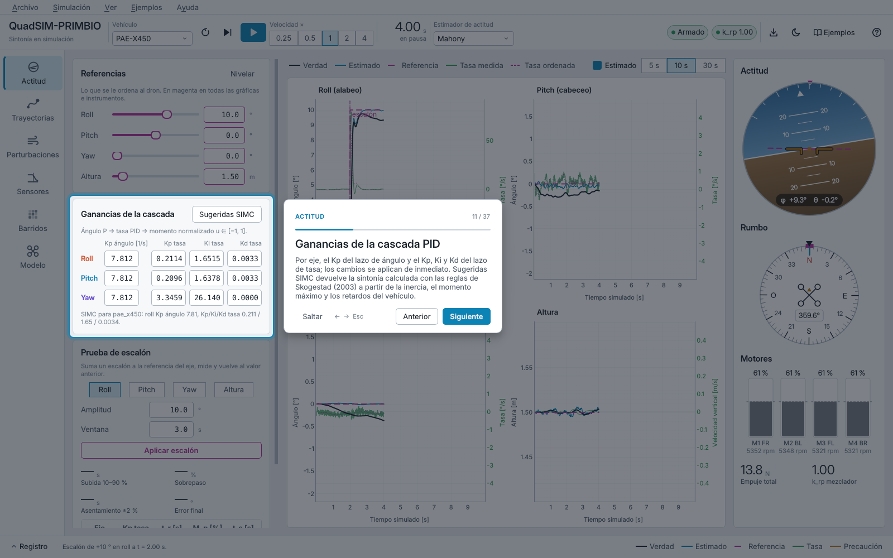

Hay tres formas de abrirlo: el botón **?** de la barra superior, el menú
Ayuda → Tour guiado o la tecla F1. Los pasos cambian de página solos cuando
el elemento siguiente está en otra área de trabajo; si está más abajo en una
columna con scroll, la columna se desplaza hasta mostrarlo. La capa se
recalcula cuando cambia el tamaño de la ventana y se redibuja al cambiar de
tema.

El recorrido completo tiene 37 pasos:

| Parte | Pasos |
|---|---|
| Inicio | bienvenida |
| Barra superior | vehículo; controles de la simulación (reiniciar, avanzar, iniciar o pausar, velocidad); reloj y factor de tiempo real; estimador de actitud; indicadores de estado; exportar, tema y ayuda |
| Navegación | áreas de trabajo (riel); registro y clave de colores |
| Actitud | referencias; ganancias de la cascada PID y Sugeridas SIMC; prueba de escalón; gráficas de los dos lazos; instrumentos (horizonte, rumbo, motores) |
| Trayectorias | trayectoria de referencia; controlador de posición y Volar trayectoria; Comparar controladores; vista 3D y error en vivo; vista superior, altura y error |
| Perturbaciones | viento; interferencia en el magnetómetro; carga útil; falla de motor; viento instantáneo y estado |
| Sensores | filtros del giroscopio y botón del notch; Bode y espectro; estimador y sus ganancias; vibración de las hélices |
| Barridos | barridos predefinidos; ejecución; mejor configuración y Aplicar; gráficas y ranking |
| Modelo | parámetros del vehículo; relojes de la simulación |
| Para seguir | ejemplos; menús; cómo volver a abrir el tour |

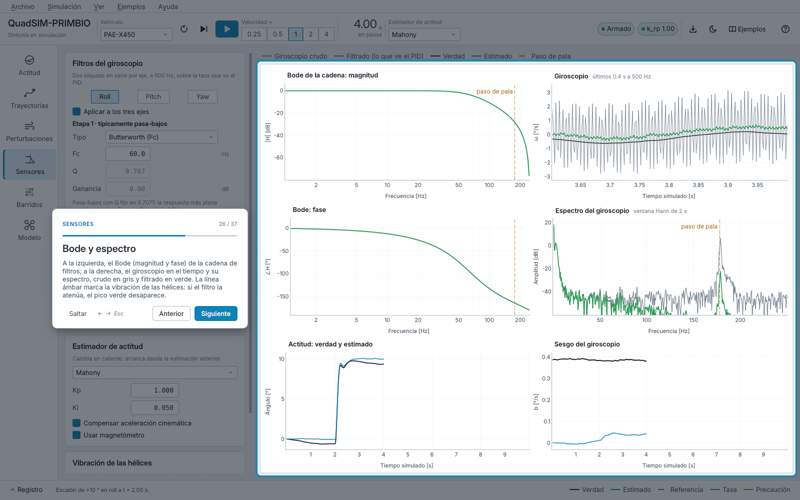

Para no repetir el recorrido entero, Ayuda → Tour de esta página (Mayús+F1)
muestra solo los pasos de la página que está a la vista. Los pasos viven en
`gui/tour.py` como datos: título, texto y una función que devuelve los
widgets que señalan. Si una página cambia de diseño basta con corregir el
atributo al que apunta el paso, y `tests/test_gui_tour.py` avisa si algún
objetivo deja de existir o de verse.

## Ejemplos


La galería (botón **Ejemplos**, menú Ejemplos o F2) presenta los escenarios
de la carpeta `examples/` como tarjetas con número, nivel, página, duración
aproximada, una descripción corta, lo que se aprende y el botón **Cargar**.
Se pueden filtrar por nivel. El menú Ejemplos también los lista uno por uno.

Cargar un ejemplo reinicia la simulación con toda su configuración, abre la
página indicada y, si el ejemplo lo pide, la pone en marcha. En la esquina
inferior derecha aparece una tarjeta guía con qué hacer, qué observar y el
resultado esperado. Se pliega con la flecha y se cierra con la equis;
**Repetir el ejemplo** lo vuelve a cargar desde cero.

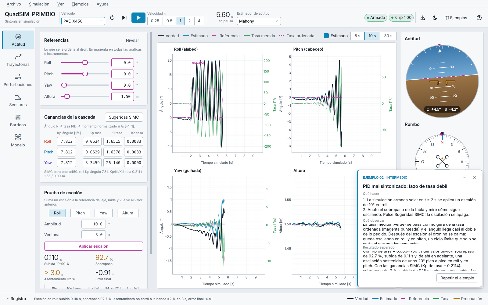

Algunos ejemplos traen acciones programadas en tiempo simulado: un escalón a
los 2 s, un cambio de referencia a los 6 s. Esas acciones se repiten en cada
reinicio (Ctrl+R), así que para comparar dos sintonías basta con cambiar una
ganancia y reiniciar.

Los resultados esperados se midieron cargando cada ejemplo con el mismo
cargador de la galería y corriendo la simulación sin pantalla, con el núcleo
actual y la semilla 1:

| # | Ejemplo | Nivel | Resultado medido |
|---|---|---|---|
| 01 | Primer vuelo y escalón de roll | Básico | escalón de 10°: subida 0.15 s, sobrepaso 0 %, error final 0.75° (lo pone el estimador); escalón de 0.5 m en altura: subida 1.01 s, asentamiento 3.0 s |
| 02 | PID mal sintonizado: lazo de tasa débil | Intermedio | Kp de tasa al 30 % de SIMC: sobrepaso 92.7 % y oscilación sostenida de unos 20° pico a pico; con SIMC, sobrepaso 0 % |
| 03 | Vibración de las hélices y filtro notch | Intermedio | tono en 177.1 Hz; atenuación de 17.9 dB con el pasa-bajos de 100 Hz y de 43.9 dB con el notch; retardo a 20 Hz de 2.04 a 2.16 ms |
| 04 | Estimadores y compensación de aceleración | Intermedio | roll de 15° sostenido: error de Mahony de 17.9° sin compensación y 1.5° con ella; Madgwick 2.7° y 1.0°; EKF 16.9° y 1.4° |
| 05 | Figura en 8 con MPC | Intermedio | RMSE 0.014 m y error máximo 0.028 m en 23 s |
| 06 | Comparación de los cinco controladores | Avanzado | RMSE 3D: MPC 0.0137 m, MPC no lineal 0.0142 m, PID 0.0169 m, MPC + RL 0.0174 m, RL 0.0502 m |
| 07 | Viento y ráfaga con control de posición | Intermedio | RMSE 0.016 m con viento de 4 m/s; error máximo 0.066 m con la ráfaga (viento de 7.1 m/s) |
| 08 | Carga útil descentrada, con y sin integral | Intermedio | sin Ki el roll se queda en +2.2° (antes de la carga, −0.6°); con el Ki de SIMC vuelve a −0.6° |
| 09 | Falla de motor en vuelo estacionario | Avanzado | M1 al 60 %: desvío máximo de 0.142 m y M1 al 93 % de acelerador; con 50 % el mezclador se satura y el dron se aleja unos 9 m |
| 10 | Interferencia magnética: PID frente a MPC | Avanzado | 15 µT: error de rumbo de hasta 13.7°; RMSE del PID de 0.0145 a 0.133 m y del MPC de 0.0128 a 0.026 m |
| 11 | Barrido rápido del pasa-bajos del giroscopio | Intermedio | 51 simulaciones en unos 45 s; mejor punto, pasa-bajos de 20 Hz con Q = 1.2 y J = 0.729, en el borde del rango |

Los tiempos de cómputo (ms por paso, duración de la comparación o del
barrido) son de la máquina de desarrollo y cambian con la computadora.
`tests/test_gui_examples.py` vuelve a medir las cifras de los ejemplos 01, 02
y 08 en cada corrida de las pruebas: si el núcleo cambia y el texto deja de
ser cierto, una prueba falla.

## Escenarios: guardar y abrir

Archivo → **Guardar escenario como…** (Ctrl+Mayús+S) guarda la configuración
completa de la sesión en un archivo JSON. Antes de elegir el archivo, un
diálogo pide un título, el nivel, una descripción, qué observar, la página en
la que debe abrirse y si la simulación arranca sola al cargarlo.
Archivo → **Abrir escenario…** (Ctrl+O) muestra primero un resumen del
archivo (vehículo, estimador, modo, trayectoria y controlador,
perturbaciones) y lo carga al confirmar.

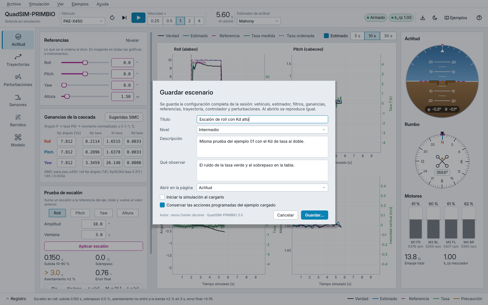

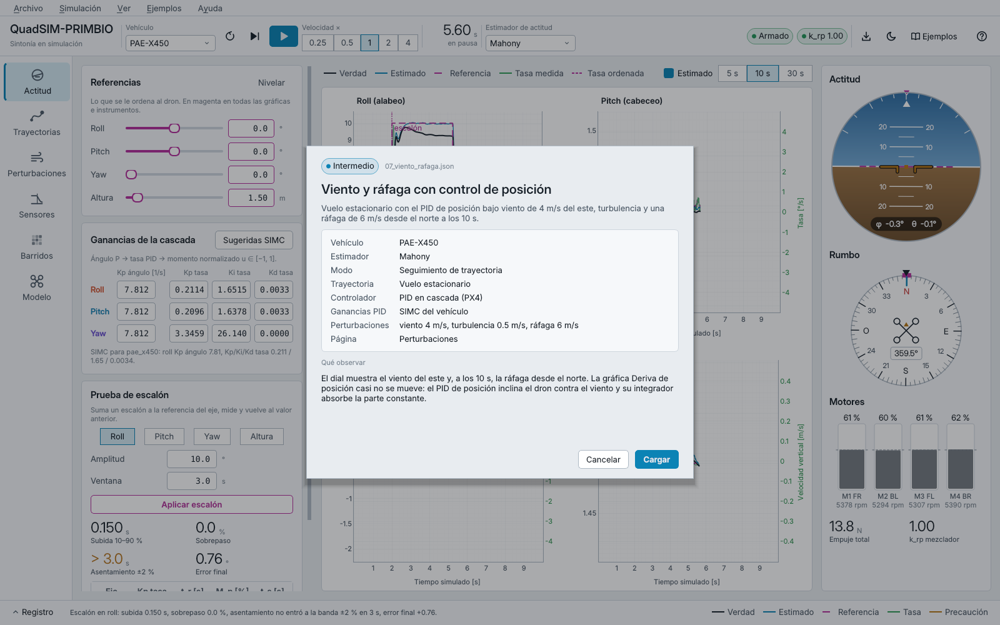

Abrir un escenario reproduce la configuración exacta con la que se guardó.
Lo que el archivo no menciona toma el valor por defecto del simulador, no el
que hubiera en la sesión anterior. Si el archivo trae algo que no se puede
reproducir (un vehículo o un controlador que no existe, un número fuera de
rango, una acción desconocida), no se carga nada: la sesión queda como
estaba y el motivo aparece en el registro. Las claves desconocidas solo
generan un aviso.

Un escenario no guarda la telemetría (para eso está Exportar CSV) ni las
acciones inmediatas de la página Perturbaciones, "Colgar ahora" y "Soltar
ahora". Las fallas de motor sí quedan, porque el simulador las registra como
eventos con su instante.

### Formato del archivo

Los ejemplos de `examples/` usan este mismo formato y sirven de plantilla.
Las claves están en español sin tildes y todas son opcionales salvo
`formato`.

```json
{
  "formato": "pae-quadcopter-sim/escenario",
  "version": 1,
  "titulo": "Viento y ráfaga con control de posición",
  "nivel": "Intermedio",
  "duracion_min": 3,
  "descripcion": "Texto corto para la tarjeta de la galería.",
  "aprenderas": ["...", "..."],
  "pasos": ["Qué hacer, en orden."],
  "observa": "Qué mirar en pantalla.",
  "resultado_esperado": "Cifras medidas.",
  "pagina": "perturbaciones",
  "iniciar": true,
  "config": {
    "vehiculo": "pae_x450",
    "semilla": 1,
    "altura_inicial": 1.5,
    "modo": "trayectoria",
    "referencias": {"roll": 0, "pitch": 0, "yaw": 0, "alt": 1.5},
    "ganancias": "simc",
    "estimador": {"tipo": "mahony", "ganancias": {"kp": 1.0, "ki": 0.05},
                  "usar_magnetometro": true, "compensar_aceleracion": true},
    "sensores": {"vibracion": true, "vibracion_giro_dps": 3.0},
    "filtros": {"roll": [{"tipo": "butterworth", "fc": 60, "q": 0.7071, "ganancia_db": 0},
                         {"tipo": "none", "fc": 177, "q": 2, "ganancia_db": 0}]},
    "trayectoria": {"tipo": "hover", "parametros": {"alt": 1.5, "duration": 30}},
    "controlador": {"tipo": "pid", "parametros": {}},
    "perturbaciones": {
      "viento": {"medio": 4, "viene_de": 90, "turbulencia": 0.5, "rafaga": 6,
                 "rafaga_inicio": 10, "rafaga_duracion": 2, "rafaga_viene_de": 0},
      "emi": {"activa": false, "ganancia_uT": 15, "direccion": [0.6, 0.8, 0],
              "pulsos_hz": 0, "pulsos_uT": 30},
      "cargas": [{"t": 3, "masa_kg": 0.3, "desplazamiento_m": [0, 0.1, 0.05],
                  "soltar": false}],
      "fallas_motor": [{"t": 5, "motor": 0, "eficiencia": 0.6}],
      "efecto_suelo": false
    }
  },
  "acciones": [{"t": 2.0, "accion": "escalon", "eje": "roll", "amplitud": 10, "ventana": 3}],
  "interfaz": {
    "escalon": {"eje": "roll", "amplitud": 10, "ventana": 3},
    "comparacion": {"controladores": ["pid", "mpc"], "duracion": 23},
    "barrido": {"preset": "gyro_lpf", "replicas": 1, "muestras": 40}
  }
}
```

| Clave | Valores y significado |
|---|---|
| `pagina` | `actitud`, `trayectorias`, `perturbaciones`, `sensores`, `barridos` o `modelo` |
| `iniciar` | con `true`, la simulación arranca al cargar |
| `config.vehiculo` | clave del catálogo `quadsim.vehicles` |
| `config.modo` | `actitud` (referencias manuales) o `trayectoria`, que exige `trayectoria` y `controlador` |
| `config.ganancias` | `"simc"` o, por eje, `angle_kp`, `rate_kp`, `rate_ki` y `rate_kd`; la clave `altura` guarda el lazo vertical (`pos_kp`, `vel_kp`, `vel_ki`, `vel_kd`) |
| `config.estimador.tipo` | `ideal`, `madgwick`, `mahony` o `ekf`; `ganancias` usa los nombres del núcleo (`beta`; `kp`, `ki`; `gyro_noise`, `bias_walk`, `accel_noise`, `mag_noise`) |
| `config.filtros` | por eje, hasta dos etapas; `tipo` es `none`, `lowpass`, `butterworth`, `chebyshev` o `notch`, y `fc` debe quedar por debajo de 250 Hz |
| `config.trayectoria`, `config.controlador` | `tipo` es la clave del registro (`hover`, `circle`, `lemniscate`…; `pid`, `mpc`, `nmpc`, `rl`, `mpc_rl`) y `parametros` usa los nombres de su `PARAMS`; lo que falte queda en su valor por defecto |
| `config.perturbaciones.viento` | rapidez en m/s; las direcciones, en grados, indican de dónde viene (0 = norte) |
| `acciones` | en tiempo simulado: `escalon` (`eje`, `amplitud`, `ventana`), `referencia` (`roll`, `pitch`, `yaw`, `alt`), `notch_en_vibracion`, `mensaje` (`texto`) y `pausa` |
| `interfaz` | estado de los formularios: panel de escalón, controladores marcados para comparar y barrido elegido |

Al guardar, el programa agrega `programa` (nombre y versión) y `autor`, que
sale de la constante `AUTHOR` de `gui/about.py` (el autor principal).

## Menús

| Menú | Opciones |
|---|---|
| Archivo | Abrir escenario… (Ctrl+O), Guardar escenario como… (Ctrl+Mayús+S), Exportar CSV… (Ctrl+E), Salir (Ctrl+Q) |
| Simulación | Iniciar / pausar (F5), Avanzar 0.1 s (F6), Reiniciar la corrida (Ctrl+R) |
| Ver | las seis páginas (Ctrl+1 … Ctrl+6), Tema claro / oscuro (Ctrl+T), Registro de eventos (Ctrl+L) |
| Ejemplos | Galería de ejemplos… (F2), cada ejemplo por su nombre, Abrir carpeta de ejemplos |
| Ayuda | Tour guiado (F1), Tour de esta página (Mayús+F1), Galería de ejemplos, Atajos de teclado, Acerca de |

Los atajos viven en las acciones de los menús y en ningún otro lugar: Qt
ignora un atajo registrado dos veces, y una prueba comprueba que no haya
repetidos.

**Acerca de** muestra el nombre (QuadSIM-PRIMBIO), la versión 3.0, los
autores (Jesús Daniel Jácome, y Francisco Javier Burgos Flórez como
director), el Proyecto Académico Especial, el Semillero PRIMBIO y el grupo IAM-NANO, la Universidad
Nacional de Colombia, Sede La Paz, el año y las bibliotecas de terceros con
su licencia. Todo eso sale de `gui/about.py`; para cambiar los autores o la
versión se edita solo ese archivo.

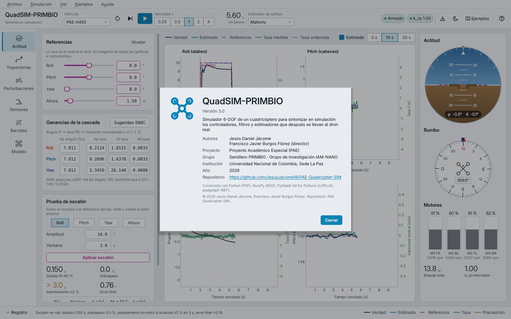

## Tema claro

Para proyectores con poco contraste conviene el tema claro (`Ctrl+T` o
`--light`). Mantiene los mismos significados de color con tonos más oscuros.

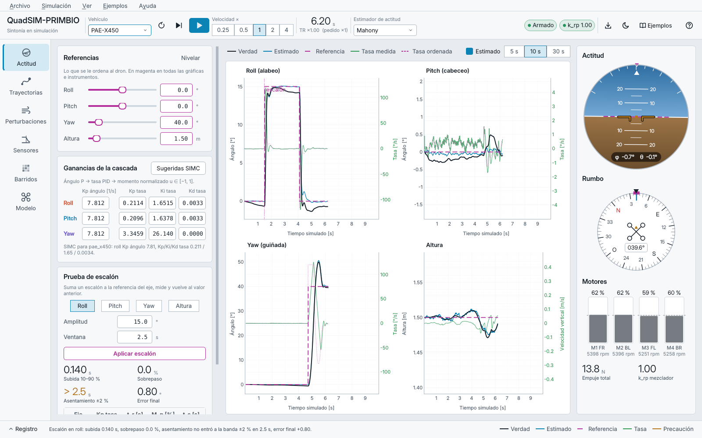

## Atajos de teclado

| Atajo | Acción |
|---|---|
| F1 | tour guiado |
| Mayús+F1 | tour de la página visible |
| F2 | galería de ejemplos |
| F5 | iniciar / pausar |
| F6 | avanzar 0.1 s simulados |
| Ctrl+R | reiniciar la corrida (conserva ganancias, filtros y perturbaciones) |
| Ctrl+1 … Ctrl+6 | ir a cada página |
| Ctrl+O | abrir escenario |
| Ctrl+Mayús+S | guardar escenario como |
| Ctrl+E | exportar CSV |
| Ctrl+T | tema claro / oscuro |
| Ctrl+L | mostrar u ocultar el registro |
| Ctrl+Q | salir |
| → / Intro, ←, Esc | dentro del tour: siguiente, anterior, cerrar |

La misma tabla aparece en Ayuda → Atajos de teclado.

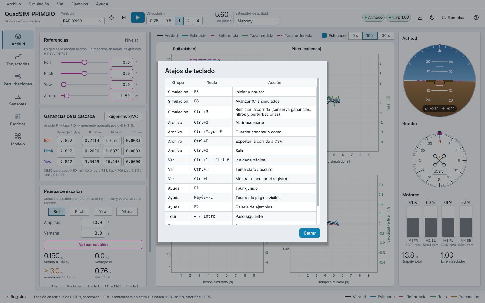

## Exportar la corrida

El CSV guarda la telemetría a 100 Hz de **tiempo simulado**, sin importar la
velocidad elegida, hasta 600 s hacia atrás. Columnas: `t`, `euler_0..2`
(verdad, grados), `euler_est_0..2`, `att_sp_0..2`, `rates_0..2`,
`rates_meas_0..2`, `rate_sp_0..2` (°/s), `pos_0..2`, `pos_est_0..2`,
`ref_pos_0..2`, `vel_0..2` (NED, m y m/s), `alt`, `alt_est`, `alt_sp`,
`sigma_0..3`, `rpm_0..3`, `thrust`, `thrust_cmd`, `u_norm_0..2`, `mixer_k_rp`,
`mixer_k_yaw`, `wind_0..2`, `emi_0..2`, `mag_0..2`, `vib_hz`, `mass`,
`payload_kg`, `gyro_bias_est_0..2`, `gyro_bias_true_0..2`, `armed`.

## Cómo está construida (para quien la mantenga)

Un único `SimulationController` (`gui/controller.py`) es dueño de la
`Simulation`. Ninguna página toca el simulador directamente: piden cambios con
métodos del controlador y se enteran de lo que pasa por señales
(`telemetry`, `reset_done`, `vehicle_changed`, `estimator_changed`,
`filters_changed`, `mode_changed`, `step_test_done`, `event`). Por eso se
puede cambiar vehículo, estimador o controlador a mitad de una corrida sin que
un panel quede apuntando a un objeto viejo.

Un `QTimer` a 50 Hz avanza `Δt_real × velocidad` en pasos de control de 2 ms.
Si el cómputo se pasa del presupuesto del cuadro (28 ms), el tic se corta y no
se acumula deuda: baja TR, la ventana sigue respondiendo. La telemetría va a
buffers circulares de numpy de tamaño fijo (`gui/store.py`); el giroscopio
crudo y filtrado se guarda aparte a 500 Hz, porque a 50 Hz el tono de 177 Hz
sería invisible por Nyquist. Solo se redibuja la página visible, a lo sumo a
30 Hz, con `setData` sobre arreglos ya recortados. Comparaciones y barridos
corren en `QThread` sobre copias de la configuración (`gui/workers.py`).

| Archivo | Contenido |
|---|---|
| `main.py` | punto de entrada y opciones de línea de comandos |
| `gui/main_window.py` | ventana, menús y atajos, barra superior, riel, registro, carga y guardado de escenarios |
| `gui/controller.py` | `SimulationController` (incluye `load_config`, que usan los escenarios) |
| `gui/tour.py` | tour guiado: pasos, capa con el hueco iluminado y tarjeta |
| `gui/scenario.py` | formato de escenarios: validación, captura de la sesión, carga y acciones programadas |
| `gui/dialogs.py` | bienvenida, galería de ejemplos, abrir y guardar escenario, atajos, Acerca de, tarjeta guía |
| `gui/about.py` | nombre, versión, autores y filiación (una sola fuente) |
| `gui/settings.py` | preferencias persistentes (QSettings) |
| `examples/*.json` | los once ejemplos |
| `gui/theme.py` | tokens de color y tipografía, hoja de estilos oscura y clara |
| `gui/store.py`, `gui/workers.py`, `gui/registry.py`, `gui/analysis.py` | buffers, hilos, acceso tolerante a los registros, cálculos de gráficas |
| `gui/pages/*.py` | las seis áreas de trabajo |
| `gui/widgets/*.py` | instrumentos (QPainter), lienzos pyqtgraph, vista 3D, formularios |
| `tests/test_gui_smoke.py` | pruebas de humo sin pantalla |
| `tests/test_gui_tour.py` | recorre el tour completo y los tours por página |
| `tests/test_gui_examples.py` | carga y corre cada ejemplo; vuelve a medir las cifras de 01, 02 y 08 |
| `tests/test_gui_scenarios.py` | guardar y abrir, archivos inválidos, menús, diálogos y todos los botones |
| `docs/screenshots/make_screenshots.py` | regenera las capturas de las páginas |
| `docs/screenshots/make_doc_figures.py` | figuras de documentación: páginas con ejemplos cargados, tour y diálogos |

Pruebas y capturas:

```bash
QT_QPA_PLATFORM=offscreen PYTHONPATH=. pytest -q tests/test_gui_*.py
QT_QPA_PLATFORM=offscreen PYTHONPATH=. python docs/screenshots/make_screenshots.py
QT_QPA_PLATFORM=offscreen PYTHONPATH=. python docs/screenshots/make_doc_figures.py
```

La prueba `test_every_button_works` pulsa cada botón visible y habilitado de
las seis páginas (con sus pestañas), de la barra superior, del riel, del
registro, de la tarjeta guía y del tour. Falla si alguno lanza una excepción o
deja un error en el registro. Durante la prueba, los diálogos modales y de
archivos se reemplazan por versiones que responden solas.

Al cerrar el programa, `main.py` borra la ventana mientras la aplicación Qt
sigue viva. Sin ese paso, en algunas corridas el proceso terminaba con una
violación de segmento al salir del intérprete, porque Python destruía los
objetos de Qt en un orden no garantizado. Por otro lado, una excepción
imprevista dentro de un botón ya no pasa en silencio: queda en el registro,
que se abre solo, y la simulación se pausa.

## Limitaciones conocidas

- La tipografía prevista es Bahnschrift (la DIN de Windows) para títulos y
  lecturas, con Segoe UI para el texto. Las capturas se hicieron en Linux, que
  cae a Inter; en Windows los números se ven algo más condensados.
- La vista 3D con OpenGL se verificó con Mesa por software (Xvfb), no con una
  tarjeta de video real.
- Las capturas usan la plataforma Qt `offscreen`; los tamaños de letra pueden
  variar con el escalado de Windows (125 %, 150 %). La ventana necesita al
  menos 1447 × 735 píxeles lógicos (unos 780 con el registro abierto), así
  que cabe en una pantalla de 1920 × 1080 al 125 %; por debajo de eso, las
  columnas con formularios e instrumentos muestran una barra de scroll.
- El TR medido depende de la máquina. Con el MPC no lineal activo la
  simulación corre a unas 1.4 veces el tiempo real (medido sin GUI en la
  máquina de desarrollo: 4 s simulados en 2.9 s), así que ×2 y ×4 no se
  alcanzan; con PID o MPC lineal sobra margen.
- La estimación de duración de un barrido supone unos 0.8 s por simulación
  (medido con `attitude_step` en la máquina de desarrollo); otros escenarios
  tardan distinto.
