# Modelo Matemático del Simulador PAE Quadcopter — 3.ª edición

Jesús Daniel — Universidad Nacional de Colombia, Sede La Paz, 2026

> Versión Markdown exportada con pandoc desde `docs/modelo/main.tex` (`docs/modelo/build.sh`). La versión de referencia, con numeración de ecuaciones y tablas, es `docs/Modelo_Matematico_Simulador_3ra_Edicion.pdf`. Las cifras salen de `experiments/model_verification.py`.

# Propósito, alcance y cambios respecto de la 2.ª edición

## Para qué sirve este documento

La pregunta de investigación del proyecto se formuló así: *técnicas de sintonía en entornos simulados como punto de partida en la sintonía de drones reales*. Una sintonía hecha en simulación solo transfiere al vehículo real si el simulador contiene, con números creíbles, los fenómenos que limitan al controlador: el rezago de los motores, la saturación de los actuadores, el acoplamiento entre inclinación y traslación, el ruido y la vibración que ven los sensores, el error del estimador de actitud y el viento. Este documento describe uno por uno esos fenómenos tal como están programados en el paquete `quadsim/`, explica por qué se modelaron así y qué se dejó por fuera, y muestra la evidencia numérica de que el código hace lo que dicen las ecuaciones.

La regla de redacción es simple. Cada ecuación de este texto corresponde a una línea de código identificable (se cita el archivo y la función), y cada cifra presentada como resultado sale del guion `experiments/model_verification.py`, que la calcula, la imprime y la guarda en `docs/modelo/resultados_verificacion.json`. Lo que es un supuesto aparece en recuadros naranjas; lo que es un detalle de implementación que conviene conocer antes de presentar el proyecto, en recuadros azules.

## Alcance

El simulador modela un cuadricóptero como un sólido rígido de seis grados de libertad con cuatro rotores de dinámica propia (17 estados), en marco inercial NED y marco cuerpo FRD, con:

- propulsor ESC + motor sin escobillas de primer orden, empuje y par cuadráticos, zona muerta y asignación de control con desaturación por prioridades;

- aerodinámica del fuselaje (arrastre cuadrático y amortiguamiento rotacional), viento como velocidad relativa del aire y efecto suelo opcional;

- sensores con ruido de hoja de datos, sesgo, deriva, vibración a la frecuencia de paso de pala, retardos y tasas de muestreo propias;

- filtros biquad sobre el giroscopio, tres estimadores de actitud (Madgwick, Mahony, EKF) y un filtro de Kalman de navegación;

- el control de bajo nivel en cascada (ángulo $\to$ tasa $\to$ momento normalizado) con ganancias calculadas del modelo por las reglas SIMC;

- cinco controladores de posición/trayectoria (PID en cascada, MPC lineal, MPC no lineal, aprendizaje por refuerzo puro y MPC con residuo aprendido) y siete generadores de trayectoria;

- perturbaciones: viento medio, turbulencia de Dryden, ráfaga $1-\cos$, interferencia electromagnética en el magnetómetro, cambio de carga útil y pérdida de eficiencia de un motor.

No modela la batería (el voltaje es constante), la elasticidad del bastidor, la aerodinámica del rotor en vuelo de avance (*blade flapping*, arrastre inducido) ni la dinámica eléctrica del motor. La sección 17 discute qué consecuencias tiene cada omisión.

## Qué cambió frente a la 2.ª edición

La 2.ª edición del modelo (`PAE_Quadcopter_GCS/simulator/physical_model.py`) cumplió su papel didáctico, pero tenía cuatro limitaciones de fondo que impedían usarla para el objetivo de investigación actual. La tabla 1.1 las resume.

| Aspecto               | 2.ª edición                                                                                                                            | 3.ª edición (este documento)                                                                                                        |
|:----------------------|:---------------------------------------------------------------------------------------------------------------------------------------|:------------------------------------------------------------------------------------------------------------------------------------|
| Dinámica de rotación  | Linealizada en hover y desacoplada por eje: $I\dot\omega=\tau-b_\omega\omega$, $\dot\theta=\omega$ por separado para roll, pitch y yaw | Newton–Euler completa con $\boldsymbol{\omega}\times J\boldsymbol{\omega}$, par giroscópico de los rotores y cuaternión (sección 4) |
| Traslación            | Solo altura; inclinarse no desplazaba al dron y mantener una inclinación no costaba momento                                            | Traslación 3D en NED con el empuje proyectado por la actitud completa                                                               |
| Integración           | Euler semi-implícito a la tasa del lazo (500 Hz)                                                                                       | RK4 a 1000 Hz con el mando retenido entre muestras de control (sección 14)                                                          |
| Marcos                | FLU (z arriba), yaw como rumbo con signo invertido a mano                                                                              | NED/FRD como PX4 y Quan Quan: yaw es rumbo de forma natural                                                                         |
| Sensores y estimación | Ruido sumado al ángulo verdadero                                                                                                       | IMU, magnetómetro, barómetro y posición externa con vibración; Madgwick, Mahony, EKF y Kalman de navegación                         |
| Vehículo por defecto  | F450 de Jiřinec, 1.474 kg, en X                                                                                                        | PAE-X450 (datos completos de CopterSim/RflySim, sección 7)                                                                          |

Diferencias de fondo entre la 2.ª y la 3.ª edición del modelo.

#### Problemas del catálogo anterior.

La revisión del vehículo de Jiřinec destapó dos errores que conviene declarar porque un evaluador atento los puede encontrar. El primero es de masa. Jiřinec identifica su coeficiente de empuje con la condición de hover $b=mg/(4\omega_0^2)$, con $b=1.5108\times10^{-5}$ N/(rad/s)$^2$ y $\omega_0=463.1$ rad/s (su ec. 4.9). Despejando la masa de esa misma ecuación se obtiene $m = 4b\omega_0^2/g = 1.3216$ kg, no los 1.474 kg de la suma de componentes de su tabla 4.2. Con 1.474 kg el hover exigiría $\omega_0=489.1$ rad/s: los números de la tesis no son coherentes entre sí, y la 2.ª edición usaba la combinación incoherente. El segundo error es de geometría: las ecuaciones de momento de Jiřinec (sec. 2.2.4) están escritas para bastidor en cruz (+), y la 2.ª edición lo cargaba en X. La 3.ª edición corrige ambos (`JIRINEC_PLUS` en `vehicles.py`, masa 1.321 kg, bastidor +) y, sobre todo, cambia el vehículo de referencia por uno cuyos parámetros forman un conjunto completo y verificable: el PAE-X450.

#### Lo que se conserva.

La cascada de control y su sintonía SIMC, la convención de momento normalizado de PX4 en el lazo de tasa, el modelo de actuador de primer orden y los filtros biquad pasan sin cambios conceptuales de una edición a otra. Lo nuevo es la planta sobre la que actúan.

#### Correcciones del núcleo durante la verificación.

Al escribir este documento, la verificación numérica encontró problemas en el propio núcleo de la 3.ª edición que se corrigieron antes de cerrarlo (5 de octubre de 2026): el acelerómetro llegaba sin filtrar al estimador de actitud y la vibración se rectificaba en un sesgo de inclinación; el arranque en el aire no inicializaba los retardos de los sensores, el estimador ni la covarianza de navegación; y varios valores por defecto (derivativo del lazo de tasa, filtro del giroscopio, ruidos del EKF, $\beta$ de Madgwick, integral del PID de posición, estimador por defecto) se ajustaron con los barridos. El texto describe el código corregido; las cifras históricas obtenidas con el núcleo anterior se señalan como tales donde aparecen.

#### Revisión externa.

El 9 de octubre de 2026 una revisión técnica independiente leyó el código y los resultados con instrucciones de buscar errores. Sus hallazgos cambiaron varias partes de este documento. La compensación de aceleración del AHRS resultó autorreferente cuando no hay sensor de posición (sección 11.2). Los retardos del ESC y del cómputo, omitidos, pesan más de lo que la edición anterior estimaba (sección 14). La lectura del banco de controladores sobrevaloraba lo que tres semillas permiten afirmar, y atribuía a la brecha de modelo un error del aprendizaje por refuerzo que en su mayor parte ya existe en el entorno de entrenamiento (sección 15.9). Lo que se pudo corregir en el código se corrigió; lo que depende de medir el dron real quedó en la sección 17, con la lista de datos pendientes.

> **Cómo reproducir las cifras de este documento.** Desde la raíz del repositorio, `bash docs/modelo/build.sh –verify` corre la verificación numérica completa (bloques A a M, alrededor de un minuto en un núcleo), regenera las figuras y `valores.tex`, compila este PDF y exporta `docs/MODELO_MATEMATICO.md`. Sin `–verify` reutiliza el último `resultados_verificacion.json`. Las cifras de los bancos de controladores (sección 15.9) y de los barridos (sección 16) vienen de sus propios guiones, citados en cada caso, porque requieren cientos de corridas.

# Marcos de referencia y convenciones

Un error de signo en un simulador no produce un mensaje de error: produce un dron que se va hacia el lado contrario, o un lazo de yaw que diverge, y encontrarlo cuesta días. Por eso las convenciones se fijaron una sola vez, en `quadsim/math3d.py`, y son las mismas de PX4 y del libro de Quan \[1\] (cap. 5). Seguir una convención publicada tiene una ventaja adicional: los parámetros, las ganancias y los índices de motor del simulador significan lo mismo que en un autopiloto real.

## Marcos

- **Marco inercial** $\{E\}$: NED. $x_E$ apunta al norte, $y_E$ al este y $z_E$ hacia abajo. La gravedad es $g\boldsymbol{e}_3$ con $\boldsymbol{e}_3=[0,0,1]^{\mathsf{T}}$ y $g=9.80665$ m/s$^2$; la altura es $h=-z_E$.

- **Marco cuerpo** $\{B\}$: FRD, con origen en el centro de masa. $x_B$ hacia adelante, $y_B$ hacia la derecha, $z_B$ hacia abajo. El empuje de los rotores apunta a $-z_B$.

La 2.ª edición usaba FLU (z arriba) y obligaba a invertir a mano el signo del yaw para que coincidiera con la brújula. En NED/FRD esa inversión desaparece: una rotación positiva alrededor de $z$ (que apunta hacia abajo) es horaria vista desde arriba, es decir, *rumbo de brújula*. La GUI muestra $\psi$ directamente en $[0^\circ,360^\circ)$.

## Actitud: cuaternión, matriz de rotación y ángulos de Euler

La actitud se guarda como un cuaternión unitario de Hamilton con la parte escalar primero, $\boldsymbol{q}=[q_w,q_x,q_y,q_z]^{\mathsf{T}}$, que rota vectores del cuerpo al marco inercial: $$\boldsymbol{v}_E = \mathbf{R}(\boldsymbol{q})\,\boldsymbol{v}_B .
\tag{2.1}$$ Los ángulos de Euler siguen la secuencia Z-Y-X (yaw $\psi$, pitch $\theta$, roll $\phi$): $$\mathbf{R}= \mathbf{R}_z(\psi)\,\mathbf{R}_y(\theta)\,\mathbf{R}_x(\phi).
\tag{2.2}$$ Con NED/FRD los signos coinciden con lo que entiende un piloto:

- $\phi>0$: ala derecha abajo (el eje $y_B$ gira hacia $+z_E$);

- $\theta>0$: morro arriba (el eje $x_B$ gira hacia $-z_E$);

- $\psi>0$: morro a la derecha, sentido horario visto desde arriba.

La verificación (bloque B de `model_verification.py`) lo comprueba con vectores concretos: con $\phi=0.3$ rad el eje $y_B$ queda en $\{E\}$ como $(0,\,0.955,\,0.296)$, con componente positiva hacia abajo; con $\theta=0.3$ rad el eje $x_B$ queda como $(0.955,\,0,\,-0.296)$, con el morro hacia arriba; con $\psi=90^\circ$ el eje $x_B$ apunta al este.

> **Declinación magnética.** Los estimadores de actitud trabajan internamente en un NED *magnético* ($x$ hacia el norte magnético) y a la salida rotan el rumbo por la declinación, $\boldsymbol{q}_{geo}=\boldsymbol{q}_{D}\otimes\boldsymbol{q}_{mag}$ con $\boldsymbol{q}_D$ una rotación de $D$ alrededor de $z$. Es lo que hace PX4. Por defecto $D=-9.85^\circ$ (sección 9).

## Numeración y sentido de giro de los motores

La geometría sigue el *Airframe Reference* de PX4 para “Quadrotor x” (`vehicles.make_rotors`). Cada rotor tiene una posición $(x_i,y_i)$ en FRD y un sentido de giro $e_i$: $e_i=+1$ si gira antihorario visto desde arriba (su reacción sobre el cuerpo es un par de guiñada positivo), $e_i=-1$ si gira horario.

| Motor |      Posición       | $x_i$ \[m\] | $y_i$ \[m\] | $e_i$ | Giro visto desde arriba |
|:------|:-------------------:|:-----------:|:-----------:|:-----:|:------------------------|
| M1    |  delantero-derecho  |    $+a$     |    $+a$     | $+1$  | antihorario (CCW)       |
| M2    |  trasero-izquierdo  |    $-a$     |    $-a$     | $+1$  | antihorario (CCW)       |
| M3    | delantero-izquierdo |    $+a$     |    $-a$     | $-1$  | horario (CW)            |
| M4    |   trasero-derecho   |    $-a$     |    $+a$     | $-1$  | horario (CW)            |

Rotores del PAE-X450 (bastidor en X, brazo $\ell=0.225$ m, $a=\ell/\sqrt2=0.1591$ m).

¿Por qué un rotor antihorario produce guiñada positiva? El motor empuja la hélice en sentido antihorario; el aire frena la hélice con un par horario, y el motor, para mantener la velocidad, ejerce sobre el cuerpo la reacción: un par horario visto desde arriba. En NED eso es un par positivo alrededor de $z_B$, o sea, rumbo creciente. La figura 2.1 se genera leyendo la geometría del propio código (`docs/modelo/fig_marco.py`), así que no puede contradecirlo.

<figure id="fig:marco">
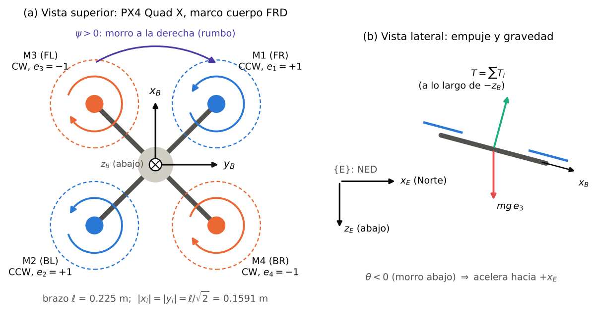
<figcaption>Convenciones. (a) Vista superior del bastidor PX4 Quad X en FRD: numeración, sentido de giro y signo \(e_i\) de cada rotor; el eje \(z_B\) entra en la página. (b) Vista lateral en NED: el empuje actúa a lo largo de \(-z_B\); con el morro abajo (\(\theta&lt;0\)) su componente horizontal acelera al dron hacia el norte.</figcaption>
</figure>

## Resumen de símbolos

| Símbolo                                       | Significado                                                               |
|:----------------------------------------------|:--------------------------------------------------------------------------|
| $\boldsymbol{p},\ \boldsymbol{v}$             | posición y velocidad del centro de masa en $\{E\}$ \[m, m/s\]             |
| $\boldsymbol{q},\ \mathbf{R}(\boldsymbol{q})$ | cuaternión de actitud y matriz de rotación $\{B\}\to\{E\}$                |
| $\boldsymbol{\omega}=[p,q,r]^{\mathsf{T}}$    | velocidad angular del cuerpo expresada en $\{B\}$ \[rad/s\]               |
| $\Omega_i$                                    | velocidad del rotor $i$ \[rad/s\]                                         |
| $\sigma_i\in[0,1]$                            | acelerador enviado al ESC del motor $i$                                   |
| $C_T,\ C_M$                                   | coeficientes de empuje y de par: $T_i=C_T\Omega_i^2$, $Q_i=C_M\Omega_i^2$ |
| $C_R,\ \omega_b,\ T_m$                        | recta del ESC y constante de tiempo del motor                             |
| $J=\operatorname{diag}(J_{xx},J_{yy},J_{zz})$ | tensor de inercia en el centro de masa                                    |
| $J_m$                                         | inercia de rotor + hélice                                                 |
| $\boldsymbol{v}_w$                            | velocidad del viento en $\{E\}$                                           |
| $\boldsymbol{f}_B$                            | fuerza específica (lo que mide un acelerómetro ideal)                     |
| $u\in[-1,1]^3$                                | momento normalizado que entrega el lazo de tasa                           |

Notación principal.

# Cinemática

## Por qué cuaterniones

La dinámica se integra con el cuaternión y no con los ángulos de Euler. La razón es práctica: la cinemática de Euler tiene una singularidad en $\theta=\pm90^\circ$ (*gimbal lock*), donde la matriz que convierte velocidad angular en derivadas de los ángulos deja de ser invertible. Un dron real no vuela de canto, pero un controlador mal sintonizado o una maniobra acrobática pueden llevarlo ahí, y un simulador que se rompe justo cuando el controlador falla no sirve para estudiar fallas. El cuaternión no tiene singularidades, cuesta cuatro números en vez de nueve (matriz de rotación) y su cinemática es bilineal, lo que facilita la integración. Los ángulos de Euler se calculan solo para mostrar y para el lazo de actitud.

## Ecuaciones

La cinemática de traslación es la definición de velocidad: $$\dot{\boldsymbol{p}} = \boldsymbol{v} .
\tag{3.1}$$ La de rotación, con $\boldsymbol{\omega}$ expresada en el cuerpo (`math3d.q_derivative`): $$\dot{\boldsymbol{q}} = \tfrac12\,\boldsymbol{q}\otimes\begin{bmatrix}0\\ \boldsymbol{\omega}\end{bmatrix}
=\frac12\begin{bmatrix}
-q_x p - q_y q - q_z r\\
\phantom{-}q_w p + q_y r - q_z q\\
\phantom{-}q_w q - q_x r + q_z p\\
\phantom{-}q_w r + q_x q - q_y p
\end{bmatrix},
\tag{3.2}$$ donde $\otimes$ es el producto de Hamilton. La matriz de rotación asociada (`math3d.q_to_rot`) es $$\mathbf{R}(\boldsymbol{q})=\begin{bmatrix}
1-2(q_y^2+q_z^2) & 2(q_xq_y-q_wq_z) & 2(q_xq_z+q_wq_y)\\
2(q_xq_y+q_wq_z) & 1-2(q_x^2+q_z^2) & 2(q_yq_z-q_wq_x)\\
2(q_xq_z-q_wq_y) & 2(q_yq_z+q_wq_x) & 1-2(q_x^2+q_y^2)
\end{bmatrix}.
\tag{3.3}$$

#### Conversión con Euler.

De Euler a cuaternión (`euler_to_q`), con $c_\bullet=\cos(\bullet/2)$ y $s_\bullet=\sin(\bullet/2)$: $$\boldsymbol{q}=\begin{bmatrix}
c_\phi c_\theta c_\psi + s_\phi s_\theta s_\psi\\
s_\phi c_\theta c_\psi - c_\phi s_\theta s_\psi\\
c_\phi s_\theta c_\psi + s_\phi c_\theta s_\psi\\
c_\phi c_\theta s_\psi - s_\phi s_\theta c_\psi
\end{bmatrix}.$$ Y de vuelta (`q_to_euler`): $$\begin{aligned}
\phi&=\operatorname{atan2}\!\big(2(q_wq_x+q_yq_z),\,1-2(q_x^2+q_y^2)\big),\\
\theta&=\arcsin\!\big(\operatorname{sat}_{[-1,1]}\,2(q_wq_y-q_zq_x)\big),\\
\psi&=\operatorname{atan2}\!\big(2(q_wq_z+q_xq_y),\,1-2(q_y^2+q_z^2)\big).
\end{aligned}$$ La saturación del argumento del arcoseno evita que el redondeo produzca un `NaN` cerca de $\theta=\pm90^\circ$.

#### Tasas de Euler y velocidad angular.

El lazo de ángulo produce derivadas deseadas de los ángulos de Euler; el lazo de tasa necesita velocidades angulares del cuerpo. La relación para Z-Y-X (`control/attitude.euler_rates_to_body`) es $$\boldsymbol{\omega }= W(\phi,\theta)\begin{bmatrix}\dot\phi\\ \dot\theta\\ \dot\psi\end{bmatrix},
\qquad
W=\begin{bmatrix}
1 & 0 & -\sin\theta\\
0 & \cos\phi & \sin\phi\cos\theta\\
0 & -\sin\phi & \cos\phi\cos\theta
\end{bmatrix}.
\tag{3.6}$$ $W$ deja de ser invertible en $\cos\theta=0$: es la misma singularidad de Euler, que por eso queda confinada al lazo de ángulo.

#### Normalización.

La integración numérica de (3.2) no conserva exactamente $\|\boldsymbol{q}\|=1$. Después de cada paso de física se renormaliza (`dynamics.renormalize_quat`). Es una proyección de orden del error de truncamiento, que no cambia el orden del método.

## Verificación

El bloque B de `model_verification.py` toma 500 actitudes aleatorias (roll y pitch hasta $\pm80^\circ$ y $\pm74^\circ$, yaw en $\pm172^\circ$) y mide el peor caso de cada propiedad:

| Propiedad comprobada                                                                                                                                 |        Error máximo |
|:-----------------------------------------------------------------------------------------------------------------------------------------------------|--------------------:|
| Ortonormalidad, $\max|\mathbf{R}^{\mathsf{T}}\mathbf{R}-I|$ y $|\det\mathbf{R}-1|$                                                                   | $1.6\times10^{-15}$ |
| $\mathbf{R}(\boldsymbol{q})$ de (3.3) contra $\mathbf{R}_z\mathbf{R}_y\mathbf{R}_x$ de (2.2)                                                         | $8.9\times10^{-16}$ |
| Ida y vuelta Euler $\to\boldsymbol{q}\to$ Euler \[rad\]                                                                                              | $1.3\times10^{-15}$ |
| $W$ de (3.6) contra derivadas de Euler obtenidas por diferencias finitas de (3.2) \[rad/s\]                                                          | $8.9\times10^{-10}$ |
| Jacobiano analítico $\partial(\mathbf{R}^{\mathsf{T}}\boldsymbol{d})/\partial\boldsymbol{q}$ usado por Madgwick y el EKF, contra diferencias finitas |  $8.7\times10^{-9}$ |

Verificación numérica de la cinemática (peor caso en 500 actitudes).

Los dos primeros errores están en el nivel del redondeo de doble precisión; los dos últimos son del orden del error de las diferencias finitas usadas como referencia ($h=10^{-6}$ y $10^{-7}$), no del código.

# Dinámica de Newton–Euler completa

## Estado y entrada

El vector de estado tiene 17 componentes (`dynamics.py`, índices `IP, IV, IQ, IW, IR`): $$\boldsymbol{x} = \big[\ \boldsymbol{p}^{\mathsf{T}}\ \ \boldsymbol{v}^{\mathsf{T}}\ \ \boldsymbol{q}^{\mathsf{T}}\ \ \boldsymbol{\omega}^{\mathsf{T}}\ \ \Omega_1\ \ \Omega_2\ \ \Omega_3\ \ \Omega_4\ \big]^{\mathsf{T}}\in\mathbb R^{3+3+4+3+4=17} .
\tag{4.1}$$ La entrada son los cuatro aceleradores $\sigma_i\in[0,1]$, retenidos (orden cero) durante cada paso de integración. Las perturbaciones entran por un objeto `Environment`: velocidad del viento $\boldsymbol{v}_w$ en $\{E\}$, fuerza externa $\boldsymbol{F}_{ext}$ en $\{E\}$, momento externo $\boldsymbol{\tau}_{ext}$ en $\{B\}$, eficiencia de cada motor $\eta_i$ y un indicador de efecto suelo.

Incluir las velocidades de los rotores en el estado, en lugar de suponer que el empuje sigue instantáneamente al mando, es la diferencia entre un modelo útil para sintonizar y uno que no lo es. El rezago del motor ($T_m=20$ ms en el PAE-X450) es el mayor retardo de la cadena de control de actitud; sin él cualquier ganancia de tasa parece estable.

## Supuestos

> **Supuestos del modelo de sólido rígido.**
>
> - Tierra plana y no rotante: $\{E\}$ es inercial y la gravedad es uniforme. A las velocidades y distancias de un multirrotor de laboratorio, la aceleración de Coriolis terrestre ($\sim10^{-4}$ m/s$^2$) es despreciable.
>
> - Cuerpo rígido con masa constante (salvo los eventos de carga útil, sección 13) y tensor de inercia diagonal (productos de inercia nulos por simetría).
>
> - Rotores en el plano horizontal que contiene al centro de masa: el empuje no genera momento por un brazo vertical.
>
> - Las fuerzas aerodinámicas del fuselaje actúan en el centro de masa.

## Traslación (Newton, en el marco inercial)

$$m\,\dot{\boldsymbol{v}} = m g\,\boldsymbol{e}_3+ \mathbf{R}(\boldsymbol{q})\,\boldsymbol{f}_B + \boldsymbol{F}_{ext},
\qquad
\boldsymbol{f}_B = \begin{bmatrix} f_{a,x}\\ f_{a,y}\\ f_{a,z} - \sum_{i=1}^4 T_i\end{bmatrix},
\tag{4.2}$$ con $T_i = C_T\Omega_i^2$ (multiplicado por el factor de efecto suelo cuando está activo) y $\boldsymbol{f}_a$ la fuerza aerodinámica del fuselaje en $\{B\}$ (sección 6). La ecuación se escribe en $\{E\}$ porque ahí la gravedad es constante y la posición se integra directamente; la fuerza de los rotores se escribe en $\{B\}$ porque ahí es constante en dirección. La matriz $\mathbf{R}$ hace el puente, y con ella entra el acoplamiento que la 2.ª edición no tenía: inclinar el dron inclina el empuje, y el dron se desplaza.

## Rotación (Euler, en el marco cuerpo)

El momento angular total del vehículo es el del cuerpo más el de los cuatro rotores. Si cada rotor gira con velocidad $\Omega_i$ alrededor de $z_B$ en el sentido $e_i$, un rotor antihorario visto desde arriba tiene su vector de velocidad angular hacia arriba, es decir, hacia $-z_B$. El momento angular de los rotores es entonces $$\boldsymbol{h}_r = \begin{bmatrix}0\\0\\h_z\end{bmatrix},\qquad
h_z = -J_m\sum_{i=1}^4 e_i\,\Omega_i .
\tag{4.3}$$ Derivando $J\boldsymbol{\omega}+\boldsymbol{h}_r$ en el marco móvil e igualando al momento externo se obtiene $$J\dot{\boldsymbol{\omega}} = \boldsymbol{\tau}_B - \boldsymbol{\omega}\times(J\boldsymbol{\omega})
 - \boldsymbol{\omega}\times\boldsymbol{h}_r - \underset{\scriptscriptstyle \text{omitido}}{\dot{\boldsymbol{h}}_r}
 + \boldsymbol{\tau}_a + \boldsymbol{\tau}_{ext},
\tag{4.4}$$ donde el momento de los rotores es $$\boldsymbol{\tau}_B=\begin{bmatrix}\tau_x\\ \tau_y\\ \tau_z\end{bmatrix}
=\begin{bmatrix}
-\sum_i y_i\,T_i\\
\phantom{-}\sum_i x_i\,T_i\\
\phantom{-}\sum_i e_i\,Q_i
\end{bmatrix},\qquad Q_i=C_M\Omega_i^2 .
\tag{4.5}$$ El signo de la fila de roll sale del producto cruz: el rotor $i$ está en $(x_i,y_i,0)$ y empuja con $(0,0,-T_i)$, así que $(x_i,y_i,0)\times(0,0,-T_i)=(-y_iT_i,\ x_iT_i,\ 0)$. Un rotor a la derecha ($y_i>0$) que empuja más produce roll negativo (levanta el ala derecha).

En componentes, con $J$ diagonal, el código (`QuadrotorDynamics.derivative`) evalúa $$\begin{aligned}
J_{xx}\dot p &= \tau_x - (J_{zz}-J_{yy})\,q r - q\,h_z + \tau_{a,x} + \tau_{ext,x},\nonumber\\
J_{yy}\dot q &= \tau_y - (J_{xx}-J_{zz})\,r p + p\,h_z + \tau_{a,y} + \tau_{ext,y},\tag{4.6}\\
J_{zz}\dot r &= \tau_z - (J_{yy}-J_{xx})\,p q + \tau_{a,z} + \tau_{ext,z}.\nonumber
\end{aligned}$$

#### El término giroscópico de los rotores, $-\boldsymbol{\omega}\times\boldsymbol{h}_r$.

Solo afecta a roll y pitch, y es proporcional a la *diferencia* entre las velocidades de los rotores CCW y CW. En hover esa diferencia es cero y el término desaparece; aparece cuando hay mando de guiñada mientras el dron gira en roll o pitch. Con $J_m/J_{zz}=3.33\times10^{-3}$ su efecto es pequeño en el PAE-X450, pero se incluye porque no cuesta nada y está en todos los modelos de referencia \[1, 5\].

## El término de reacción por aceleración de los rotores, omitido

El término $-\dot{\boldsymbol{h}}_r = J_m\sum_i e_i\dot\Omega_i\,\boldsymbol{e}_3$ es la reacción que siente el cuerpo cuando los motores *aceleran* sus rotores. Está en las ecuaciones de Phang et al. \[5\] (ecs. 11.14–11.16), y el código lo calcula, pero no lo aplica, salvo que la dinámica se construya con la opción `include_rotor_reaction=True`. La decisión no es de comodidad; es de consistencia con el resto del modelo.

Con el propulsor de primer orden de la sección 5, un escalón del acelerador desde hover hasta el máximo produce, en el primer instante, $$\dot\Omega = \frac{\Omega_{max}-\Omega_h}{T_m}
= \frac{1006.6-557.3}{0.02} = 22463\ \text{rad/s}^2,
\qquad
J_m\dot\Omega = 2.89\ \text{N·m por motor}.$$ Ese par tendría que darlo el motor. Un motor 2212 de 920 KV (el típico de un F450) tiene $K_t = 60/(2\pi\cdot920) = 0.0104$ N·m/A; con un límite de corriente de 15 A (supuesto razonable para un ESC de 20–30 A) entrega como mucho $0.156$ N·m, unas 19 veces menos. El par aerodinámico máximo de la hélice es $0.180$ N·m, 16 veces menor que esa reacción. En un motor real la corriente se satura y la aceleración del rotor queda limitada por el par disponible; el modelo de primer orden no tiene esa saturación, de modo que su $\dot\Omega$ inicial es físicamente inalcanzable.

Aplicar $\dot{\boldsymbol{h}}_r$ con ese $\dot\Omega$ generaría golpes de guiñada de casi 3 N·m (ocho veces el momento máximo de guiñada del vehículo, $0.361$ N·m) que el dron real no siente. Modelarlo bien exige un modelo eléctrico del motor con límite de corriente, que queda como trabajo futuro (sección 17). El modelo de Quan \[1\] (cap. 6) y su implementación CopterSim \[3\], de donde provienen los parámetros del PAE-X450, tampoco incluyen este término: la omisión es coherente con la fuente de los datos.

## Dinámica de los rotores

Cada rotor sigue un primer orden hacia la velocidad de régimen que impone su ESC (sección 5): $$T_m\,\dot\Omega_i = \eta_i\,\omega_{ss}(\sigma_i) - \Omega_i ,
\tag{4.8}$$ con $\eta_i\in(0,1]$ la eficiencia del motor (1 salvo en el escenario de falla, sección 13).

## Fuerza específica y contacto con el suelo

El acelerómetro ideal mide la fuerza específica, que el código calcula a partir de la derivada del estado (`specific_force_B`): $$\boldsymbol{f}_{acc} = \mathbf{R}^{\mathsf{T}}\big(\dot{\boldsymbol{v}} - g\,\boldsymbol{e}_3\big)
= \frac{1}{m}\Big(\boldsymbol{f}_B + \mathbf{R}^{\mathsf{T}}\boldsymbol{F}_{ext}\Big).
\tag{4.9}$$ La segunda igualdad, que sale de (4.2), tiene una consecuencia que reaparece en la sección 11: el acelerómetro de un multirrotor mide empuje y arrastre, nunca la gravedad. En hover inclinado y sin velocidad mide $(0,0,-g)$ *independientemente* de la inclinación.

El suelo se trata como una restricción unilateral simple (`Simulation._ground_contact`): si $z>0$ se fija $z=0$ y se anula la velocidad vertical descendente; si además el empuje total es menor que el peso, el dron queda apoyado en sus patas: velocidad horizontal y angular nulas y actitud nivelada conservando el rumbo. No hay fricción ni rebote: basta para despegar y aterrizar, no para estudiar aterrizajes.

# Propulsor y asignación de control

## Modelo ESC + motor sin escobillas + hélice

El controlador de vuelo no manda empuje: manda un acelerador $\sigma$ (un ancho de pulso o un valor DShot normalizado) a un ESC, y el ESC lleva el motor a una velocidad. El modelo de `propulsion.py` sigue la cadena física en ese orden, con las ecuaciones del cap. 4 de Quan \[1\] y de CopterSim \[3\]: $$\begin{aligned}
\omega_{ss}(\sigma) &= \begin{cases}
0 & \sigma < \sigma_{dz}\\
\max\!\big(0,\ C_R\,\sigma + \omega_b\big) & \sigma\ge\sigma_{dz}
\end{cases}
&&\text{(velocidad de régimen del ESC)}\tag{5.1}\\
T_m\,\dot\Omega &= \omega_{ss} - \Omega &&\text{(dinámica del rotor)}\tag{5.2}\\
T &= C_T\,\Omega^2,\qquad Q = C_M\,\Omega^2 &&\text{(empuje y par de arrastre)}\tag{5.3}
\end{aligned}$$

La recta (5.1) es lo que se mide en un banco poniendo escalones de acelerador y registrando las rpm en régimen; $T_m$ sale de la respuesta al escalón. Es la misma estructura que Powers, Mellinger y Kumar \[4\] (p. 312) escriben como $\dot\omega = k_m(\omega^{des}-\omega)$, con la recta del ESC delante. Para el PAE-X450, $C_R=1148$ rad/s, $\omega_b=-141.4$ rad/s, $T_m=0.02$ s y $\sigma_{dz}=0.05$.

> **La zona muerta en el PAE-X450.** Con $\omega_b<0$ la recta cruza cero en $\sigma_0=-\omega_b/C_R=0.123$. Por debajo de ese acelerador el ESC ya entrega velocidad nula por el $\max(0,\cdot)$, de modo que la zona muerta explícita $\sigma_{dz}=0.05$ no cambia nada en este vehículo: la zona muerta efectiva es $[0,\,0.123)$. El parámetro existe para los vehículos del catálogo cuyo ESC se modela sin desplazamiento.

#### ¿Por qué cuadrático?

Para una hélice de paso fijo en aire quieto, la teoría de cantidad de movimiento y los ensayos estáticos dan $T\propto\Omega^2$ y $Q\propto\Omega^2$ con buena aproximación. Quitian Niño \[8\], midiendo rotores en banco en esta misma universidad, encontró que un ajuste $T=b\Omega^2+a\Omega+c$ es estadísticamente mejor; el simulador conserva la forma cuadrática pura porque hace lineal la asignación de control en $s_i=\Omega_i^2$ y porque es la forma que usan los datos de la fuente. Si al comparar con un banco real apareciera un sesgo sistemático a bajas revoluciones, este es el primer sospechoso.

## Matriz de asignación

Empuje colectivo y momentos son lineales en $s_i=\Omega_i^2$ (ecuación (4.5)): $$\begin{bmatrix}T\\ \tau_x\\ \tau_y\\ \tau_z\end{bmatrix}
= \underset{\scriptscriptstyle B}{\begin{bmatrix}
C_T & C_T & C_T & C_T\\
-y_1C_T & -y_2C_T & -y_3C_T & -y_4C_T\\
x_1C_T & x_2C_T & x_3C_T & x_4C_T\\
e_1C_M & e_2C_M & e_3C_M & e_4C_M
\end{bmatrix}}
\begin{bmatrix}s_1\\ s_2\\ s_3\\ s_4\end{bmatrix}.
\tag{5.4}$$ Con los rotores de la tabla 2.1 y $aC_T=1.758\times10^{-6}$: $$B_{\text{PAE-X450}}=\begin{bmatrix}
1.105 & 1.105 & 1.105 & 1.105\\
-0.1758 & 0.1758 & 0.1758 & -0.1758\\
0.1758 & -0.1758 & 0.1758 & -0.1758\\
0.01779 & 0.01779 & -0.01779 & -0.01779
\end{bmatrix}\times10^{-5}.$$ Su número de condición es 62.1 y $\max|BB^{-1}-I|=5.9\times10^{-16}$. La matriz se invierte una vez al construir el mezclador (`Mixer.__init__`); en el lazo solo se multiplican columnas de $B^{-1}$. El paso inverso de $s_i$ a acelerador usa la recta del ESC en régimen, $$\sigma_i=\operatorname{sat}_{[0,1]}\!\left(\frac{\sqrt{s_i}-\omega_b}{C_R}\right)
\quad(\sigma_i=0 \text{ si } s_i\approx0),
\tag{5.6}$$ igual que un autopiloto real, que tampoco conoce la velocidad instantánea de los rotores.

#### Comprobación de signos.

Pidiendo el empuje de hover más un momento de $+0.2$ N·m en cada eje (tabla 5.1), los motores que suben son los que deben subir, y el momento que resulta al pasar las velocidades de régimen por $B$ es exactamente el pedido.

| Momento pedido     | $\sigma$ (M1 FR, M2 BL, M3 FL, M4 BR) | Lectura                                 |
|:-------------------|:--------------------------------------|:----------------------------------------|
| $\tau_x=+0.2$ N·m  | 0.5859, 0.6304, 0.6304, 0.5859        | suben los izquierdos: ala derecha abajo |
| $\tau_y=+0.2$ N·m  | 0.6304, 0.5859, 0.6304, 0.5859        | suben los delanteros: morro arriba      |
| $\tau_z=+0.05$ N·m | 0.6608, 0.6608, 0.5502, 0.5502        | suben los CCW: morro a la derecha       |

Aceleradores (M1, M2, M3, M4) para $T=mg$ y un momento positivo en un eje. El momento recuperado con $B$ coincide con el pedido a 4 cifras.

## Desaturación por prioridades

Cuando la combinación pedida no cabe en $s_i\in[0,\Omega_{max}^2]$, algo hay que sacrificar. El mezclador (`Mixer.allocate`) lo hace con la misma prioridad que PX4: primero se protege la actitud en roll y pitch (lo que mantiene al dron derecho), después el empuje y al final la guiñada, que es el eje menos crítico y el más débil. Separando $\boldsymbol{s}=\boldsymbol{s}_T+\boldsymbol{s}_{RP}+\boldsymbol{s}_Y$ en las contribuciones de cada columna de $B^{-1}$:

1.  Si el rango de $\boldsymbol{s}_{RP}$ (máximo menos mínimo) excede $\Omega_{max}^2$, ni con el colectivo ideal cabe: se escala $\boldsymbol{s}_{RP}\leftarrow k_{rp}\boldsymbol{s}_{RP}$, $k_{rp}=\Omega_{max}^2/\text{rango}$.

2.  Se desplaza el colectivo con un mismo $\Delta s$ en los cuatro motores para que $\boldsymbol{s}_T+k_{rp}\boldsymbol{s}_{RP}$ quede dentro de $[0,\Omega^2_{max}]$. Esto sacrifica empuje, no actitud.

3.  Se agrega la guiñada con el mayor $k_y\in[0,1]$ que no saque a ningún motor del intervalo.

Dos casos de la verificación (bloque C) lo muestran. Con empuje del 90 % del máximo, $\tau_x=3$ N·m y $\tau_z=0.3$ N·m, el resultado es $\sigma=(0.472, 1.000, 1.000, 0.472)$: el roll se cumple completo ($\tau_x=3.00$ N·m), el colectivo baja -14.38 N (de 40.3 a 25.93 N) y la guiñada se anula ($k_y=0.00$). En el extremo opuesto, con empuje del 30 % del peso y $\tau_x=1$ N·m, el mezclador *sube* el colectivo $2.17$ N para poder crear el momento, $\sigma=(0.000, 0.588, 0.588, 0.000)$. Ese segundo caso es la razón física por la que un multirrotor pierde autoridad de actitud en descensos rápidos con los motores cerca del ralentí: no hay colectivo del cual restar. Los factores $k_{rp}$, $k_y$ y el desplazamiento de empuje se publican en la telemetría.

## Momentos máximos

El lazo de tasa entrega un momento normalizado $u\in[-1,1]$ por eje, que se convierte en N·m multiplicando por el momento máximo del eje (`VehicleParams.max_torque`): los rotores que empujan a favor a fondo y los que empujan en contra en cero, $$\tau_{x,max}=\sum_{y_i<0}|y_i|\,C_T\Omega_{max}^2=3.563~\text{N·m},\qquad
\tau_{z,max}=\sum_{e_i>0}C_M\Omega_{max}^2=0.361~\text{N·m}.
\tag{5.7}$$ La guiñada tiene 9.9 veces menos autoridad que el roll. No se fijó a mano: sale del cociente $C_M/(aC_T)$, y explica por qué en cualquier multirrotor el yaw es el eje lento.

# Aerodinámica del fuselaje, viento y efecto suelo

## Arrastre de traslación

El modelo de arrastre es el de CopterSim \[3\] (ec. 1.19 de \[2\]): cuadrático en la velocidad *relativa al aire*, por eje del cuerpo, más un término lineal opcional que usan los vehículos tomados de Luukkonen \[7\]: $$\begin{gathered}
\boldsymbol{v}_{r,B} = \mathbf{R}^{\mathsf{T}}\big(\boldsymbol{v} - \boldsymbol{v}_w\big),\tag{6.1}\\
f_{a,j} = -C_{d,xy}\,v_{r,j}|v_{r,j}| - A\,v_{r,j}\quad (j=x,y),\qquad
f_{a,z} = -C_{d,z}\,v_{r,z}|v_{r,z}| - A\,v_{r,z}.\tag{6.2}
\end{gathered}$$ Para el PAE-X450, $C_{d,xy}=0.055$ N/(m/s)$^2$ y $A=0$.

El viento entra únicamente aquí, como velocidad del aire. Esa es la forma físicamente correcta: el viento no “empuja” al dron con una fuerza externa arbitraria, sino que cambia la velocidad relativa sobre la que actúa el arrastre. Dos consecuencias se ven en el simulador sin programarlas: un dron quieto en un viento de 3 m/s del norte siente $0.055\cdot3^2\approx0.50$ N hacia el sur y tiene que inclinarse unos $\arctan(0.50/13.7)\approx2^\circ$ contra el viento para mantener su posición; y un dron que vuela con el viento a favor a la velocidad del viento no siente arrastre alguno.

> **Arrastre vertical.** CopterSim solo modela arrastre en $x_B,y_B$. El simulador agrega $C_{d,z}=C_{d,xy}$ como supuesto (campo `caveats` del vehículo). En ascensos y descensos lentos su efecto es pequeño; no debe usarse para estudiar descensos rápidos dentro de la propia estela (anillo de vórtices), que este modelo no representa.

## Amortiguamiento rotacional

$$\boldsymbol{\tau}_a = -\begin{bmatrix}
C_{Cm,x}\,p|p|\\ C_{Cm,y}\,q|q|\\ C_{Cm,z}\,r|r|
\end{bmatrix},
\qquad C_{Cm}=(0.0035,\ 0.0039,\ 0.0034)\ \text{N·m/(rad/s)}^2 .
\tag{6.3}$$ Los coeficientes son los de CopterSim. A 3 rad/s el amortiguamiento de roll vale unos 0.03 N·m, menos del 1 % de $\tau_{x,max}$: no cambia la naturaleza integradora del lazo de tasa, pero acota la velocidad angular en lazo abierto. La 2.ª edición dejaba este término en cero por falta de fuente; ahora la tiene.

## Efecto suelo

Cerca del suelo la estela del rotor se frena contra la superficie y el rotor produce más empuje con la misma potencia. Con el modelo clásico de Cheeseman y Bennett \[18\], a una altura $h$ y para un rotor de radio $R_p$, $$k_{ge}(h) = \frac{T_{IGE}}{T_{OGE}} = \frac{1}{1-\left(\dfrac{R_p}{4h}\right)^2},
\qquad k_{ge}\le1.4,
\tag{6.4}$$ y se aplica como factor sobre cada $T_i$ (`dynamics.py`). El tope de 1.4 (también para $h\le2$ cm) evita la singularidad en $h=R_p/4$, donde la fórmula deja de ser válida. Con $R_p=0.12$ m:

|           |       |       |       |       |       |
|:----------|:-----:|:-----:|:-----:|:-----:|:-----:|
| $h$ \[m\] | 0.06  | 0.12  | 0.24  |  0.5  |  1.0  |
| $k_{ge}$  | 1.333 | 1.067 | 1.016 | 1.004 | 1.001 |

Factor de efecto suelo para $R_p=0.12$ m.

A partir de una altura de dos diámetros el efecto es menor del 0.4 %. Está apagado por defecto y se activa en `DisturbanceConfig(ground_effect=True)`; es útil para estudiar despegues y aterrizajes, no para el vuelo de seguimiento que se evalúa en este trabajo.

# Parámetros del vehículo de referencia y del catálogo

## Por qué el PAE-X450

Un modelo con ecuaciones correctas y parámetros inventados no sirve para sintonizar nada. La 2.ª edición armaba su vehículo con números de distintas tesis, y la sección 1 mostró que ni siquiera dentro de una misma tesis eran coherentes. La 3.ª edición adopta como vehículo por defecto un cuadricóptero en X de clase 450 mm y 1.4 kg (motores sin escobillas, ESC y hélices de unos 10 pulgadas: el “dron mediano normal” de laboratorio) cuyos parámetros vienen *todos* de una misma fuente: el modelo por defecto de CopterSim, el simulador del grupo de Quan Quan en la Universidad de Beihang, base de la plataforma RflySim y de los libros \[1, 2\].

La fuente primaria es el archivo de inicialización del modelo Simulink, `Init.m`, del repositorio `github.com/XunhuaDai/CopterSim`, commit `0d14487f` (25 de julio de 2019) \[3\], en el que cada parámetro viene comentado. Los valores de la tabla 7.1 se cotejaron contra ese archivo el 4 de octubre de 2026 y coinciden dígito a dígito.

| Parámetro                      | Símbolo                | Valor                  | Unidad          | Nombre en `Init.m` / nota                  |
|:-------------------------------|:-----------------------|:-----------------------|:----------------|:-------------------------------------------|
| Masa                           | $m$                    | 1.4                    | kg              | `uavMass`                                  |
| Brazo (centro a eje del motor) | $\ell$                 | 0.225                  | m               | `uavR`                                     |
| Inercias                       | $J_{xx},J_{yy},J_{zz}$ | 0.0241, 0.0239, 0.0386 | kg·m$^2$        | `uavJxx/yy/zz`; productos de inercia nulos |
| Coeficiente de empuje          | $C_T$                  | $1.105\times10^{-5}$   | N/(rad/s)$^2$   | `rotorCt`                                  |
| Coeficiente de par             | $C_M$                  | $1.779\times10^{-7}$   | N·m/(rad/s)$^2$ | `rotorCm`                                  |
| Inercia rotor + hélice         | $J_m$                  | $1.287\times10^{-4}$   | kg·m$^2$        | `motorJm`                                  |
| Pendiente del ESC              | $C_R$                  | 1148                   | rad/s           | `motorCr`                                  |
| Ordenada del ESC               | $\omega_b$             | $-141.4$               | rad/s           | `motorWb`                                  |
| Constante de tiempo del motor  | $T_m$                  | 0.02                   | s               | `motorT`                                   |
| Zona muerta del acelerador     | $\sigma_{dz}$          | 0.05                   | —               | `motorMinThr`                              |
| Arrastre horizontal            | $C_{d,xy}$             | 0.055                  | N/(m/s)$^2$     | `uavCd`                                    |
| Arrastre vertical              | $C_{d,z}$              | 0.055                  | N/(m/s)$^2$     | **supuesto**: igual a $C_{d,xy}$           |
| Amortiguamiento rotacional     | $C_{Cm}$               | 0.0035, 0.0039, 0.0034 | N·m/(rad/s)$^2$ | `uavCCm`                                   |
| Acelerador de hover declarado  | —                      | 0.609                  | —               | `BattHoverThr`; solo para comprobar        |

Parámetros del PAE-X450 (`vehicles.PAE_X450`). Fuente: `Init.m` de CopterSim \[3\], modelo por defecto de \[2, 1\], salvo donde se indica.

> **Lo que no viene de CopterSim.** El arrastre vertical; el voltaje constante (CopterSim trae un modelo de batería que aquí no se implementa); y el punto de aplicación del arrastre: `Init.m` declara una distancia vertical de 0.12 m entre el centro aerodinámico y el centro de masa (`uavDearo`), que produciría un momento de cabeceo proporcional al arrastre. El simulador aplica el arrastre en el centro de masa y no modela ese momento (sección 17).

## Chequeos de consistencia

Un conjunto de parámetros tomado de una fuente puede tener erratas. La forma de detectarlas es cruzar cantidades que la fuente da por separado y que la física obliga a que coincidan. El bloque A de `model_verification.py` hace cinco cruces.

#### Velocidad y acelerador de hover.

El rotor sostiene el hover cuando $4C_T\Omega_h^2=mg$: $$\Omega_h=\sqrt{\frac{mg}{4C_T}}=557.3~\text{rad/s}\ (5322~\text{rpm}),\qquad
\sigma_h=\frac{\Omega_h-\omega_b}{C_R}=0.6087.
\tag{7.1}$$ `Init.m` declara por separado un acelerador de hover de 0.609. Que el valor calculado desde masa, $C_T$ y la recta del ESC coincida con el declarado a la tercera cifra indica que propulsor y masa son coherentes entre sí: es exactamente la prueba que el F450 de Jiřinec no pasa.

#### Coeficiente de empuje adimensional.

La literatura de hélices reporta el coeficiente estático $C_T'=T/(\rho n^2D^4)$, con $n$ en rev/s. Con $\Omega=2\pi n$, $C_T'=4\pi^2C_T/(\rho D^4)$. Suponiendo la hélice de 9.4 pulgadas (0.239 m) que monta un F450 (supuesto: `Init.m` no declara el diámetro) y $\rho=1.225$ kg/m$^3$, resulta $C_T'=0.110$ y $C_P'=2\pi C_Q'=0.0464$. Son valores del orden de los que publican las bases de ensayos estáticos para hélices de dos palas de ese tamaño (UIUC Propeller Data Site \[25\]), lo que descarta un error de unidades en $C_T$ y $C_M$, por ejemplo una confusión entre rpm y rad/s, que cambiaría el coeficiente en un factor $(60/2\pi)^2\approx91$.

#### Relación par/empuje.

$C_M/C_T=0.0161$ m, típica de hélices de 9–10 pulgadas; de ella sale la autoridad de guiñada.

#### Empuje máximo.

Con $\sigma=1$, $\Omega_{max}=C_R+\omega_b=1006.6$ rad/s (9612 rpm) y cada rotor da $C_T\Omega_{max}^2=11.20$ N (1.14 kgf). La relación empuje/peso es $3.26$, normal para un F450 con batería 4S y suficiente para maniobrar con margen.

#### Frecuencia de paso de pala.

Con dos palas, la vibración por desbalance aparece a $f_{bp}=2\Omega/(2\pi)$: 177.4 Hz en hover y 320.4 Hz a acelerador máximo. Este número gobierna el diseño de los filtros (sección 9 y sección 10).

## Otros vehículos del catálogo

El catálogo (`VEHICLES`) conserva cuatro vehículos más, útiles para mostrar que el método de sintonía se adapta solo cuando cambia la física. La tabla 7.2 resume sus parámetros y las cantidades derivadas calculadas por el mismo código.

|                           |       PAE-X450       |     Jiřinec (+)      |      Luukkonen       |        KayLion        |     Hummingbird      |
|:--------------------------|:--------------------:|:--------------------:|:--------------------:|:---------------------:|:--------------------:|
| Bastidor                  |          X           |          \+          |          X           |           X           |          \+          |
| $m$ \[kg\]                |         1.4          |        1.321         |        0.468         |         0.032         |         0.5          |
| $\ell$ \[m\]              |        0.225         |        0.214         |        0.225         |         0.058         |        0.175         |
| $J_{xx}$ \[kg·m$^2$\]     |        0.0241        |        0.0093        |       0.00486        |  $3.07\times10^{-5}$  |       0.00232        |
| $J_{zz}$ \[kg·m$^2$\]     |        0.0386        |        0.0151        |        0.0088        |  $5.97\times10^{-5}$  |        0.004         |
| $C_T$ \[N/(rad/s)$^2$\]   | $1.105\times10^{-5}$ | $1.511\times10^{-5}$ | $2.980\times10^{-6}$ | $3.334\times10^{-8}$  | $5.572\times10^{-6}$ |
| $C_M$ \[N·m/(rad/s)$^2$\] | $1.779\times10^{-7}$ | $4.406\times10^{-7}$ | $1.140\times10^{-7}$ | $1.058\times10^{-10}$ | $1.368\times10^{-7}$ |
| $T_m$ \[s\]               |         0.02         |         0.1          |         0.05         |        0.0821         |         0.05         |
| $\Omega_h$ \[rad/s\]      |         557          |         463          |         620          |         1534          |         469          |
| $\sigma_h$                |        0.609         |        0.577         |        0.577         |         0.707         |        0.577         |
| Empuje/peso               |         3.26         |         3.00         |         3.00         |         2.00          |         3.00         |
| $\tau_{x,max}$ \[N·m\]    |         3.56         |         2.08         |         1.1          |        0.0129         |        0.644         |
| $\tau_{z,max}$ \[N·m\]    |         0.36         |        0.567         |        0.263         |         0.001         |        0.181         |

Catálogo de vehículos (valores y derivados calculados por `vehicles.py`).

Las fuentes y advertencias de cada uno están en sus campos `source` y `caveats`:

- **Jiřinec (+)** \[6\]: inercias (ec. 4.7), $b$ (ec. 4.9), $d$ (p. 28), motor $0.7/(0.1s+1)$ (ec. 4.6), brazo 0.214 m. Corregido a 1.321 kg y bastidor + (sección 1). ESC lineal sin desplazamiento y empuje/peso 3.0 son supuestos; el arrastre lineal 0.25 kg/s viene de Luukkonen.

- **Luukkonen** \[7\] (tabla 1, que toma los valores de Tayebi y McGilvray): rotores instantáneos en la fuente, por lo que $T_m=0.05$ s es supuesto.

- **NUS KayLion** \[5\]: el único con todo medido en banco (ecs. 11.18–11.27), incluida $T_m=0.0821$ s. Empuje/peso 2.0 deducido de su banco.

- **AscTec Hummingbird** \[4\] (tablas 16.1–16.2): sus coeficientes venían en N/rpm$^2$; convertidos dividiendo por $(2\pi/60)^2$ dan $k_F=5.5717\times10^{-6}$ y $k_M=1.3678\times10^{-7}$ en unidades SI.

En los cuatro, el ESC se modela como recta sin desplazamiento ($\omega_b=0$) con $C_R$ elegido para la relación empuje/peso indicada, lo que fija $\sigma_h=1/\sqrt{T/W}$. Para estos vehículos el acelerador de hover es una consecuencia de ese supuesto, no un dato.

# Linealización en hover y evidencia de que el modelo no lineal la recupera

La linealización en vuelo estacionario no se usa para simular: el simulador integra siempre el modelo completo. Se usa para dos cosas. Para *diseñar* controladores (las reglas SIMC de la sección 12 y el MPC lineal de la sección 15 parten de ella), y para *verificar* el código: si el modelo no lineal está bien programado, su jacobiano numérico en hover tiene que coincidir con las derivadas analíticas, y su respuesta a ángulos pequeños tiene que coincidir con la del modelo lineal.

## Punto de equilibrio

Con $\boldsymbol{v}=\boldsymbol{0}$, $\boldsymbol{q}=(1,0,0,0)$, $\boldsymbol{\omega}=\boldsymbol{0}$, $\Omega_i=\Omega_h$ y $\sigma_i=\sigma_h$ de (7.1), todas las derivadas de (4.2)–(4.8) se anulan. El residuo numérico de `derivative` en ese punto es $\max|\dot{\boldsymbol{x}}|=5.7\times10^{-12}$, y diez segundos de integración RK4 en lazo abierto desde el equilibrio terminan con una velocidad de $1.8\times10^{-14}$ m/s: el equilibrio es exacto hasta el redondeo. El acelerómetro ideal mide en ese estado $(0,0,-g)$.

## Modelo linealizado

Con ángulos pequeños, $\boldsymbol{q}\approx(1,\phi/2,\theta/2,\psi/2)$ y $\mathbf{R}\approx I+[(\phi,\theta,\psi)]_{\times}$. Escribiendo $\delta\Omega_i=\Omega_i-\Omega_h$ y $\delta\sigma_i=\sigma_i-\sigma_h$: $$\begin{aligned}
\dot v_x &= -g\,\theta, \qquad \dot v_y = g\,\phi, \qquad
\dot v_z = -\frac{2C_T\Omega_h}{m}\sum_i\delta\Omega_i, \tag{8.1}\\
\dot\phi &= p,\qquad \dot\theta=q,\qquad \dot\psi=r, \tag{8.2}\\
\dot p &= \frac{2C_T\Omega_h}{J_{xx}}\sum_i(-y_i)\,\delta\Omega_i,\quad
\dot q = \frac{2C_T\Omega_h}{J_{yy}}\sum_i x_i\,\delta\Omega_i,\quad
\dot r = \frac{2C_M\Omega_h}{J_{zz}}\sum_i e_i\,\delta\Omega_i, \tag{8.3}\\
T_m\,\delta\dot\Omega_i &= C_R\,\delta\sigma_i - \delta\Omega_i. \tag{8.4}
\end{aligned}$$ Desaparecen tres familias de términos. $\boldsymbol{\omega}\times J\boldsymbol{\omega}$ y el amortiguamiento $C_{Cm}\omega|\omega|$ son de segundo orden en $\boldsymbol{\omega}$; el término giroscópico se anula porque en hover $h_z=0$ (dos rotores giran en cada sentido a la misma velocidad); el arrastre cuadrático tiene derivada nula en $\boldsymbol{v}=\boldsymbol{0}$. Lo que queda es la estructura que justifica la cascada de control: cada eje angular es un doble integrador detrás de un primer orden (el motor), y la traslación horizontal es otro doble integrador cuya entrada es el ángulo. Powers, Mellinger y Kumar \[4\] (pp. 318–319) lo dicen en una frase: en ángulos pequeños las aceleraciones angulares están desacopladas, cada una depende solo de su componente de momento.

## Jacobiano numérico contra derivadas analíticas

El bloque D calcula por diferencias centrales el jacobiano $\partial\dot{\boldsymbol{x}}/\partial\boldsymbol{x}$ del modelo completo en hover y lo compara con (8.1)–(8.3):

| Derivada                                                              | Numérica (modelo completo)           | Analítica                               |
|:----------------------------------------------------------------------|:-------------------------------------|:----------------------------------------|
| $\partial\dot v_y/\partial\phi$, $\partial\dot v_x/\partial\theta$    | $9.80665$, $-9.80665$                | $g$, $-g$                               |
| $\partial\dot v_z/\partial\Omega_i$ \[m/s$^2$ por rad/s\]             | $-8.7979\times10^{-3}$               | $-2C_T\Omega_h/m$, idéntico a 10 cifras |
| $\partial\dot p/\partial\Omega_i$ (M1, M2, M3, M4)                    | $\mp0.08131$ con signos $(-,+,+,-)$  | $-y_i\,2C_T\Omega_h/J_{xx}$             |
| $\partial\dot r/\partial\Omega_i$                                     | $\pm0.005137$ con signos $(+,+,-,-)$ | $e_i\,2C_M\Omega_h/J_{zz}$              |
| $\max|\partial\dot{\boldsymbol{\omega}}/\partial\boldsymbol{\omega}|$ | $1.6\times10^{-7}$                   | 0                                       |
| Autovalores                                                           | 13 nulos y cuatro en -50.000         | 0 y $-1/T_m=-50$                        |

Jacobiano del modelo no lineal en hover frente a la linealización analítica.

## Ganancia de planta del lazo de tasa

Para el diseño del lazo de tasa interesa la ganancia entre el momento normalizado $u$ y la aceleración angular. De (8.3) y del mezclador, en régimen, $$\frac{\dot p}{u} = K_x = \frac{\tau_{x,max}}{J_{xx}} = 147.8~\text{rad/s}^2 .
\tag{8.5}$$ Aplicando un escalón $u=0.02$ al modelo completo a través del mezclador real, la ganancia medida es 146.4 a los 0.1 s (cinco constantes de tiempo del motor) y 145.8 a los 0.2 s. La diferencia de 1–1.4 % es el amortiguamiento rotacional (6.3), que crece con la velocidad angular que el propio escalón produce y que la linealización elimina. A $t=T_m$ la respuesta va en el 0.641 de su valor final, frente al $1-e^{-1}=0.632$ de un primer orden: el motor del modelo completo se comporta como dice (8.4).

## Lazo cerrado: no lineal frente a linealizado

La prueba más exigente compara las dos plantas dentro del simulador completo, con el mismo controlador. El bloque F reemplaza la planta por una clase `HoverLinearDynamics` que implementa (8.1)–(8.4) con el mismo vector de estado, y aplica escalones de roll de 2, 5, 15 y 30$^\circ$ de 0.5 s, con estimador ideal y sensores sin ruido (para aislar la dinámica).

|    Escalón | $\max|\Delta\phi|$ \[$^\circ$\] | relativo al escalón | $\max|\Delta y|$ \[cm\] (desplazamiento) | $\max|\Delta h|$ \[cm\] |
|-----------:|:-------------------------------:|:-------------------:|:----------------------------------------:|:-----------------------:|
|  2$^\circ$ |              0.001              |        0.1 %        |             0.1 (de 0.28 m)              |           0.0           |
|  5$^\circ$ |              0.007              |        0.1 %        |             0.7 (de 0.69 m)              |           0.1           |
| 15$^\circ$ |              0.119              |        0.8 %        |             2.7 (de 2.05 m)              |           1.1           |
| 30$^\circ$ |              0.621              |        2.1 %        |             11.3 (de 4.18 m)             |           4.5           |

Diferencia máxima entre la planta no lineal y la linealizada en lazo cerrado, ante escalones de roll de 0.5 s.

<figure id="fig:linnl">
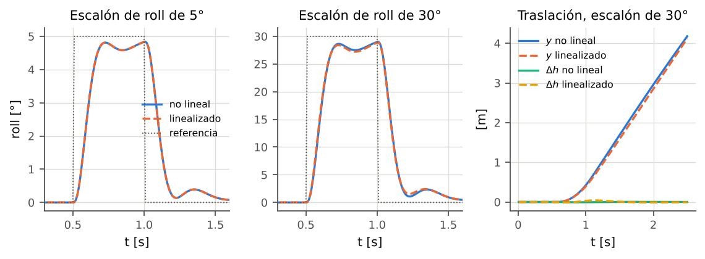
<figcaption>Lazo cerrado con la planta no lineal y con la linealizada en hover. Izquierda y centro: escalones de roll de 5\(^\circ\) y 30\(^\circ\). Derecha: desplazamiento lateral y cambio de altura durante el escalón de 30\(^\circ\).</figcaption>
</figure>

La lectura es la esperada y, por eso, informativa. Hasta 5$^\circ$ las dos plantas son indistinguibles (diferencias del 0.1 y 0.1 %); a 15$^\circ$ la diferencia en roll es del 0.8 % y a 30$^\circ$ del 2.1 %, y aparece sobre todo en la vuelta a cero, donde la proyección $\cos\phi$ del empuje y el acoplamiento con la altura empiezan a pesar. El modelo no lineal recupera la linealización en su dominio de validez, y se separa de ella de forma gradual y con el signo correcto fuera de él. Que la 3.ª edición use el modelo completo importa justamente en la figura en 8 rápida (sección 15), con inclinaciones de hasta 21.9$^\circ$.

# Sensores

El controlador no ve el estado; ve medidas. Un simulador que le entrega el estado verdadero al controlador permite sintonías que el dron real no tolera, porque oculta el ruido que amplifica el derivativo, el retardo que come margen de fase y la vibración que satura los motores. El módulo `sensors.py` modela los sensores del proyecto PAE con valores de hoja de datos, y cada medida se construye como $$\text{medida} = \text{verdad} + \text{sesgo} + \text{ruido blanco} + \text{vibración},
\quad \text{entregada con retardo y a su propia tasa.}$$ La IMU se muestrea a la tasa del lazo de control (500 Hz, $\Delta t=2$ ms).

## Ruido blanco y la densidad espectral

Las hojas de datos dan el ruido como densidad espectral $N$ (unidad por $\sqrt{\text{Hz}}$). Muestreado a $f_s$ con ancho de banda igual a Nyquist, la desviación por muestra es $$\sigma = N\sqrt{f_s/2} = N\sqrt{1/(2\Delta t)} .
\tag{9.2}$$ Con los valores de la tabla 9.1, a 500 Hz el giroscopio tiene $\sigma=0.079$ $^\circ$/s y el acelerómetro $\sigma=0.95$ m$g$ (0.0093 m/s$^2$). Son cifras pequeñas: en un dron real el ruido propio del MEMS lo tapa la vibración, y por eso esta es configurable por separado.

| Sensor                       | Modelo                                                                                                                                                                                | Fuente del valor                                                                                |
|:-----------------------------|:--------------------------------------------------------------------------------------------------------------------------------------------------------------------------------------|:------------------------------------------------------------------------------------------------|
| Giroscopio (ISM330DHCX)      | ruido $5$ m$^\circ$/s/$\sqrt{\text{Hz}}$; sesgo inicial $\mathcal N(0,0.3^\circ/\text{s})$ por eje; deriva de sesgo (paseo aleatorio) $0.005^\circ$/s/$\sqrt{\text{s}}$; retardo 2 ms | ruido: hoja de datos DS13012 \[22\]; sesgo y deriva: supuestos típicos                          |
| Acelerómetro (ISM330DHCX)    | ruido $60~\mu g/\sqrt{\text{Hz}}$; sesgo constante $\mathcal N(0,0.05~\text{m/s}^2)$; retardo 2 ms                                                                                    | ruido: DS13012; sesgo: supuesto                                                                 |
| Vibración de hélices         | $3^\circ$/s (giro) y 1.5 m/s$^2$ (acel.) a la velocidad de hover, 2 palas                                                                                                             | supuesto (sección 9.2)                                                                          |
| Magnetómetro (MMC5983MA)     | $\boldsymbol{m}_B=\mathbf{R}^{\mathsf{T}}\boldsymbol{m}_E+\boldsymbol{b}_{EMI}+\mathcal N(0,0.04~\mu\text{T})$, 100 Hz                                                                | ruido 0.4 mG RMS, hoja de datos \[23\]                                                          |
| Barómetro (BMP180)           | $h+$deriva$+\mathcal N(0,0.17~\text{m})$, 40 Hz, retardo 30 ms, deriva $0.002$ m/$\sqrt{\text{s}}$                                                                                    | 0.02 hPa RMS en ultra alta resolución \[24\] $\approx0.17$ m; tasa, retardo y deriva: supuestos |
| Posición externa (mocap/RTK) | $\boldsymbol{p}+\mathcal N(0,0.01~\text{m})$, 100 Hz, retardo 10 ms                                                                                                                   | supuesto; Larotta \[9\] usa un sistema externo de este tipo                                     |

Parámetros de los sensores (`SensorConfig`).

#### Sesgo del giroscopio.

El sesgo inicial se sortea una vez por semilla y luego deriva como paseo aleatorio, $b_{k+1}=b_k+\mathcal N(0,\sigma_{bw}\sqrt{\Delta t})$. Un sesgo de $0.3^\circ$/s parece poco, pero integrado sin corrección son $18^\circ$ en un minuto: es la razón de ser de los estimadores de la sección 11.

## Vibración a la frecuencia de paso de pala

Cada hélice de dos palas ligeramente desbalanceada sacude el bastidor dos veces por vuelta. El simulador lleva la fase $\varphi_i$ de cada rotor (integrada con $\Omega_i$ en cada subpaso de física) y suma al giroscopio y al acelerómetro $$\delta\boldsymbol{\omega}_{vib} = A_g\sum_{i=1}^4\left(\frac{\Omega_i}{\Omega_h}\right)^2\sin(n_b\varphi_i)\,\boldsymbol{d}_i,
\qquad
\delta\boldsymbol{a}_{vib} = A_a\sum_{i=1}^4\left(\frac{\Omega_i}{\Omega_h}\right)^2\sin(n_b\varphi_i)\,\boldsymbol{d}'_i,
\tag{9.3}$$ con $n_b=2$ palas, $A_g=3^\circ$/s, $A_a=1.5$ m/s$^2$, $\boldsymbol{d}_i$ una dirección unitaria aleatoria fija por rotor y $\boldsymbol{d}'_i$ la misma dirección con las componentes permutadas cíclicamente. La amplitud escala con $\Omega^2$ porque la fuerza centrífuga de un desbalance de masa crece con el cuadrado de la velocidad. La frecuencia del tono es $$f_{bp}=\frac{n_b\,\Omega}{2\pi}=177.4~\text{Hz en hover}.$$

#### Por qué importa a 500 Hz.

Con la IMU muestreada a 500 Hz el límite de Nyquist es 250 Hz. En hover el tono de 177 Hz cae por debajo y se ve tal cual; la densidad espectral del giroscopio simulado (figura 9.1) tiene su pico en 177.2 Hz, y la frecuencia media que reporta el simulador es 177.4 Hz. El tono se mueve con el acelerador, y para $\sigma>0.807$ ($\Omega>785.4$ rad/s) pasa de Nyquist y se *repliega*: a acelerador máximo, los 320.4 Hz reales aparecen a $500-320.4=179.6$ Hz (medido: 179.7 Hz). Un filtro notch fijo deja de servir justo cuando el dron más exige a sus motores. Los autopilotos comerciales muestrean el giroscopio a 1–8 kHz por esa razón; el lazo de 500 Hz del firmware ESP32 del proyecto obliga a convivir con el problema, y el simulador permite estudiarlo.

<figure id="fig:psd">
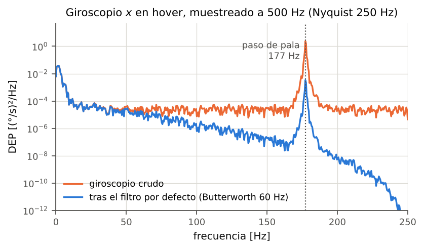
<figcaption>Densidad espectral del giroscopio \(x\) en hover (simulador completo, 9 s, 500 Hz). El RMS del giroscopio crudo es 1.58 \(^\circ\)/s y, tras el filtro por defecto (Butterworth de 60 Hz), 0.32 \(^\circ\)/s.</figcaption>
</figure>

> **Amplitud de la vibración.** Las amplitudes $A_g$ y $A_a$ y el espectro de un solo tono por rotor son supuestos de orden de magnitud. El estudio de barridos (sección 16) muestra que las conclusiones cualitativas sobre filtros no dependen de ellas, pero los valores óptimos sí: antes de transferir una sintonía de filtro al dron real hay que medir su espectro en hover y ajustar $A_g$.

## Campo magnético

El campo terrestre en NED geográfico se construye con intensidad $F$, inclinación $I$ (positiva hacia abajo) y declinación $D$: $$\boldsymbol{m}_E = F\,\big(\cos I\cos D,\ \cos I\sin D,\ \sin I\big)
= (26.66,\ -4.63,\ 18.53)~\mu\text{T},
\tag{9.5}$$ con $F=32.8~\mu$T, $I=+34.4^\circ$ y $D=-9.85^\circ$: el World Magnetic Model 2025 evaluado para Valledupar (10.46$^\circ$N, 73.25$^\circ$O, unos 170 m de altura), la ciudad más cercana a la sede La Paz, en la fecha 2026.75 (paquete `pygeomag`). El campo cambia lentamente con los años; para otra fecha o lugar se recalcula con el mismo modelo o con la calculadora de NOAA. El EKF usa la misma inclinación para su referencia magnética. La interferencia $\boldsymbol{b}_{EMI}$ la pone el módulo de perturbaciones (sección 13) y afecta solo a la medida: el dron no la siente, el estimador sí.

## Retardos y tasas

Cada sensor tiene una línea de retardo (`_Delay`) de $n=\max(1,\operatorname{round}(\tau/\Delta t))$ muestras de control: 1 para la IMU, 5 para la posición externa y 15 para el barómetro. Magnetómetro, barómetro y posición se actualizan a su tasa y mantienen el último valor entre actualizaciones; cada muestra lleva un indicador `*_new` para que los estimadores solo corrijan con datos nuevos.

> **Inicialización de las líneas de retardo.** Las líneas de retardo de la posición y del barómetro se construyen llenas con el origen y altura cero, lo correcto para un despegue desde el suelo. Si la simulación arranca en el aire (`start_airborne=True`), `Simulation._prime_airborne` llama a `SensorSuite.prime(x)`, que las llena con el estado inicial; sin ese paso, durante los primeros 10 ms (posición) y 30 ms (barómetro) los sensores reportarían “dron en el origen, en el suelo” y el filtro de navegación saltaría la altura completa.

# Filtros digitales del giroscopio

## Dónde están y qué filtran

La señal de tasa que llega al PID es la salida del estimador de actitud (giroscopio menos sesgo estimado) pasada por una cadena de filtros por eje (`Simulation.step_control`). Por defecto la cadena tiene dos etapas: la etapa 0 es un pasa-bajos Butterworth de 60 Hz y la etapa 1, un notch centrado en 177 Hz con $Q=2$ que viene apagado. El corte de 60 Hz (la 2.ª edición y las primeras versiones de este núcleo usaban 80 Hz) se fijó junto con el derivativo del lazo de tasa a partir del barrido conjunto de la sección 16: un corte más bajo quita más vibración y su retardo adicional lo compensa el adelanto de fase de un $k_d$ mayor (sección 12). El estimador de actitud recibe el giroscopio sin filtrar, como en PX4, porque integra la tasa y la integral de un tono de 177 Hz es despreciable. El *acelerómetro*, en cambio, sí se filtra antes del estimador, con un Butterworth de 30 Hz (`SimConfig.ahrs_accel_lpf_hz`), por la razón no lineal que explica la sección 11.

Todo filtro introduce retardo. El compromiso que el usuario debe resolver, y que los barridos automáticos de la sección 16 cuantifican, es cuánto ruido quitar a cambio de cuánto margen de fase perder en el lazo de tasa.

## El biquad

Todos los tipos son secciones de segundo orden (*biquad*) en forma directa II transpuesta, con los coeficientes del *Audio EQ Cookbook* de Bristow-Johnson \[21\], que corresponden a la transformación bilineal con la frecuencia de corte pre-distorsionada. Es el mismo filtro de Betaflight y PX4 sobre el giroscopio. La ecuación en diferencias (`Biquad.process`) es $$y_k = b_0x_k + z_1,\qquad
z_1 \leftarrow b_1x_k - a_1y_k + z_2,\qquad
z_2 \leftarrow b_2x_k - a_2y_k ,
\tag{10.1}$$ con $H(z)=\dfrac{b_0+b_1z^{-1}+b_2z^{-2}}{1+a_1z^{-1}+a_2z^{-2}}$. Llamando $\omega_0=2\pi f_c/f_s$ y $\alpha=\sin\omega_0/(2Q)$, y normalizando por $a_0=1+\alpha$: $$\begin{aligned}
\text{común:}\quad & a_1=\tfrac{-2\cos\omega_0}{a_0},\qquad a_2=\tfrac{1-\alpha}{a_0};\nonumber\\
\text{pasa-bajos:}\quad & b_0=b_2=\tfrac{1-\cos\omega_0}{2a_0},\qquad b_1=\tfrac{1-\cos\omega_0}{a_0};\tag{10.2}\\
\text{notch:}\quad & b_0=b_2=\tfrac{1}{a_0},\qquad b_1=\tfrac{-2\cos\omega_0}{a_0}.\tag{10.3}
\end{aligned}$$

#### Tipos.

**Butterworth** es el pasa-bajos con $Q=1/\sqrt2$ (máximamente plano). **Pasa-bajos** deja libre el $Q$: con $Q>0.707$ el filtro tiene un pico antes del corte pero menos retardo en la banda de paso. **Chebyshev I** de orden 2 con rizado $r_p$ dB: con $\varepsilon=\sqrt{10^{r_p/10}-1}$ y $v_0=\operatorname{asinh}(1/\varepsilon)/2$, el polo analógico normalizado es $s=-\sinh v_0\sin\frac{\pi}{4}\pm j\cosh v_0\cos\frac{\pi}{4}$; de su módulo $\omega_n$ y su parte real se obtienen $Q=\omega_n/(2|\Re s|)$ y la frecuencia de diseño $f_c\,\omega_n$, y con ellas se usa (10.2). Para 1 dB resulta $Q=0.957$. El código normaliza la ganancia continua a 0 dB (la verificación da 0.0 dB en continua y un máximo de $+1.0$ dB en la banda de paso): el rizado queda *por encima* de la ganancia unitaria, a diferencia del Chebyshev de libro de orden par, que tiene $-r_p$ dB en continua. **Notch** rechaza una banda angosta alrededor de $f_c$, tanto más angosta cuanto mayor es $Q$.

#### Detalles de robustez.

$f_c$ se acota a $0.98$ veces Nyquist y $Q\ge0.05$; `reset(x0)` inicializa el estado en el régimen permanente de una entrada constante (sin transitorio de arranque); `Simulation.set_filter`, que rediseña un filtro en pleno vuelo (desde la GUI o un barrido), lo reinicia así con la tasa actual, para que el cambio no produzca un escalón en la señal; si la salida no es finita, el filtro se reinicia y deja pasar la entrada.

## Compromiso atenuación–retardo

La tabla 10.1 y la figura 10.1 comparan, a $f_s=500$ Hz, el retardo de grupo en 10 Hz (la zona donde vive la dinámica del lazo de tasa) con la atenuación en la frecuencia de paso de pala.

|                             |                  |                      |                       |
|:----------------------------|:----------------:|:--------------------:|:---------------------:|
| Filtro                      | Retardo de grupo |         Fase         |      Atenuación       |
|                             |  a 10 Hz \[ms\]  | a 10 Hz \[$^\circ$\] |    a 177 Hz \[dB\]    |
| Butterworth 80 Hz           |       2.62       |         -9.3         |         -22.7         |
| Butterworth 60 Hz           |       3.67       |        -13.0         |         -28.4         |
| Pasa-bajos 40 Hz, $Q=0.707$ |       5.84       |        -20.2         |         -35.9         |
| Chebyshev I 80 Hz, 1 dB     |       1.84       |         -6.5         |         -21.3         |
| Notch 177 Hz, $Q=4$         |       0.12       |         -0.4         | $<-200$ (cero exacto) |

Retardo y atenuación de los filtros (calculados de la respuesta en frecuencia exacta de cada biquad, `Biquad.response`).

<figure id="fig:bode">
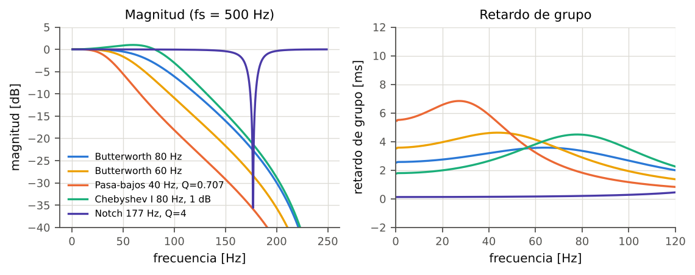
<figcaption>Magnitud y retardo de grupo de los filtros de la tabla 10.1.</figcaption>
</figure>

Bajar el corte de 80 a 60 Hz gana 6 dB de atenuación de la vibración a cambio de 1 ms de retardo; bajarlo a 40 Hz gana 13 dB y duplica el retardo. El notch, en cambio, anula el tono con un retardo más de diez veces menor que cualquier pasa-bajos, pero solo si está centrado: en la sección 16 se mide que un notch angosto descentrado 2 Hz pierde casi todo su beneficio, y el tono se mueve con el acelerador (sección 9.2).

## Filtro de primer orden

El término derivativo del PID usa un filtro de primer orden discreto (`control/pid.py`, y la clase `PT1` de `filters.py`): $$y_k = y_{k-1}+\alpha\,(x_k-y_{k-1}),\qquad \alpha=\frac{\Delta t}{\tau+\Delta t},\quad \tau=\frac{1}{2\pi f_c}.
\tag{10.4}$$

# Estimadores de actitud y de navegación

## El problema que resuelven

El giroscopio mide bien los cambios rápidos de actitud pero deriva: su sesgo, integrado, crece sin límite. El acelerómetro y el magnetómetro dan referencias absolutas (dirección de la gravedad y del norte magnético) pero ruidosas, perturbables y, en el caso del acelerómetro de un multirrotor, engañosas, como se verá enseguida. Un estimador de actitud (AHRS) fusiona las tres fuentes. El simulador ofrece cuatro, intercambiables en caliente (`estimators.py`): *ideal* (devuelve la verdad, sirve de línea base), Madgwick, Mahony y un filtro de Kalman extendido. El estimador por defecto es Mahony (`SimConfig.estimator`): con el acelerómetro filtrado fue el más equilibrado entre escalones de actitud, maniobras y seguimiento de trayectoria. Los tres reales comparten tres convenciones:

- la dirección de la gravedad medida en el cuerpo es $\hat{\boldsymbol{s}}_g=-\boldsymbol{a}/\|\boldsymbol{a}\|$ (en reposo el acelerómetro lee $(0,0,-g)$ en FRD);

- trabajan en un NED magnético y rotan la salida por la declinación (sección 2);

- se inicializan con la primera muestra (`triad_alignment`): roll y pitch del acelerómetro, $\phi_0=\operatorname{atan2}(-a_y,-a_z)$, $\theta_0=\operatorname{atan2}\big(a_x,\sqrt{a_y^2+a_z^2}\big)$, y rumbo del magnetómetro compensado por inclinación, $\psi_0=\operatorname{atan2}(-m_{h,y},m_{h,x})+D$, con $m_{h,x}=m_x\cos\theta_0+m_y\sin\phi_0\sin\theta_0+m_z\cos\phi_0\sin\theta_0$ y $m_{h,y}=m_y\cos\phi_0-m_z\sin\phi_0$.

> **Inicialización en el aire.** Si la simulación arranca en vuelo, la primera muestra trae la vibración de las hélices (hasta 1.5 m/s$^2$) y alinear con ella dejaba errores iniciales de varios grados ($\approx9^\circ$ de cabeceo medidos con Madgwick). Con `start_airborne=True`, `Simulation._prime_airborne` inicializa el estimador con la actitud verdadera. Es la hipótesis coherente con “arrancar en el aire”: el autopiloto real se alinea en tierra, con los motores apagados, antes de despegar, y llega al vuelo con el estimador convergido. Los sesgos y el ruido de los sensores se conservan; no es el estimador ideal.

## El acelerómetro de un multirrotor no mide la gravedad

La (4.9) dice que el acelerómetro mide $\boldsymbol{f}_{acc}=(\boldsymbol{f}_B+\mathbf{R}^{\mathsf{T}}\boldsymbol{F}_{ext})/m$: empuje más arrastre. En vuelo estacionario inclinado $15^\circ$ y sin velocidad, el modelo da $\boldsymbol{f}_{acc}=(0,\ 0,\ -9.80665)$, exactamente igual que nivelado: el roll aparente que deduce el acelerómetro es $0^\circ$. Leishman, Macdonald, Beard y McLain \[13\] lo explican con detalle: la idea de que el acelerómetro “mide la gravedad cuando no hay aceleración” falla en un multirrotor, porque inclinado *siempre* acelera horizontalmente (salvo que el arrastre lo equilibre), y lo que mide es la fuerza del rotor, alineada con $z_B$.

La consecuencia práctica es que, durante una aceleración sostenida, un AHRS que trate $-\boldsymbol{a}/\|\boldsymbol{a}\|$ como gravedad converge a “nivelado” y el lazo de actitud, que cree estar en el ángulo pedido, sigue inclinando el dron. El simulador implementa la corrección que usa PX4 (`ATT_ACC_COMP`): restar al acelerómetro la aceleración cinemática estimada por el filtro de navegación antes de pasarlo al AHRS (`SimConfig.acc_compensation`, activa por defecto con el dron armado y, como se explica más abajo, solo cuando el filtro de navegación recibe correcciones de posición absoluta). La cadena completa del acelerómetro hacia el AHRS (`Simulation.step_control`) es, por eje, $$\begin{gathered}
\boldsymbol{a}_{kin,E} = \operatorname{sat}_{0.8g}\Big(\mathcal{H}_{30}\Big\{\frac{\hat{\boldsymbol{v}}_k-\hat{\boldsymbol{v}}_{k-1}}{\Delta t}\Big\}\Big),\tag{11.1}\\
\boldsymbol{a}_{AHRS} = \mathcal{H}_{30}\{\boldsymbol{a}_{med}\} - \kappa\,\hat\mathbf{R}^{\mathsf{T}}\boldsymbol{a}_{kin,E},\qquad \kappa\in[0,1],\tag{11.2}
\end{gathered}$$ con $\mathcal H_{30}$ un Butterworth de segundo orden de 30 Hz (`SimConfig.ahrs_accel_lpf_hz`; 0 lo desactiva), que quita la vibración antes de la normalización $\boldsymbol{a}/\|\boldsymbol{a}\|$ (sección 11.6). La derivada de la velocidad estimada pasa por el *mismo* Butterworth que el acelerómetro, para que las dos señales que se restan lleguen con el mismo retardo, y su norma se recorta a $0.8g$. La ganancia $\kappa$ de la compensación sube o baja en rampa en 0.5 s (`acc_comp_ramp_s`), de modo que activarla o perderla en vuelo no produce un salto. Todo esto vive en `quadsim/estimation.py`, una sola cadena que usan la simulación y los barridos de estimadores. La rotación que aparece en (11.2) es la *estimada*, $\hat\mathbf{R}$, y no la verdadera: el AHRS no conoce otra. La edición anterior escribía el resultado como $\approx-g\,\mathbf{R}^{\mathsf{T}}\boldsymbol{e}_3$, y esa lectura solo vale si $\boldsymbol{a}_{kin,E}$ es la aceleración real medida por una vía independiente del acelerómetro y $\hat\mathbf{R}\approx\mathbf{R}$. En ese caso, con $\boldsymbol{f}_{acc}=\mathbf{R}^{\mathsf{T}}(\dot{\boldsymbol{v}}-g\boldsymbol{e}_3)$, $$\boldsymbol{a}_{AHRS}\approx\mathbf{R}^{\mathsf{T}}(\dot{\boldsymbol{v}}-g\boldsymbol{e}_3)-\hat\mathbf{R}^{\mathsf{T}}\dot{\boldsymbol{v}}\approx-g\,\mathbf{R}^{\mathsf{T}}\boldsymbol{e}_3,$$ y el AHRS recibe la dirección verdadera de la gravedad. El problema es de dónde sale $\boldsymbol{a}_{kin,E}$. El filtro de navegación predice con el *mismo* acelerómetro rotado con la actitud estimada, $\boldsymbol{a}_E=\hat\mathbf{R}\boldsymbol{f}_{acc}+g\boldsymbol{e}_3$ (ecuación (11.13)). Entre correcciones de posición, entonces, $\boldsymbol{a}_{kin,E}\approx\hat\mathbf{R}\boldsymbol{f}_{acc}+g\boldsymbol{e}_3$ y $$\boldsymbol{a}_{AHRS}\approx\boldsymbol{f}_{acc}-\hat\mathbf{R}^{\mathsf{T}}\big(\hat\mathbf{R}\boldsymbol{f}_{acc}+g\boldsymbol{e}_3\big)=-g\,\hat\mathbf{R}^{\mathsf{T}}\boldsymbol{e}_3:$$ el AHRS recibe su propia estimación de la gravedad. La compensación es *autorreferente*. La información real de gravedad solo entra a través del término de corrección del filtro de navegación, es decir, de las medidas de posición. Sin sensor de posición (solo barómetro, que no corrige el plano horizontal) roll y pitch dejan de ser observables, y con ellos el sesgo del giroscopio. La revisión externa lo reprodujo con Mahony en 30 s de vuelo estacionario, partiendo de una alineación perfecta: con sensor de posición y compensación el error de inclinación fue 0.45$^\circ$; solo con barómetro y compensación creció a 15.2$^\circ$ (unos 0.5$^\circ$/s) con 157 m de deriva horizontal; solo con barómetro y sin compensación quedó en 1.4$^\circ$.

De ahí la regla que aplica el núcleo (`AccelCompensation.wanted`): la compensación actúa solo si hubo una corrección *horizontal* de posición absoluta en los últimos 0.2 s (`acc_comp_fix_timeout_s`), si el dron está armado y en el aire y si el filtro de navegación ya se asentó (tras `settle` o 1 s después de un reinicio). En tierra, recién armado, la velocidad del navegador reiniciado producía una $\boldsymbol{a}_{kin,E}$ espuria de 1.6–2.8 m/s$^2$. Además, el filtro de navegación rechaza medidas de posición atípicas: las que superan 5 desviaciones estándar de la innovación predicha (`nav_gate_sigma`) y, a la vez, se alejan más de 25 cm de la predicción (`gate_min_m`). El piso absoluto evita que una predicción sesgada, por ejemplo por un rumbo estimado desviado, haga rechazar medidas buenas una tras otra (sección 15.10). Sin correcciones de posición el AHRS recibe el acelerómetro filtrado sin compensar, que se equivoca durante las aceleraciones sostenidas pero no deriva: en el mismo vuelo estacionario de 30 s, solo con barómetro, el error de inclinación pasó de 15.2 a 1.46$^\circ$ (prueba `test_baro_only_hover_keeps_tilt_estimate`). Es la situación del dron real del proyecto (ESP32 con BMP180 y sin captura de movimiento), así que la compensación, tal como está, no le sirve: haría falta estimar $\boldsymbol{a}_{kin,E}$ por una vía independiente (por ejemplo, la segunda derivada filtrada de una posición medida o la aceleración de referencia de la trayectoria) o una arquitectura acoplada en la que el error de actitud sea estado del filtro de navegación, como el EKF2 de PX4.

Hay un segundo límite, de sincronía. La versión anterior suavizaba $\boldsymbol{a}_{kin,E}$ con un filtro de primer orden fijo de 50 ms, que no dependía de `ahrs_accel_lpf_hz`, y la calculaba después del AHRS, de modo que se usaba un periodo tarde; el desfase frente a la ruta del acelerómetro era de 65.6 ms. Con el mismo Butterworth en las dos ramas y el cálculo antes del AHRS bajó a 17.0 ms. Lo que queda es el atraso propio de la velocidad del navegador: la posición llega con 10 ms de retardo y se fusiona como si fuera actual.

El filtrado suaviza la derivada de la velocidad estimada, que es ruidosa; la misma $\boldsymbol{a}_{kin,E}$ se entrega a los controladores de posición en `NavState.acc`. El filtro de navegación, en cambio, predice con el acelerómetro sin filtrar (ecuación (11.13)).

<figure id="fig:acc">
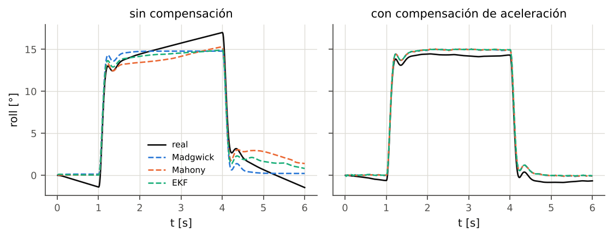
<figcaption>Roll real y estimado durante una inclinación sostenida de \(15^\circ\) (de \(t=1\) a 4 s), sin y con compensación de aceleración.</figcaption>
</figure>

La figura 11.1 y la tabla 11.1 muestran el efecto. Sin compensación, Mahony y el EKF “ven” 15$^\circ$ mientras el dron real llega a unos 31–34$^\circ$; con compensación el error máximo de los tres queda por debajo de 1$^\circ$. Madgwick sin compensación se equivoca poco (2.2$^\circ$) por una razón que no es mérito: con $\beta=0.015$ su corrección por gravedad es tan lenta que en 3 s apenas se aparta de la integración del giroscopio. Esa misma lentitud es la que lo atrasa en maniobras largas.

|                      |    Sin compensación    |                        |    Con compensación    |                        |
|:---------------------|:----------------------:|:----------------------:|:----------------------:|:----------------------:|
| 2-3(lr)4-5 Estimador | error máx \[$^\circ$\] | roll real \[$^\circ$\] | error máx \[$^\circ$\] | roll real \[$^\circ$\] |
| Madgwick             |          2.2           |          17.0          |          0.8           |          14.3          |
| Mahony               |          21.5          |          36.2          |          0.8           |          14.3          |
| EKF                  |          15.4          |          30.3          |          0.8           |          14.2          |

Inclinación sostenida de $15^\circ$ durante 3 s (bloque I): error máximo del roll estimado y roll real al final del tramo.

## Madgwick

Madgwick, Harrison y Vaidyanathan \[10\] plantean la corrección como un paso de descenso por gradiente sobre el error entre direcciones medidas y predichas. Con $\boldsymbol{d}$ una dirección de referencia en $\{E\}$ y $\boldsymbol{s}$ su medida en $\{B\}$, el residuo es $\boldsymbol{f}(\boldsymbol{q})=\mathbf{R}(\boldsymbol{q})^{\mathsf{T}}\boldsymbol{d}-\boldsymbol{s}$ y su jacobiano analítico (`_jac_rot_inv`), con $\boldsymbol{q}=(w,\boldsymbol{u})$: $$\frac{\partial(\mathbf{R}^{\mathsf{T}}\boldsymbol{d})}{\partial w}=-2\,\boldsymbol{u}\times\boldsymbol{d},\qquad
\frac{\partial(\mathbf{R}^{\mathsf{T}}\boldsymbol{d})}{\partial\boldsymbol{u}}=2w\,[\boldsymbol{d}]_{\times}+2\big((\boldsymbol{u}\cdot\boldsymbol{d})I+\boldsymbol{u}\boldsymbol{d}^{\mathsf{T}}-2\boldsymbol{d}\boldsymbol{u}^{\mathsf{T}}\big).
\tag{11.3}$$ El código usa dos pares: gravedad, $\boldsymbol{d}_g=\boldsymbol{e}_3$ con $\boldsymbol{s}=\hat{\boldsymbol{s}}_g$; y campo magnético, $\boldsymbol{d}_m=\boldsymbol{b}$ con $\boldsymbol{s}=\hat{\boldsymbol{m}}$, donde la referencia se reconstruye de la propia medida: $\boldsymbol{h}=\mathbf{R}\hat{\boldsymbol{m}}$, $\boldsymbol{b}=(\sqrt{h_x^2+h_y^2},\,0,\,h_z)$. La actualización (`MadgwickEstimator.update`) es $$\nabla=\sum_j J_j^{\mathsf{T}}\boldsymbol{f}_j,\qquad
\dot{\boldsymbol{q}}=\tfrac12\boldsymbol{q}\otimes[0,\boldsymbol{\omega}_{med}]-\beta\,\frac{\nabla}{\|\nabla\|},\qquad
\boldsymbol{q}\leftarrow\frac{\boldsymbol{q}+\dot{\boldsymbol{q}}\,\Delta t}{\|\boldsymbol{q}+\dot{\boldsymbol{q}}\,\Delta t\|},
\tag{11.4}$$ con $\beta=0.015$ rad/s por defecto. Dos rasgos importan al interpretar resultados. El primero es que el paso de corrección está *normalizado*: su magnitud es siempre $\beta$, sea grande o pequeño el error. Con un acelerómetro limpio (filtrado y compensado) el término correctivo se comporta casi como un relé de amplitud $\beta$, y un $\beta$ grande produce un ciclo límite que el lazo de actitud amplifica. Se midió en lazo cerrado con el núcleo actual: en la figura en 8 con el PID de posición, $\beta=0.1$ da 12.2 cm de RMSE, $\beta=0.03$ da 4.1 cm y $\beta=0.015$, 2.7 cm; en el escalón de roll, $\beta=0.12$ deja 2.5$^\circ$ de error de estimación. Por eso el valor por defecto es pequeño. El precio es que, en maniobras sostenidas agresivas, el estimador se atrasa. Este valor no coincide con el óptimo del barrido de $\beta$ (0.10–0.15, sección 16): aquel barrido midió el error de estimación *en sombra* con la cadena de entonces, con el acelerómetro crudo y sin realimentación del estimador sobre el vuelo, y el ciclo límite solo aparece cuando el estimador cierra el lazo. El segundo rasgo es que esta implementación es la versión sin compensación de deriva del giroscopio (el término $\zeta$ de la sec. 3.4 del artículo no está): el sesgo no se estima y `rates()` entrega el giroscopio crudo.

## Mahony

Mahony, Hamel y Pflimlin \[11\] formulan un filtro complementario no lineal en $SO(3)$ con acción proporcional e integral. El error es el producto cruz entre direcciones medidas y predichas: $$\boldsymbol{e}=\hat{\boldsymbol{s}}_g\times(\mathbf{R}^{\mathsf{T}}\boldsymbol{e}_3)\ +\ \hat{\boldsymbol{m}}\times(\mathbf{R}^{\mathsf{T}}\boldsymbol{b}),
\tag{11.5}$$ con $\boldsymbol{b}$ construido como en Madgwick. La corrección y el integrador (`MahonyEstimator.update`): $$\boldsymbol{I}\leftarrow\boldsymbol{I}+k_i\,\boldsymbol{e}\,\Delta t,\qquad
\hat{\boldsymbol{b}}_g=-\boldsymbol{I},\qquad
\boldsymbol{\omega}_c=\boldsymbol{\omega}_{med}+k_p\boldsymbol{e}+\boldsymbol{I},\qquad
\boldsymbol{q}\leftarrow\operatorname{norm}\!\big(\boldsymbol{q}+\tfrac12\boldsymbol{q}\otimes[0,\boldsymbol{\omega}_c]\Delta t\big),
\tag{11.6}$$ con $k_p=1$ rad/s y $k_i=0.05$ rad/s$^2$ por defecto. El integrador es exactamente el sesgo estimado del giroscopio, con el signo cambiado, y se recorta al mismo tope que usa el EKF para el sesgo.

#### Magnetómetro solo para el rumbo.

Tal como están escritas, (11.4) y (11.5) dejan que el magnetómetro corrija los tres ejes. Con una interferencia fuerte, que tiene componente vertical, eso inclina también roll y pitch. En Madgwick y Mahony el código proyecta la corrección magnética sobre el eje vertical terrestre expresado en el cuerpo, como hace el estimador de actitud de PX4 (`attitude_estimator_q`), de modo que el magnetómetro solo mueve el rumbo. En el escenario `estimator_accuracy` con 40 $\mu$T de EMI, el error de inclinación de Mahony bajó de 9.67 a 1.59$^\circ$ RMS y el de Madgwick de 2.9 a 1.1$^\circ$; sin EMI la proyección cuesta unos 0.03$^\circ$, porque el campo correcto también aportaba algo de información de inclinación. El EKF no lleva esta proyección.

## Filtro de Kalman extendido (7 estados)

El EKF (`EKFEstimator`) usa el estado $\boldsymbol{x}=[\boldsymbol{q}^{\mathsf{T}},\boldsymbol{b}_g^{\mathsf{T}}]^{\mathsf{T}}$ con formulación aditiva sobre el cuaternión y renormalización, en la línea de Sabatini \[12\].

#### Predicción.

Con $\boldsymbol{\omega}=\boldsymbol{\omega}_{med}-\boldsymbol{b}_g$, $$\begin{gathered}
\bar{\boldsymbol{q}}=\operatorname{norm}\big(\boldsymbol{q}+\Omega(\boldsymbol{\omega})\boldsymbol{q}\,\Delta t\big),\qquad
\Omega(\boldsymbol{\omega})=\frac12\begin{bmatrix}0&-\omega_x&-\omega_y&-\omega_z\\
\omega_x&0&\omega_z&-\omega_y\\ \omega_y&-\omega_z&0&\omega_x\\ \omega_z&\omega_y&-\omega_x&0\end{bmatrix},\\
F=\begin{bmatrix}I_4+\Omega\Delta t & -\Xi(\boldsymbol{q})\Delta t\\ 0 & I_3\end{bmatrix},\qquad
\Xi(\boldsymbol{q})=\frac12\begin{bmatrix}-q_x&-q_y&-q_z\\ q_w&-q_z&q_y\\ q_z&q_w&-q_x\\ -q_y&q_x&q_w\end{bmatrix},\\
P\leftarrow FPF^{\mathsf{T}}+Q,\qquad Q=\operatorname{diag}\big(\sigma_g^2\Delta t^2\,\Xi\Xi^{\mathsf{T}},\ \ \sigma_{bw}^2\Delta t\,I_3\big),
\end{gathered}$$ con $\sigma_g=0.02$ rad/s y $\sigma_{bw}=0.0002$ rad/s/$\sqrt{\text{s}}$ por defecto, y $P_0=\operatorname{diag}(10^{-3}I_4,\,10^{-4}I_3)$.

#### Corrección.

Medidas: la dirección de la gravedad en cada paso, y la dirección del campo magnético solo cuando hay muestra nueva (100 Hz). A diferencia de Madgwick y Mahony, la referencia magnética es fija y conocida, $\boldsymbol{m}_{ref}=(\cos I,0,\sin I)$ en el NED magnético: $$\begin{gathered}
\boldsymbol{z}=\begin{bmatrix}\hat{\boldsymbol{s}}_g\\ \hat{\boldsymbol{m}}\end{bmatrix},\quad
\boldsymbol{h}(\bar{\boldsymbol{q}})=\begin{bmatrix}\mathbf{R}^{\mathsf{T}}\boldsymbol{e}_3\\ \mathbf{R}^{\mathsf{T}}\boldsymbol{m}_{ref}\end{bmatrix},\quad
H=\begin{bmatrix}J(\bar{\boldsymbol{q}},\boldsymbol{e}_3) & 0\\ J(\bar{\boldsymbol{q}},\boldsymbol{m}_{ref}) & 0\end{bmatrix},\\
R=\operatorname{diag}\big(\sigma_a^2\,(1+k_{ad}\,\big|\|\boldsymbol{a}\|-g\big|/g)^2\,I_3,\ \ \sigma_m^2I_3\big),\\
K=PH^{\mathsf{T}}(HPH^{\mathsf{T}}+R)^{-1},\quad \boldsymbol{x}\leftarrow\boldsymbol{x}+K(\boldsymbol{z}-\boldsymbol{h}),\quad
P\leftarrow\tfrac12\big[(I-KH)P+((I-KH)P)^{\mathsf{T}}\big],
\end{gathered}$$ con $J$ de (11.3), $\sigma_a=0.5$, $\sigma_m=0.3$ (adimensionales: son ruidos sobre direcciones unitarias) y $k_{ad}=4$. Los valores de $\sigma_a$ y $\sigma_m$ son los que el barrido de la sección 16 encontró robustos frente a interferencia magnética; los primeros valores del núcleo (0.05 y 0.05) confiaban demasiado en un acelerómetro que la vibración desvía en $1.5/9.8\approx0.15$ de dirección, y demasiado poco en la medida magnética. El factor adaptativo infla la covarianza del acelerómetro cuando su norma se aleja de $g$, es decir, en maniobra. Tras la corrección se renormaliza el cuaternión y el sesgo se acota a $\pm0.2$ rad/s.

## Resultados en vuelo estacionario

La tabla 11.2 resume 10 s de vuelo estacionario en modo actitud (después de 2 s de asentamiento), con y sin vibración.

| Estimador | Vibración |    roll     |    pitch    |     yaw     |
|:----------|:----------|:-----------:|:-----------:|:-----------:|
| Madgwick  | sí        | 0.68 / 0.06 | 0.21 / 0.05 | 0.43 / 0.02 |
|           | no        | 0.68 / 0.06 | 0.21 / 0.05 | 0.43 / 0.02 |
| Mahony    | sí        | 0.62 / 0.06 | 0.10 / 0.06 | 0.42 / 0.04 |
|           | no        | 0.62 / 0.06 | 0.10 / 0.06 | 0.42 / 0.04 |
| EKF       | sí        | 0.53 / 0.13 | 0.00 / 0.13 | 0.31 / 0.03 |
|           | no        | 0.53 / 0.13 | 0.01 / 0.13 | 0.31 / 0.03 |

Error del estimador en hover, media / desviación estándar \[$^\circ$\] (bloque I, semilla 1).

Con el núcleo actual los tres estimadores quedan por debajo de $0.65^\circ$ de error medio y de $0.15^\circ$ de desviación, y los resultados con y sin vibración son prácticamente iguales: el pasa-bajos del acelerómetro y el filtro del giroscopio la retiran. El error medio que queda (0.5–0.6$^\circ$ en roll) es un sesgo lento, del orden de los $0.3^\circ$ del sesgo inicial del acelerómetro ($0.05/9.8$ rad) más el resto de la rectificación. Con el núcleo anterior el cuadro era otro: Madgwick deambulaba con 1–2$^\circ$ de desviación y el EKF con vibración llegaba a $1.6^\circ$; el paso normalizado de Madgwick con $\beta=0.08$ y el $\sigma_a=0.05$ del EKF explicaban la diferencia.

#### Sesgo por rectificación de la vibración.

 Esta es la razón del pasa-bajos de (11.2). La normalización $\boldsymbol{a}/\|\boldsymbol{a}\|$ es no lineal: si la vibración $\boldsymbol{n}$ de cada rotor actúa a lo largo de una dirección fija con componentes vertical y horizontal, el término de segundo orden $-(\boldsymbol{n}\cdot\hat{\boldsymbol{g}})\boldsymbol{n}_\perp/g^2$ tiene media no nula, del orden de $A_a^2/(4g^2)\approx0.34^\circ$ por rotor. El bloque I2 lo mide desactivando el filtro (`ahrs_accel_lpf_hz = 0`): el error medio de inclinación (4 semillas, 5 s en hover) es 1.26$^\circ$ con Madgwick, 0.52$^\circ$ con Mahony y 0.63$^\circ$ con el EKF. Con el Butterworth de 30 Hz del núcleo (el equivalente de `IMU_ACCEL_CUTOFF` de PX4) baja a 0.54, 0.51 y 0.48$^\circ$. La verificación de la 3.ª edición detectó este sesgo y el filtro se incorporó al núcleo a raíz de ello.

## Filtro de navegación

Los controladores de posición necesitan posición y velocidad estimadas. `NavEstimator` es un Kalman lineal independiente por eje con estado $[p,v]$, el esqueleto lineal del EKF2 de PX4. Predice con la aceleración medida llevada al marco inercial con la actitud *estimada*, $$\boldsymbol{a}_E=\hat\mathbf{R}\,\boldsymbol{a}_{med}+g\boldsymbol{e}_3,\qquad
\begin{bmatrix}p\\v\end{bmatrix}_{k+1}=\begin{bmatrix}1&\Delta t\\0&1\end{bmatrix}\begin{bmatrix}p\\v\end{bmatrix}_k+\begin{bmatrix}\Delta t^2/2\\ \Delta t\end{bmatrix}a_E,\qquad
P\leftarrow FPF^{\mathsf{T}}+G\,q_a^2\,G^{\mathsf{T}},
\tag{11.13}$$ con $q_a=0.5$ m/s$^2$ (`SimConfig.nav_accel_noise`, un valor de diseño que cubre sobre todo la vibración y el error de actitud, no el ruido blanco del acelerómetro), y corrige con el sensor de posición externo ($\sigma=0.01$ m, tres ejes) cuando llega una muestra nueva o, si no, con el barómetro ($\sigma=0.17$ m, solo $z$). Un error de actitud de $\delta$ radianes inyecta $g\,\delta$ de aceleración horizontal falsa en la predicción: el estimador de navegación hereda los errores del AHRS, y esa es una de las razones por las que el error de seguimiento depende del estimador de actitud (sección 15).

> **Detalles de implementación del filtro de navegación.**
>
> - El barómetro se fusiona aunque el sensor de posición esté activo: la condición es *posición nueva* o, en su defecto, *barómetro nuevo*, y como las dos tasas no están sincronizadas, en 10 s se registraron 3000 correcciones de posición y 308 de barómetro. El efecto es despreciable porque $\sigma_{baro}\gg\sigma_{pos}$: el error RMS de la altura estimada en 60 s es 2.61 mm con esa fusión y 2.61 mm sin ella.
>
> - `reset` deja $P=0.1\,I$; con esa covarianza inicial la ganancia sobre la velocidad es grande durante unos 0.5 s y la velocidad estimada tiene 5–8 cm/s de ruido. En un arranque en el aire, `NavEstimator.settle` itera el propio filtro durante 2 s con la medida exacta y lleva $P$ a régimen sin cambiar el estado.

# Control de bajo nivel

## Arquitectura en cascada

El control de actitud es una cascada de tres niveles, la misma de PX4, del firmware ESP32 del proyecto y de la descripción que hace Larotta \[9\] (p. 57) del Crazyflie (`control/attitude.py`): $$\underset{\scriptscriptstyle \text{actitud}}{(\phi,\theta,\psi)_{ref}}
\xrightarrow{\ \text{P}\ }
\underset{\scriptscriptstyle \text{tasas de Euler}}{(\dot\phi,\dot\theta,\dot\psi)_{ref}}
\xrightarrow{\ W\ }
\underset{\scriptscriptstyle \text{tasa}}{\boldsymbol{\omega}_{ref}}
\xrightarrow{\ \text{PID}\ }
\underset{\scriptscriptstyle \text{momento norm.}}{u\in[-1,1]^3}
\xrightarrow{\ \times\tau_{max}\ }
\boldsymbol{\tau}
\xrightarrow{\ \text{mezclador}\ }\sigma_{1..4}.
\tag{12.1}$$ La cascada funciona porque las constantes de tiempo están separadas: el lazo de tasa ve un integrador rápido (ecuación (8.5)) y el de ángulo ve el lazo de tasa cerrado como un retardo corto. Powers, Mellinger y Kumar \[4\] (p. 317) lo justifican desde la linealización en hover: a ángulos pequeños el control de actitud se desacopla del de posición y admite lazos anidados.

#### Lazo de ángulo.

Proporcional puro sobre el error de cada ángulo de Euler (el de yaw envuelto a $(-\pi,\pi]$ para girar por el camino corto), más una prealimentación de tasa de yaw opcional: $$\dot\phi_{ref}=K_{\phi}(\phi_{ref}-\hat\phi),\quad
\dot\theta_{ref}=K_{\theta}(\theta_{ref}-\hat\theta),\quad
\dot\psi_{ref}=K_{\psi}\operatorname{wrap}(\psi_{ref}-\hat\psi)+\dot\psi_{ff},$$ convertido a tasa del cuerpo con (3.6) y acotado a $220^\circ$/s en roll y pitch y $120^\circ$/s en yaw. No lleva integrador: el lazo de tasa interno ya tiene uno, y un segundo integrador sobre una planta integradora solo agrega sobreimpulso.

#### Lazo de tasa.

Un PID por eje (`control/pid.py`) cuya salida es el momento normalizado $u$; el momento físico es $\tau=u\,\tau_{max}$ con $\tau_{max}$ de (5.7). Normalizar es la convención de PX4 (`MC_ROLLRATE_P` está en momento normalizado por rad/s) y tiene una ventaja práctica: las ganancias de vehículos con inercias que difieren en tres órdenes de magnitud quedan en el mismo rango numérico.

## El PID discreto

En cada periodo $\Delta t$ (`PID.update`): $$\begin{aligned}
e_k&=r_k-y_k,\nonumber\\
I_k&=\begin{cases}I_{k-1} & \text{si la salida está saturada y } e_k\,u_{k-1}>0\\
\operatorname{sat}_{\pm i_{lim}/k_i}\!\big(I_{k-1}+e_k\Delta t\big) & \text{en otro caso}\end{cases}\tag{12.3}\\
d_k&=d_{k-1}+\alpha_d\Big(-\frac{y_k-y_{k-1}}{\Delta t}-d_{k-1}\Big),\qquad \alpha_d=\frac{\Delta t}{\tau_d+\Delta t},\ \tau_d=\frac{1}{2\pi f_d}\nonumber\\
u_k&=\operatorname{sat}_{\pm u_{lim}}\big(k_pe_k+k_iI_k+k_dd_k+k_{ff}r_k\big).\nonumber
\end{aligned}$$ Cada protección responde a una falla real. La derivada sobre la *medida*, y no sobre el error, evita el golpe derivativo cuando la referencia salta. El filtro del derivativo ($f_d=40$ Hz nominales en el lazo de tasa) evita que la vibración llegue amplificada a los motores. Se discretiza como en Betaflight, $\alpha=\Delta t/(\tau+\Delta t)$, y esa fórmula no da el corte nominal: a 500 Hz el corte efectivo es 32.4 Hz, con unos 4.9 ms de retardo en baja frecuencia. Se conserva por compatibilidad con las ganancias afinadas; la opción `d_filter_exact` de la clase `PID` usa $\alpha=1-e^{-2\pi f_d\Delta t}$, cuyo corte coincide con el nominal. Cuál de las dos usa el firmware del dron está por verificar. La integración condicional congela el integrador cuando la salida está saturada y el error empuja hacia el mismo lado (*anti-windup*), y el límite absoluto $|k_iI|\le i_{lim}=0.3$ acota cuánto momento puede acumular. En el lazo de tasa $u_{lim}=1$.

## Sintonía SIMC a partir del modelo

Las ganancias por defecto no están escritas a mano: `control/tuning.py` las calcula con las reglas SIMC de Skogestad \[14\] a partir de los parámetros físicos, de modo que cambiar de vehículo cambia las ganancias. SIMC tiene un solo parámetro libre, la constante de tiempo de lazo cerrado deseada $\tau_c$, con interpretación física directa; es más fácil de defender ante evaluadores que una sintonía por optimización de caja negra, y produce márgenes de robustez razonables por construcción (Ziegler–Nichols, en comparación, da sobreimpulsos del orden del 25 % \[15\]).

#### Modelo de diseño del lazo de tasa.

Linealizando en hover (sección 8) cada eje es un integrador, y los retardos de la cadena se agrupan con la “regla de la mitad” de SIMC (la mitad de la constante de tiempo despreciada se suma al retardo): $$\frac{\omega(s)}{u(s)}=\frac{K\,e^{-\theta s}}{s},\qquad
K=\frac{\tau_{max}}{J},\qquad
\theta=\underset{\scriptscriptstyle 2\ \text{ms}}{\tau_{IMU}}+\underset{\scriptscriptstyle 1\ \text{ms}}{\Delta t/2}+\underset{\scriptscriptstyle 3\ \text{ms}}{\tau_{filtro}}+\underset{\scriptscriptstyle 10\ \text{ms}}{T_m/2}=16~\text{ms}.
\tag{12.4}$$ Esa es la cadena *nominal* con la que se afinaron y documentaron las ganancias por defecto: 2 ms de IMU y 3 ms fijos de filtro, el retardo del Butterworth de 80 Hz de las primeras versiones (2.62 ms de retardo de grupo a 10 Hz, tabla 10.1). Con el filtro actual, Butterworth de 60 Hz, el retardo de grupo a 10 Hz es 3.67 ms. `chain_delay` también sabe leer la cadena *configurada* (`Simulation.attitude_chain`): retardo de la IMU de `SensorConfig`, retardo de grupo de las etapas de filtro de cada eje evaluado en el cruce estimado (que depende de $\theta$ y se resuelve por punto fijo), retardo de cómputo y retardo del ESC. Con la configuración por defecto da $\theta=16.6$ ms en lugar de 16.0, y un $K_p$ de tasa 3.6 % menor. La simulación solo usa la cadena configurada si se pide (`SimConfig.gains_from_chain`), para que las ganancias no cambien en silencio durante un barrido de filtros, donde el filtro varía con las ganancias fijas. Dos cosas quedan fuera de $\theta$ por diseño: el filtro del derivativo, que solo afecta a esa rama, y la forma exacta del rezago del motor. La regla de la mitad reparte $T_m/2=10$ ms, cuando el motor de primer orden aporta en la frecuencia de cruce más fase que esa. Las ganancias SIMC son, por eso, un punto de partida; los márgenes reales del lazo se discuten en la sección 14. Para el PAE-X450, $K_x=147.8$, $K_y=149.1$ y $K_z=9.34$ rad/s$^2$.

#### Reglas.

Para un integrador con retardo, SIMC da un PI $$K_c=\frac{1}{K(\tau_c+\theta)},\qquad T_i=4(\tau_c+\theta),\qquad k_i=\frac{K_c}{T_i},
\qquad \tau_c=\theta .
\tag{12.5}$$ La elección $\tau_c=\theta$ es la recomendación “ajustada” de Skogestad (margen de ganancia $\approx3$, margen de fase $\approx47^\circ$). El código agrega un derivativo en roll y pitch, $k_d=K_c\,\theta$ (es decir, $T_d=\theta$), porque la planta real tiene el rezago del motor que la regla de la mitad solo reparte y que el derivativo compensa con adelanto de fase; en yaw $k_d=0$. El factor no viene de SIMC sino de los barridos automáticos (sección 16): la primera versión usaba $k_d=K_c\theta/3$, y frente a un doblete de *tasa* ese derivativo dejaba un 20 % de sobreimpulso; con $K_c\theta$ y el filtro de 60 Hz baja a cerca del 6 %, a costa de un 7 % más de actividad de alta frecuencia en los motores. El lazo de ángulo es proporcional, diseñado sobre $1/s$ con el lazo de tasa cerrado visto como un retardo $\tau_{cl}=\tau_c+\theta$ y una constante de lazo cerrado $3\tau_{cl}$: $$K_{ang}=\frac{1}{3\tau_{cl}+\tau_{cl}}=\frac{1}{4\tau_{cl}}.
\tag{12.6}$$

#### Con los números del PAE-X450.

$\theta=16$ ms y $\tau_c+\theta=32$ ms, de modo que $$\begin{aligned}
\text{roll:}&\quad K_c=\frac{1}{147.8\cdot0.032}=0.2114,\quad T_i=0.128~\text{s},\quad k_i=1.6515,\quad k_d=0.00338;\\
\text{pitch:}&\quad K_c=0.2096,\quad k_i=1.6378,\quad k_d=0.00335;\\
\text{yaw:}&\quad K_c=3.3459,\quad k_i=26.140,\quad k_d=0;\\
\text{ángulo:}&\quad K_{ang}=\frac{1}{4\cdot0.032}=7.812~\text{s}^{-1}\ \text{(los tres ejes)}.
\end{aligned}$$ Como comprobación, la frecuencia de cruce del lazo de tasa de roll es $K_cK=31.25$ rad/s $=1/(\tau_c+\theta)$, como prescribe SIMC. En unidades físicas, $K_c\tau_{max}=0.753$ N·m por rad/s. El $K_c$ de yaw es 16 veces mayor que el de roll porque su planta es 16 veces más lenta ($K_z\ll K_x$): las ganancias normalizadas absorben la diferencia de autoridad.

#### Respuesta medida.

En el simulador completo (estimador ideal, sensores sin ruido), un escalón de roll de $10^\circ$ tiene un tiempo de subida del 10 al 90 % de 130 ms, sobreimpulso 0.00 % y error final $1.8\times10^{-3}$$^\circ$. La subida es más rápida que la que sugiere el objetivo de diseño (una constante de lazo cerrado de $3\tau_{cl}=96$ ms daría $2.2\times96\approx210$ ms de subida), señal de que la regla de la mitad sobrestima el retardo efectivo: el diseño queda del lado conservador. Con un estimador real en el lazo, la identificación de la sección 15 da un primer orden con retardo de $59.8~\text{ms}+43~\text{ms}$ para el lazo de actitud cerrado.

## Lazo vertical

En modo actitud, la altura se controla con una cascada posición–velocidad que corre en el lazo externo (100 Hz) y entrega una aceleración vertical deseada hacia arriba (`VerticalController`): $$\begin{gathered}
\dot h_{ref}=\operatorname{sat}_{\pm2.5}\big(K_h(h_{ref}-\hat h)\big),\qquad
a_{up}=\text{PI}\big(\dot h_{ref}-\hat{\dot h}\big)\in[-6,6]~\text{m/s}^2,\\
T=\operatorname{sat}_{[0,\,0.95T_{max}]}\frac{m\,(g+a_{up})}{\max(\cos\hat\phi\cos\hat\theta,\ 0.5)} .
\end{gathered}
\tag{12.7}$$ La división por $\cos\phi\cos\theta$ compensa la pérdida de empuje vertical al inclinarse (con un tope en $60^\circ$ de inclinación equivalente). Con la compensación de masa, la planta entre $a_{up}$ y $\dot h$ es un integrador con ganancia 1; las ganancias salen de las mismas reglas con un retardo supuesto de 50 ms y $\tau_c=2.5\theta$: $K_h=1.429$ s$^{-1}$, $k_p=5.714$ s$^{-1}$ y $k_i=8.163$ s$^{-2}$.

## De la aceleración deseada a empuje y actitud: planitud diferencial

Los cinco controladores de posición (sección 15) entregan una aceleración deseada $\boldsymbol{a}_{des}$ en NED, y una sola función (`acceleration_to_attitude`) la convierte en empuje y actitud de referencia. Mellinger y Kumar \[16\] mostraron que el cuadricóptero es diferencialmente plano con salidas planas $(\boldsymbol{p},\psi)$: la actitud y el empuje quedan determinados por la aceleración y el rumbo. De (4.2) sin arrastre, la fuerza que debe producir el empuje es $$\boldsymbol{F}=m\,(\boldsymbol{a}_{des}-g\boldsymbol{e}_3),\qquad F_z\le-0.1\,mg,
\qquad \|\boldsymbol{F}_{xy}\|\le|F_z|\tan\theta_{max},
\tag{12.8}$$ donde la primera cota impide pedir empuje hacia abajo y la segunda limita la inclinación a $\theta_{max}=30^\circ$ (`SimConfig.tilt_max_deg`). El simulador pasa ese mismo límite a `acceleration_to_attitude` para todos los controladores, de modo que ninguno puede inclinar más que otro. Como el empuje actúa a lo largo de $-z_B$: $$\boldsymbol{z}_B=-\frac{\boldsymbol{F}}{\|\boldsymbol{F}\|},\quad
\boldsymbol{x}_c=(\cos\psi_{ref},\sin\psi_{ref},0),\quad
\boldsymbol{y}_B=\frac{\boldsymbol{z}_B\times\boldsymbol{x}_c}{\|\boldsymbol{z}_B\times\boldsymbol{x}_c\|},\quad
\boldsymbol{x}_B=\boldsymbol{y}_B\times\boldsymbol{z}_B,
\tag{12.9}$$ y de $\mathbf{R}=[\boldsymbol{x}_B\ \boldsymbol{y}_B\ \boldsymbol{z}_B]$ se leen $\theta=-\arcsin x_{B,z}$, $\phi=\operatorname{atan2}(y_{B,z},z_{B,z})$, $\psi=\operatorname{atan2}(x_{B,y},x_{B,x})$ y $T=\|\boldsymbol{F}\|$. Con el PAE-X450, pedir 1 m/s$^2$ hacia el norte da $\theta=-5.82^\circ$ (morro abajo) y $T=13.80$ N; 2 m/s$^2$ hacia el este da $\phi=11.53^\circ$. Ambos coinciden con $\arctan(a/g)$ y $m\sqrt{g^2+a^2}$.

Usar una conversión común es lo que hace justa la comparación: los cinco controladores ven la misma planta, los mismos sensores, el mismo estimador y el mismo bajo nivel, y solo difieren en cómo calculan $\boldsymbol{a}_{des}$.

# Perturbaciones

Las perturbaciones se priorizaron según cuánto afectan a un multirrotor pequeño en la práctica: viento primero, interferencia electromagnética en el magnetómetro después y cambios de masa o carga en tercer lugar. `disturbances.py` las implementa en ese orden, más una falla parcial de motor. Todas se configuran en `DisturbanceConfig` y se actualizan una vez por periodo de control. También pueden agregarse durante la simulación (por ejemplo, desde la GUI): `DisturbanceManager.add_payload_event` y `add_motor_fault` agregan eventos programados, y `Simulation.attach_payload` aplica una carga de inmediato.

## Viento

La velocidad del viento en $\{E\}$ es la suma de un viento medio, una turbulencia y una ráfaga discreta: $$\boldsymbol{v}_w(t)=\underset{\scriptscriptstyle \text{medio}}{-V_m\begin{bmatrix}\cos\chi\\ \sin\chi\\ 0\end{bmatrix}}
+\boldsymbol{u}_{turb}(t)+\boldsymbol{v}_{rafaga}(t),
\tag{13.1}$$ con $\chi$ la dirección *de donde* sopla (un viento “del norte”, $\chi=0$, empuja hacia el sur, $-x_E$). Entra a la dinámica solo como velocidad del aire en (6.1).

#### Turbulencia de Dryden.

El modelo de Dryden (MIL-F-8785C \[19\], MIL-HDBK-1797 \[20\]) describe la turbulencia como ruido blanco filtrado con espectros dados. El simulador usa un filtro formador de *primer orden* por eje (proceso de Gauss–Markov), $$\dot u=-\frac{V}{L}\,u+\sigma\sqrt{\frac{2V}{L}}\;n(t),
\tag{13.2}$$ cuya varianza estacionaria es $\sigma^2$ y cuyo tiempo de correlación es $L/V$. Se integra por Euler–Maruyama con el paso de control. A baja altura ($h<1000$ ft) las escalas de longitud son las de la norma, $$L_w=h,\qquad L_u=L_v=\frac{h}{(0.177+0.000823\,h)^{1.2}}\quad(h\ \text{en pies}),$$ y la intensidad vertical se toma como $\sigma_w=0.5\,\sigma$, que es lo que da la relación de la norma, $\sigma_w/\sigma_u=(0.177+0.000823h)^{0.4}=0.505$, a 1.5 m. La velocidad que fija el ancho de banda es $V=\max(\|\boldsymbol{v}\|,V_m,1~\text{m/s})$.

La verificación (bloque K, 3000 s simulados a 1.5 m con $V_m=3$ m/s y $\sigma=1$ m/s) da una desviación de 0.968 m/s en $u$ y 0.500 m/s en $w$, una escala $L_u=11.66$ m y un tiempo de correlación medido (caída a $1/e$ de la autocorrelación) de 3.75 s, frente al teórico $L/V=3.89$ s.

> **Simplificaciones de la turbulencia.** La norma especifica para $v$ y $w$ espectros de segundo orden (con un cero), y define $u$ a lo largo del viento medio; aquí los tres ejes usan el primer orden y van alineados con NED. Para un multirrotor que vuela a pocos m/s, con escalas de decenas de metros, la diferencia está en el extremo de alta frecuencia del espectro, que el arrastre del fuselaje ya filtra. La intensidad $\sigma$ se da directamente en m/s, sin la tabla de probabilidad de excedencia de la norma.

#### Ráfaga discreta $1-\cos$.

Entre $t_0$ y $t_0+d$, $$v_{rafaga}(t)=\frac{A}{2}\left(1-\cos\frac{2\pi(t-t_0)}{d}\right),
\tag{13.4}$$ en la dirección de la que viene la ráfaga: sube a $A$ en $d/2$ y vuelve a cero, como la ráfaga discreta de la norma militar. La figura 13.1 muestra una realización.

<figure id="fig:viento">
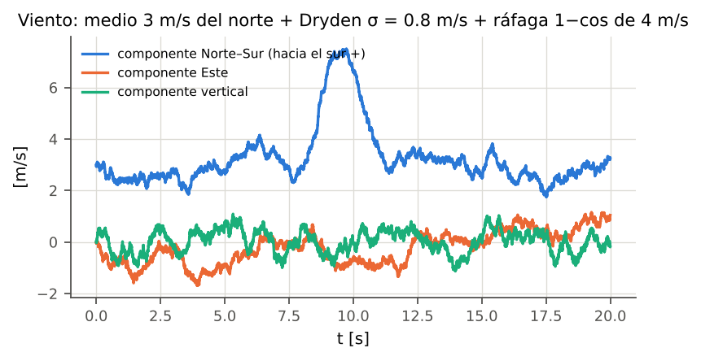
<figcaption>Viento medio de 3 m/s del norte, turbulencia de Dryden con \(\sigma=0.8\) m/s y ráfaga \(1-\cos\) de 4 m/s entre 8 y 11 s.</figcaption>
</figure>

## Interferencia electromagnética en el magnetómetro

Las corrientes de los ESC y del cableado de potencia generan un campo que se suma al terrestre en el magnetómetro. El modelo (`DisturbanceManager._emi`) lo hace proporcional a una corriente equivalente: $$\boldsymbol{b}_{EMI}=k_I\left(\frac14\sum_i\sigma_i^{1.5}\right)\hat{\boldsymbol{d}}_{EMI}+\text{pulsos},
\tag{13.5}$$ con $k_I=15~\mu$T (campo con los cuatro motores a fondo), $\hat{\boldsymbol{d}}_{EMI}=(0.6,0.8,0)$ en el cuerpo y pulsos opcionales de amplitud uniforme en $\pm30~\mu$T a una tasa dada (por ejemplo, un servo). En hover ($\sigma_h=0.6087$) el campo parásito es 7.12 $\mu$T, el 26 % de la componente horizontal del campo terrestre; si el estimador confiara solo en el magnetómetro, el rumbo se desviaría 10.3$^\circ$. Es la razón por la que PX4 ofrece compensación del magnetómetro por corriente (`CAL_MAG_COMP`). La perturbación afecta solo a la medida.

> **El exponente 1.5.** El comentario del código justifica $\sigma^{1.5}$ como “potencia de la hélice $\propto\Omega^3$”. Esa equivalencia vale si el empuje fuera proporcional al acelerador ($\Omega\propto\sqrt\sigma$), pero en el modelo de propulsor de este simulador $\Omega$ es afín en $\sigma$ (ecuación (5.1)); con él, la corriente de fase sería $\propto\Omega^2$ y la de batería $\propto\Omega^3$. El exponente es por tanto una forma funcional supuesta, no derivada; como $k_I$ es un parámetro libre de la perturbación, la discrepancia solo cambia cómo crece la interferencia con el acelerador.

## Cambio de masa y carga útil

Un evento a un tiempo $t$ engancha (o suelta) una masa puntual $m_p$ en la posición $\boldsymbol{r}$ del cuerpo (`vehicles.with_payload`). La carga cambia tres cosas, y las tres le importan al control: $$\begin{gathered}
m'=m+m_p,\qquad \boldsymbol{c}'=\frac{m\,\boldsymbol{c}+m_p\,\boldsymbol{r}}{m'},\qquad
\boldsymbol{d}_0=\boldsymbol{c}-\boldsymbol{c}',\qquad \boldsymbol{d}=\boldsymbol{r}-\boldsymbol{c}',\tag{13.6}\\
J'_{xx}=J_{xx}+m(d_{0,y}^2+d_{0,z}^2)+m_p(d_y^2+d_z^2)\quad\text{(y análogos, teorema de Steiner)},\nonumber
\end{gathered}$$ donde $\boldsymbol{c}$ es el centro de masa actual medido en el marco geométrico del bastidor (cero en el vehículo nominal, distinto de cero si ya había cargas) y $\boldsymbol{r}$ la posición de la nueva carga en ese mismo marco. Así varias cargas sucesivas se componen correctamente: cada una traslada el tensor acumulado al nuevo centro de masa común. Los brazos de palanca de los rotores pasan a medirse desde el nuevo centro de masa, $(x_i-c'_x,\ y_i-c'_y)$. Solo se conserva la diagonal del tensor: los productos de inercia que introduce una carga descentrada se desprecian. El controlador y el mezclador *no se enteran*: siguen usando el vehículo nominal, que es lo que pasa en un dron real al que se le cuelga algo.

|                                                    | Carga en $(0,0,5)$ cm (debajo) | Carga en $(5,0,0)$ cm (adelante) |
|:---------------------------------------------------|:-------------------------------|:---------------------------------|
| $J_{xx},J_{yy},J_{zz}$ \[kg·m$^2$\]                | 0.02472, 0.02452, 0.03860      | 0.02410, 0.02452, 0.03922        |
| Desplazamiento del centro de masa                  | 8.82 mm en $z$                 | 8.82 mm en $x$                   |
| Momento en hover con aceleradores iguales          | 0                              | -0.147 N·m (morro abajo)         |
| Momento normalizado que debe aportar el integrador | 0                              | -0.041                           |
| Acelerador de hover                                | 0.658                          | 0.658                            |

Efecto de una carga de 300 g en el PAE-X450 (bloque K).

La carga descentrada produce un momento constante que solo un término integral puede compensar; la centrada solo cambia la masa y la inercia, es decir, la ganancia de la planta. Por eso el escenario de carga de los bancos de comparación (300 g en $(4,4,5)$ cm, enganchada en $t=8$ s) mide a la vez robustez a la ganancia y rechazo de perturbación.

## Pérdida de eficiencia de un motor

A partir de un instante dado, la velocidad de régimen del motor $i$ se multiplica por $\eta_i<1$ en (4.8). Con $\eta=0.8$ el rotor da el 64 % del empuje para el mismo acelerador. El controlador lo ve como una perturbación de momento y de empuje que debe absorber con su integrador.

## Escenarios estándar

Para que todos los experimentos sean comparables, `scenarios.py` define cuatro escenarios con nombre: *nominal*; *viento* (3 m/s del norte, Dryden $\sigma=1$ m/s, ráfaga de 4 m/s del este en $t=6$ s durante 2 s); *carga* (300 g descentrada en $t=8$ s); y *EMI* (15 $\mu$T a plena potencia más pulsos de 30 $\mu$T a 0.5 Hz).

# Integración numérica y tasas de ejecución

¿A qué frecuencia corre realmente la simulación? La pregunta surge porque la GUI anterior se refrescaba a 50 Hz. La respuesta corta: 50 Hz es la tasa a la que se *dibuja*; la física avanza a 1 kHz con Runge–Kutta de cuarto orden. Esta sección explica la arquitectura de relojes, justifica el integrador y el paso, y presenta la evidencia numérica.

## Cuatro relojes, como en un autopiloto

| Reloj           |       Tasa        | Qué se ejecuta                                                                                                                                                                                               |
|:----------------|:-----------------:|:-------------------------------------------------------------------------------------------------------------------------------------------------------------------------------------------------------------|
| Física          |      1000 Hz      | RK4 sobre el modelo de 17 estados; 2 subpasos por periodo de control con los aceleradores retenidos (ZOH); renormalización del cuaternión; fase de los rotores; contacto con el suelo                        |
| Control         |      500 Hz       | perturbaciones, muestreo de sensores, pasa-bajos del acelerómetro y AHRS, filtros del giroscopio, filtro de navegación, lazo de actitud/tasa y mezclador. Es la tasa de `TaskControlFast` del firmware ESP32 |
| Externo         |      100 Hz       | lazo vertical (modo actitud) o controlador de posición/trayectoria (modo trayectoria), uno de cada 5 periodos de control                                                                                     |
| Sensores lentos | 100 / 40 / 100 Hz | magnetómetro, barómetro, posición externa; mantienen el último valor entre muestras                                                                                                                          |
| Registro y GUI  |  100 Hz / 50 Hz   | solo lectura del estado; no afectan la simulación                                                                                                                                                            |

Tasas de ejecución (`SimConfig` y `Simulation.step_control`).

La separación de un orden de magnitud entre el lazo de actitud y el de posición es la que piden Powers, Mellinger y Kumar \[4\] (pp. 317 y 321). En cada periodo de control el orden de las operaciones es: (1) perturbaciones; (2) sensores, a partir del estado $\boldsymbol{x}_k$ y de su derivada con los aceleradores del periodo anterior; (3) estimación y filtros; (4) lazo externo, si toca; (5) lazo de actitud y mezclador, que fijan $\sigma_k$; (6) dos pasos RK4 de 1 ms con $\sigma_k$ constante.

El paso de física es siempre un submúltiplo exacto del periodo de control, $\Delta t_{fis}=\Delta t_{ctrl}/n_{sub}$ con $n_{sub}=\operatorname{round}(f_{fis}/f_{ctrl})$. Si la razón pedida no es entera, la tasa de física efectiva difiere un poco de la pedida, pero el reloj y la integración siguen sincronizados. Antes se integraban $n_{sub}$ pasos de $1/f_{fis}$ mientras el reloj avanzaba $1/f_{ctrl}$: con 400 Hz de control una caída libre salía un 20 % lenta y con 2000 Hz, el doble de rápida, y `ctrl_hz` es un parámetro que los barridos pueden variar.

> **Retardo de cómputo, ESC y resolución del acelerador.** Por defecto el mando $\sigma_k$ calculado con las medidas de $t_k$ se aplica desde $t_k$, sin el periodo de retardo de cómputo que tiene un autopiloto real (que calcula durante el periodo y aplica al siguiente), y el ESC sigue a $\sigma$ de forma instantánea y continua, sin frecuencia de PWM ni protocolo. La cadena de medida sí tiene sus retardos (IMU 2 ms, más el filtro y la retención).
>
> La edición anterior despachaba la omisión como “2 ms frente a los 16 ms de retardo equivalente”. Esa comparación usa el retardo agregado de SIMC y subestima el efecto, porque lo que importa es la fase en la frecuencia de cruce. El guion `experiments/delay_margins.py` lo mide para el lazo de tasa de roll con las ganancias por defecto, de dos maneras: margen de fase y multiplicador máximo de las ganancias del lazo lineal en hover, y una bisección en la simulación 6-DOF completa hasta que aparece una oscilación sostenida. La tabla 14.2 resume los casos. Un periodo de cómputo quita 3.3$^\circ$ de margen de fase y baja la ganancia admisible de 5.4 a 4.3 veces; un ESC con PWM estándar de 50 Hz la deja en 2.4 veces. El motor pesa todavía más: según la revisión externa, con $T_m=30$ ms en lugar de 20 el margen baja a 48$^\circ$. Un barrido que explore ganancias de tasa hasta 2.5 veces el valor SIMC puede encontrar, en simulación, una sintonía que en el dron oscile.
>
> Para estudiarlo, `SimConfig` ofrece cuatro opciones desactivadas por defecto: `compute_delay_samples` (aplica $\sigma_{k-n}$ en lugar de $\sigma_k$), `esc_rate_hz` (muestreo y retención del mando a la tasa del ESC), `esc_pulse_delay_s` (el valor retenido actúa un ancho de pulso después) y `throttle_levels` (cuantiza $\sigma$ a un número finito de niveles, como el LEDC del ESP32). Los valores por defecto conservan el comportamiento con el que se identificaron los rezagos y se afinaron los controladores de este documento, y así seguirán hasta tener los datos reales del ESC y del firmware del dron (sección 17).

| Cadena de actuación                   | MF \[$^\circ$\] | MG \[dB\] | Gan. máx. (lineal) | Gan. máx. (6-DOF) |
|:--------------------------------------|:---------------:|:---------:|:------------------:|:-----------------:|
| Continua, sin cómputo (por defecto)   |      58.7       |   14.6    |        5.39        |       4.91        |
| +1 periodo de cómputo (2 ms)          |      55.4       |   12.7    |        4.30        |       3.91        |
| +2 periodos de cómputo (4 ms)         |      52.0       |   11.1    |        3.60        |       3.22        |
| ESC 400 Hz + 1 periodo                |      53.2       |   11.7    |        3.84        |       3.67        |
| ESC 400 Hz + 1 periodo + pulso 1.5 ms |      50.7       |   10.6    |        3.40        |       3.22        |
| ESC 50 Hz + pulso 1.5 ms              |      39.6       |    7.8    |        2.44        |       2.25        |

Margen del lazo de tasa de roll del PAE-X450 con las ganancias por defecto y distintas cadenas de actuación (`experiments/results/delay_margins/`). Cruce en 4.7 Hz en todos los casos. Ganancia máxima: factor común sobre $K_p$, $K_i$ y $K_d$ de tasa antes de la inestabilidad, en el lazo lineal y en la simulación completa. Las filas son escenarios, no mediciones del dron.

## Los integradores

Con la entrada constante en el paso, $\dot{\boldsymbol{x}}=f(\boldsymbol{x})$, el código (`dynamics.rk4_step`) implementa Runge–Kutta clásico: $$\begin{gathered}
\boldsymbol{k}_1=f(\boldsymbol{x}_n),\quad
\boldsymbol{k}_2=f\!\big(\boldsymbol{x}_n+\tfrac{h}{2}\boldsymbol{k}_1\big),\quad
\boldsymbol{k}_3=f\!\big(\boldsymbol{x}_n+\tfrac{h}{2}\boldsymbol{k}_2\big),\quad
\boldsymbol{k}_4=f(\boldsymbol{x}_n+h\boldsymbol{k}_3),\\
\boldsymbol{x}_{n+1}=\boldsymbol{x}_n+\tfrac{h}{6}\big(\boldsymbol{k}_1+2\boldsymbol{k}_2+2\boldsymbol{k}_3+\boldsymbol{k}_4\big),
\end{gathered}
\tag{14.1}$$ con error local $O(h^5)$ y global $O(h^4)$ \[26\]. Euler explícito, $\boldsymbol{x}_{n+1}=\boldsymbol{x}_n+h f(\boldsymbol{x}_n)$ (global $O(h)$), se conserva solo para comparar (`SimConfig.integrator="euler"`).

#### Estabilidad.

El modo más rápido del modelo en lazo abierto es el del motor, $\lambda=-1/T_m=-50$ s$^{-1}$ (tabla 8.1). A 1 kHz, $h\lambda=-0.05$. Euler es estable para $h\lambda\in(-2,0)$, o sea $h<2T_m=40$ ms; RK4, en el eje real, para $h\lambda>-2.785$, o sea $h<55.7$ ms. La estabilidad numérica no es la restricción que fija el paso: lo son la exactitud y la necesidad de que la física sea más rápida que el lazo de control que la observa. El NMPC de la sección 15, con paso de predicción de 50 ms, sí queda cerca de ese límite en su modelo interno ($\Delta t_{pred}/\tau_T=2.6$), y por eso integra exactamente sus estados de rezago.

#### La vibración no necesita física más rápida.

El tono de 177 Hz podría parecer un argumento para integrar más rápido. No lo es: la fase de cada rotor se avanza analíticamente, $\varphi_i\leftarrow\varphi_i+\Omega_i h$, y el sensor la evalúa en los instantes de muestreo. El tono que ve la IMU es exacto para cualquier paso de física.

## Evidencia numérica

#### Orden de convergencia.

El bloque E integra durante 1 s una maniobra no lineal genérica (velocidad de $(3,-2,1)$ m/s, actitud y velocidad angular no nulas, rotores desbalanceados, aceleradores fijos distintos) con pasos de 8 ms a 0.25 ms, y compara con una solución de referencia RK4 de $h=25~\mu$s. Se comprobó que a lo largo de la referencia ninguna componente de $\boldsymbol{v}_B$ ni de $\boldsymbol{\omega}$ cruza cero (mínimo $|\cdot|$ = $9.9\times10^{-6}$): las funciones $x|x|$ del arrastre no tienen “esquinas” en el intervalo, condición para que RK4 alcance su orden.

<figure id="fig:conv">
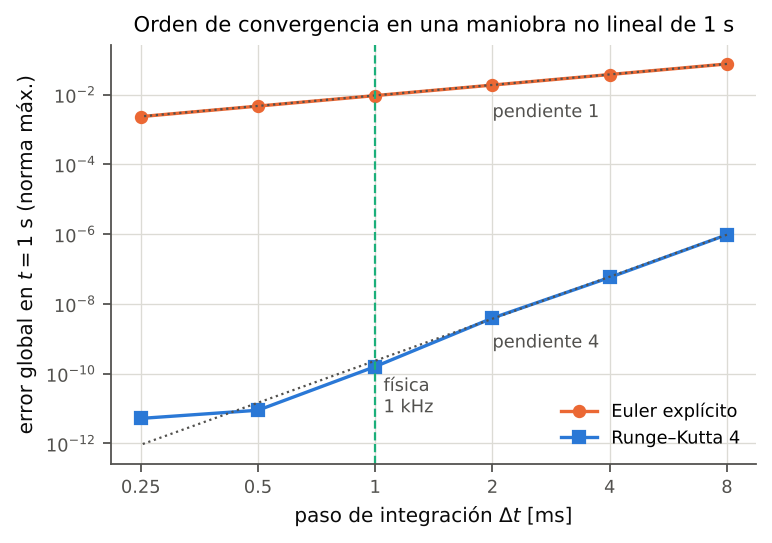
<figcaption>Error global en \(t=1\) s frente al paso. Pendientes ajustadas: Euler 1.00, RK4 4.19 (pares sucesivos: 4.07, 3.87, 4.62, 4.16). El último punto de RK4 toca el piso de redondeo (\(\approx\)\(5.2\times10^{-12}\)).</figcaption>
</figure>

Las pendientes medidas, 1.00 y 4.19, son las teóricas 1 y 4. Al paso de 1 ms el error de RK4 es $1.6\times10^{-10}$; un Euler explícito con el paso de 2 ms de la 2.ª edición tiene $1.9\times10^{-2}$, ocho órdenes de magnitud más.

#### Conservación en rotación libre.

Sin arrastre, sin amortiguamiento y con los rotores parados, el cuerpo rígido conserva la energía $E=\tfrac12\boldsymbol{\omega}^{\mathsf{T}}J\boldsymbol{\omega}$ y el momento angular en el marco inercial, $\boldsymbol{L}_E=\mathbf{R}J\boldsymbol{\omega}$. Son invariantes exactos que ningún integrador de paso fijo genérico conserva por construcción; medir su deriva es una prueba independiente. Además, el PAE-X450 cumple $J_{yy}<J_{xx}<J_{zz}$, así que un giro alrededor de $x$ es un giro alrededor del eje *intermedio*, inestable (efecto Dzhanibekov o teorema de la raqueta de tenis \[27\]). Linealizando las ecuaciones de Euler alrededor de $\boldsymbol{\omega}=(\omega_0,0,0)$, las perturbaciones crecen con tasa $$\lambda=\omega_0\sqrt{\frac{(J_{xx}-J_{yy})(J_{zz}-J_{xx})}{J_{yy}J_{zz}}}=1.121~\text{s}^{-1}\quad(\omega_0=20~\text{rad/s}).
\tag{14.2}$$ Con perturbaciones iniciales de $10^{-3}$ rad/s, la primera inversión se espera hacia $\ln(20/1.4\times10^{-3})/\lambda\approx8.53$ s; la simulación la da a los 7.87 s y muestra 3 inversiones de $\omega_x$ en 40 s (figura 14.2). Los ejes estables sí lo son: girando alrededor de $z$ (inercia máxima) o de $y$ (mínima), las componentes transversales se quedan por debajo de $1.4\times10^{-3}$ y $1.1\times10^{-2}$ rad/s en 10 s.

<figure id="fig:dzh">
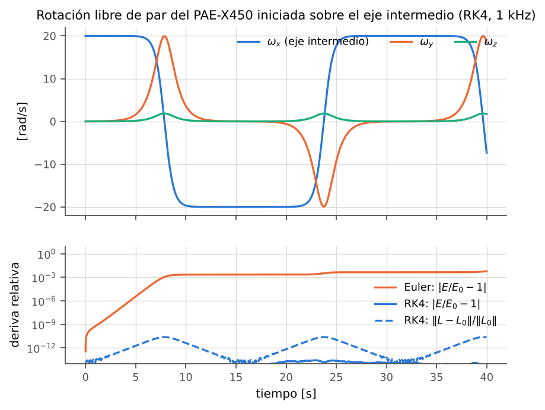
<figcaption>Rotación libre iniciada sobre el eje intermedio. Arriba: inversiones periódicas de \(\omega_x\). Abajo: deriva relativa de la energía y del momento angular inercial con RK4 y con Euler a 1 kHz.</figcaption>
</figure>

Con RK4 a 1 kHz la deriva máxima en 40 s es $2.7\times10^{-14}$ en energía y $2.4\times10^{-11}$ en momento angular; con Euler al mismo paso, $6.0\times10^{-3}$ y $3.1\times10^{-3}$. La diferencia muestra qué tan engañoso puede ser Euler en una simulación larga: inyecta energía, y lo hace justo en las fases rápidas de la inversión.

#### Exactitud en lazo cerrado.

La prueba que más le importa al usuario es si la frecuencia de física cambia los resultados del simulador completo. El bloque E corre 3 s con escalones de roll de $\pm15^\circ$ (estimador ideal, sensores sin ruido, controlador a 500 Hz) con física a 16 kHz como referencia y compara:

| Integrador y tasa de física | roll \[$^\circ$\]  | posición lateral $y$ \[m\] |
|:----------------------------|:------------------:|:--------------------------:|
| RK4, 1000 Hz (por defecto)  | $1.4\times10^{-7}$ |     $7.0\times10^{-9}$     |
| RK4, 500 Hz                 | $2.6\times10^{-5}$ |     $1.1\times10^{-6}$     |
| Euler, 1000 Hz              | $1.1\times10^{-1}$ |     $3.0\times10^{-3}$     |
| Euler, 500 Hz (2.ª edición) | $2.3\times10^{-1}$ |     $6.1\times10^{-3}$     |

Error máximo frente a la referencia de 16 kHz en lazo cerrado.

Con RK4 la física a 1 kHz es indistinguible de la de 16 kHz (error de millonésimas de grado) y la de 500 Hz también bastaría; los 1000 Hz se eligieron por margen, a un costo bajo. Euler a 500 Hz se separa $2.3\times10^{-1}$$^\circ$ en roll y $6.1\times10^{-3}$ m en posición lateral en tres segundos: no es catastrófico, pero es del orden de los efectos que se quieren estudiar (errores de estimación de décimas de grado, errores de seguimiento de centímetros), y crece con la duración.

#### Costo.

Con el estimador por defecto (Mahony), el simulador completo corre a unas 13.5 veces el tiempo real en un núcleo (bloque L; medido con otro proceso pesado compartiendo la CPU), suficiente para barridos de cientos de corridas y para la GUI en tiempo real.

# Controladores de posición y trayectoria

Una decisión de diseño del proyecto fue conservar la cascada PID de bajo nivel, que es suficiente para la actitud, y comparar las técnicas avanzadas *encima* de ella, en el lazo de posición. El simulador tiene cinco controladores con una interfaz común, siete generadores de trayectoria, un procedimiento de identificación de los rezagos que los controladores basados en modelo necesitan y un banco de comparación con métricas sobre la posición verdadera.

## Interfaz común y restricciones compartidas

Todos los controladores heredan `PositionController` y corren en el lazo externo (100 Hz): $$\texttt{update}(t,\ \text{NavState},\ \text{trayectoria})\ \to\ (\boldsymbol{a}_{des},\ \psi_{ref},\ \dot\psi_{ff})\ \ [\text{u opcionalmente } (T,\phi,\theta,\psi)].$$ `NavState` contiene solo cantidades *estimadas* (posición y velocidad del filtro de navegación, actitud del AHRS, tasas filtradas y la aceleración cinemática estimada $\boldsymbol{a}_{kin,E}$ de (11.1)) y la masa *nominal*: el controlador no sabe si alguien le colgó una carga. La aceleración deseada pasa por la planitud diferencial de la sección 12.5; solo el NMPC entrega empuje y actitud directamente.

Para que la comparación sea justa, PID, MPC y NMPC comparten la misma caja de aceleraciones admisibles (`common.accel_limits`): $$|a_x|,|a_y|\le g\tan30^\circ=5.66~\text{m/s}^2,\qquad
-0.8\Big(\frac{T_{max}}{m}-g\Big)=-17.75\ \le a_z\le\ 0.8\,g=7.85~\text{m/s}^2 .
\tag{15.2}$$ El factor 0.8 deja un 20 % de empuje al lazo de actitud: los motores no pueden dar a la vez todo el empuje y todo el momento (sección 5). El PID acota la norma horizontal en lugar de cada eje, y la política de RL proyecta sobre un cono de $30^\circ$ con $a_z\in[-6,6]$ m/s$^2$; las tres formas coinciden en la inclinación máxima en hover sostenido.

## Generadores de trayectoria

Cada trayectoria (`trajectories.py`) entrega la referencia y sus tres primeras derivadas *analíticas*, $(\boldsymbol{p},\boldsymbol{v},\boldsymbol{a},\boldsymbol{j})$, más el rumbo. Los controladores las usan como prealimentación y el MPC y el NMPC como previsión del horizonte. Hay siete: vuelo estacionario, escalones (caja en XY más escalón de altura), círculo, figura en 8, hélice, mínimo *snap* por puntos de paso y punto a punto de mínimo *jerk*.

#### Arranque desde el reposo.

Una curva periódica pura, por ejemplo $x=R\cos\omega t$, arranca con velocidad $R\omega$: un escalón en la referencia de velocidad que ningún dron puede seguir y que contaminaría las métricas con un transitorio arbitrario. Las curvas periódicas se recorren con una fase $\vartheta(t)$ cuya velocidad sube con el polinomio *smoothstep* de quinto orden, $$\dot\vartheta=\omega\,s\!\left(\frac{t}{T_r}\right),\qquad s(u)=10u^3-15u^4+6u^5,
\tag{15.3}$$ que cumple $s(0)=0$, $s(1)=1$ y $s'=s''=0$ en ambos extremos. Por la regla de la cadena, $$\boldsymbol{v}=\boldsymbol{f}'\dot\vartheta,\quad
\boldsymbol{a}=\boldsymbol{f}''\dot\vartheta^2+\boldsymbol{f}'\ddot\vartheta,\quad
\boldsymbol{j}=\boldsymbol{f}'''\dot\vartheta^3+3\boldsymbol{f}''\dot\vartheta\ddot\vartheta+\boldsymbol{f}'\dddot\vartheta,$$ y en $t=0$ velocidad, aceleración y *jerk* son exactamente cero (el bloque M lo verifica: $\max|\cdot|=0$). Como $\int_0^1s=1/2$, la rampa recorre media vuelta equivalente; con la rampa simétrica de bajada la trayectoria termina en reposo en el punto de partida tras un número entero de vueltas, y dura $n_{vueltas}T+T_r$.

#### Figura en 8.

Lemniscata de Gerono en el plano horizontal, $$x=c_x+A\sin\vartheta,\qquad y=c_y+\tfrac{B}{2}\sin2\vartheta,
\tag{15.5}$$ con $A=2$ m y $B=1$ m (el 8 mide $4\times1$ m). Es la prueba clásica de seguimiento en la literatura de MPC para cuadricópteros \[36, 37\], aunque esos trabajos la usan a velocidades mucho mayores y con otra parametrización; la de Gerono se eligió por su forma cerrada. Con periodo de 10 s (dos vueltas) alcanza 1.40 m/s y 0.99 m/s$^2$ (inclinación de 5.7$^\circ$); la versión rápida del banco, con periodo de 5 s y tres vueltas, 2.81 m/s y 3.95 m/s$^2$, que exigen 21.9$^\circ$ de inclinación, cerca del límite de 30$^\circ$. El círculo de 1.5 m y 10 s llega a 0.94 m/s.

#### Mínimo snap.

Para recorrer puntos de paso, Mellinger y Kumar \[16\] minimizan $\int\|\boldsymbol{p}^{(4)}\|^2dt$. Por Euler–Lagrange la solución cumple $\boldsymbol{p}^{(8)}=0$ en cada tramo: polinomios de grado 7. Con la asignación de tiempos fija ($T_i=\max(t_{min},d_i/\bar v)$), posiciones impuestas en los puntos de paso, reposo ($v=a=j=0$) en los extremos y continuidad de las derivadas 1 a 6 en los puntos interiores, el número de ecuaciones iguala al de incógnitas ($8M$ para $M$ tramos) y la solución del sistema lineal *es* el mínimo \[17\]. Cada tramo usa tiempo normalizado $\tau\in[0,1]$ para que la matriz esté bien condicionada. Verificación: el salto relativo de las derivadas 1–6 en los nudos es $6.6\times10^{-15}$.

## Identificación de los rezagos del lazo interno

Visto desde el lazo de posición, todo lo que hay debajo (planitud, AHRS, cascada de actitud, mezclador, motores) es un sistema $\boldsymbol{a}_{des}\to\boldsymbol{a}$. Los controladores basados en modelo necesitan una descripción simple de él. `identification.py` la obtiene con un ensayo de escalón sobre el simulador *completo*, como en un banco real: el dron arranca en hover, un comandante en lazo abierto aplica un escalón $+U$ y, en otra corrida con la misma semilla, $-U$; la semidiferencia cancela la deriva común (sesgos, ruido). Sobre esa respuesta se ajusta por mínimos cuadrados $$y(t)=K\,U\left(1-e^{-(t-\theta)/\tau}\right),\quad t>\theta,
\tag{15.6}$$ con búsqueda en malla sobre $(\theta,\tau)$ y $K$ lineal en cada punto, en dos versiones: primer orden con retardo (FOPDT) y primer orden puro ($\theta=0$, que absorbe el retardo en $\tau$ por la regla de la mitad).

| Canal                  |       Primer orden puro        |            FOPDT            |
|:-----------------------|:------------------------------:|:---------------------------:|
| $a_{des,xy}\to a_{xy}$ | $\tau_{a,xy}=119.1$ ms (7.5 %) | $61.8$ ms $+$ 43 ms (3.1 %) |
| $a_{des,z}\to a_z$     |  $\tau_{a,z}=19.5$ ms (0.6 %)  |     igual, sin retardo      |
| $\phi_{ref}\to\phi$    |     $\tau_{att}=117.2$ ms      |     $59.8$ ms $+$ 43 ms     |

Rezagos identificados del PAE-X450 que usan los controladores (`DEFAULT_LAGS`; identificados con Madgwick y el núcleo anterior, escalones de 1.5 m/s$^2$ y $8^\circ$). Error RMS relativo del ajuste entre paréntesis.

<figure id="fig:ident">
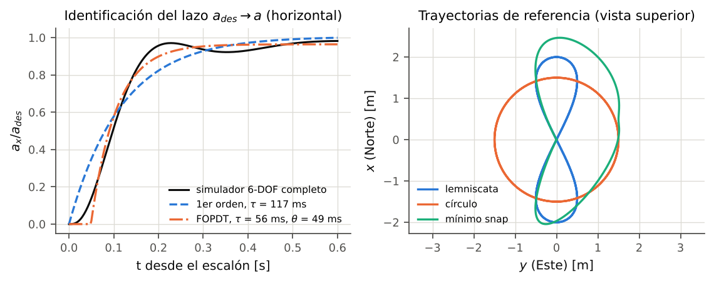
<figcaption>Izquierda: respuesta del simulador completo a un escalón de aceleración horizontal y los dos ajustes. Derecha: figura en 8, círculo y trayectoria de mínimo snap por defecto (vista superior).</figcaption>
</figure>

La lectura de la figura 15.1 es importante para entender los resultados del banco. El lazo horizontal no es de primer orden: es de segundo orden, con una curva en S, una joroba hacia los 0.2 s y una cola lenta que deja el integrador del lazo de tasa. El primer orden puro de 119 ms comete un 7.5 % de error; el FOPDT, 3.1 %. El canal vertical, en cambio, es casi exactamente el motor ($T_m=20$ ms). Todos los controladores basados en modelo comparten ese error de modelado.

La tabla 15.1 es la que usan los controladores, y se identificó con el núcleo anterior. El ensayo de la figura 15.1 se repitió con el núcleo actual (estimador Mahony, acelerómetro filtrado, $k_d=K_c\theta$, giroscopio a 60 Hz; bloque M): el canal horizontal da $\tau=117.2$ ms como primer orden puro (8.6 % de error) y $56.1~\text{ms}+49~\text{ms}$ como FOPDT (3.6 %). `DEFAULT_LAGS` no se regeneró tras el cambio del núcleo.

## PID en cascada (estilo PX4)

`position/pid.py` reproduce la estructura de `mc_pos_control` de PX4: un P de posición que genera una referencia de velocidad, y un PID de velocidad con prealimentación de la velocidad y la aceleración de referencia: $$\begin{aligned}
\boldsymbol{v}_{sp}&=\boldsymbol{v}_{ref}+\operatorname{sat}_{v_{max}}\!\big(K_p(\boldsymbol{p}_{ref}-\hat{\boldsymbol{p}})\big),\qquad
\boldsymbol{e}_v=\boldsymbol{v}_{sp}-\hat{\boldsymbol{v}},\nonumber\\
\boldsymbol{a}_{des}&=\operatorname{sat}_{\text{caja}}\Big(\boldsymbol{a}_{ref}+K_v\boldsymbol{e}_v+K_i\!\int\!\boldsymbol{e}_v\,dt+K_d\,\tfrac{d}{dt}\boldsymbol{e}_v\Big),
\tag{15.7}
\end{aligned}$$ con la corrección de velocidad acotada ($3$ m/s en XY, $2$ m/s en $z$), integración condicional e integral acotada como en (12.3), y el derivativo filtrado a 5 Hz (apagado por defecto, $K_d=0$). Sin prealimentación un lazo de posición solo corrige *después* de que el error aparece.

#### Ganancias derivadas del modelo.

Con las mismas reglas SIMC de la sección 12 sobre la planta identificada: el lazo de velocidad ve $a_{cmd}\to v=1/s$ con el FOPDT de la tabla 15.1, y la regla de la mitad da $\theta_{ef}=\tau+\theta+\Delta t/2$ ($\Delta t/2$ es la retención del lazo de 100 Hz). Con $\tau_c=\max(1.5\,\theta_{ef},\,0.1~\text{s})$, más conservador que el “ajustado” $\tau_c=\theta$ para dejar margen al ruido del estimador, $$K_v=\frac{1}{\tau_c+\theta_{ef}},\quad K_i=\frac{K_v}{4(\tau_c+\theta_{ef})},\quad
K_p=\frac{1}{3\,(\tau_c+\theta_{ef})}.$$ Resulta $K_p=1.21$, $K_v=3.64$, $K_i=3.32$ en XY y $K_p=2.68$, $K_v=8.03$, $K_i=16.13$ en $z$; los valores por defecto de PX4 son todavía más conservadores (0.95 / 1.8 / 0.4 en XY).

#### Ganancias afinadas en simulación.

Para el PAE-X450, $K_p$ y $K_v$ salen de una malla $K_p\in\{2.4,3,3.6,4.5\}\times K_v\in\{4.5,5.5,6.5\}$ con $K_i=K_v^2/4$ (la relación SIMC $T_i=4/K_v$), escogiendo el mínimo del RMSE medio en figura en 8 y círculo: $K_p=3.6$, $K_v=5.5$, $K_i=7.56$, que bajó el RMSE de 6.2 a 3.1 cm frente a las ganancias derivadas (malla hecha con el núcleo anterior y Madgwick, escenario nominal, semilla 1). El MPC y el NMPC se afinaron con el mismo protocolo. Esa semilla es también una de las tres del banco final, y el integral se eligió mirando el caso con interferencia magnética (nota siguiente): los tres controladores clásicos se afinaron sobre parte del conjunto de prueba, cosa que no se hizo con el RL (sección 15.9). Es, en pequeño, el flujo que propone el proyecto: sintonía en simulación como punto de partida. El valor por defecto actual del integral es, sin embargo, $K_{i,xy}=2$, por la razón de la nota siguiente: el óptimo en el escenario nominal no es el óptimo robusto.

> **Fragilidad del integral con interferencia magnética.** Las cifras de esta nota son anteriores a restringir la corrección magnética al rumbo (sección 11); el banco final de la sección 15.9 ya incluye ese cambio. Con EMI en el magnetómetro el rumbo estimado se desviaba 11–12$^\circ$; el empuje real queda rotado respecto de la aceleración pedida, y un integral grande sobre una planta rotada entra en espiral. Con el núcleo actual (Mahony, acelerómetro filtrado), en la figura en 8 nominal $K_{i,xy}=2$ dio 2.35 cm de RMSE frente a 2.38 cm con 7.56; con EMI, 4.99 cm frente a 73 cm (semilla 1, medido antes de corregir el desfase de 10 ms del registro de la referencia que se explica en la sección 15.9; el orden de magnitud de la diferencia no depende de esa corrección). Por eso el valor por defecto pasó a 2.0. Aun así, con EMI y *escalones* de 1 m el PID entra en un ciclo límite saturado en la inclinación máxima: es un hallazgo del banco, no un error de implementación. El MPC, cuyo observador de perturbación estima la aceleración no explicada en lugar de integrar el error, no lo sufre.

## MPC lineal con previsión

#### Modelo de predicción.

Por eje, desacoplado, con la aceleración total como estado y el rezago identificado (`position/mpc.py`): $$\dot p=v,\qquad \dot v=a,\qquad \dot a=\frac{u-a}{\tau_a},\qquad
\boldsymbol{x}=[p,v,a]^{\mathsf{T}},\ u=a_{cmd},
\tag{15.9}$$ con $\tau_a=\tau_{a,xy}$ en $x,y$ y $\tau_{a,z}$ en $z$. Se discretiza de forma *exacta* con retención de orden cero y paso $h=\Delta t_{pred}$; con $\alpha=e^{-h/\tau}$ y $\beta=1-\alpha$: $$A=\begin{bmatrix}1&h&\tau(h-\tau\beta)\\0&1&\tau\beta\\0&0&\alpha\end{bmatrix},\qquad
B=\begin{bmatrix}h^2/2-\tau h+\tau^2\beta\\ h-\tau\beta\\ \beta\end{bmatrix}.
\tag{15.10}$$ El bloque M compara (15.10) con la exponencial de la matriz aumentada (`scipy.linalg.expm`) para tres $\tau$ y dos pasos: error máximo $1.7\times10^{-15}$.

#### Costo.

Sobre un horizonte de $N=20$ pasos de 50 ms (1 s), con la referencia muestreada en $t+kh$: $$J=\sum_{k=1}^{N}q_p(p_k-p_{ref,k})^2+q_v(v_k-v_{ref,k})^2
+\sum_{k=0}^{N-1}r_u\,(u_k-u_{ref,k})^2+r_{du}(u_k-u_{k-1})^2 .
\tag{15.11}$$ La entrada de referencia es la que hace que el modelo con rezago siga exactamente la aceleración de referencia: si $a=a_{ref}$, entonces $u_{ref}=a_{ref}+\tau_a\,j_{ref}$, evaluada en el centro de cada intervalo. Con $u_{ref}=0$ el término $r_uu^2$ sesgaría el seguimiento hacia aceleración nula (en un círculo, hacia adentro); penalizando la *desviación* el sesgo desaparece. Pesos por defecto: $q_p=1$, $q_v=0$ en XY; $q_{pz}=2$, $q_{vz}=0.1$; $r_u=5\times10^{-4}$, $r_{du}=0$.

#### QP condensado y su solución.

Eliminando los estados con $\boldsymbol{p}=\Phi\boldsymbol{x}_0+\Gamma\boldsymbol{U}$, el costo es una cuadrática en las $N$ entradas, $\tfrac12\boldsymbol{U}^{\mathsf{T}}H\boldsymbol{U}+\boldsymbol{f}^{\mathsf{T}}\boldsymbol{U}$, con $H=2(q_p\Gamma_p^{\mathsf{T}}\Gamma_p+q_v\Gamma_v^{\mathsf{T}}\Gamma_v+r_uI+r_{du}D^{\mathsf{T}}D)$ precalculada y $\boldsymbol{f}$ lineal en el estado y en la previsión. Las únicas restricciones son la caja (15.2) sobre $\boldsymbol{U}$, así que la proyección es exacta y barata. El algoritmo: (1) se calcula el óptimo sin restricciones $\boldsymbol{U}^*=-H^{-1}\boldsymbol{f}$; si cumple la caja, es el óptimo exacto (caso más común en el banco). (2) Si no, FISTA \[28\] con reinicio por gradiente \[29\], precondicionado diagonal (Jacobi: $\tilde H=SHS$, $S=\operatorname{diag}(H)^{-1/2}$), paso $1/L$ con $L=\lambda_{max}(\tilde H)$, arranque en caliente con la solución anterior desplazada y un máximo de 60 iteraciones. Con ese tope el costo queda a menos del 0.3 % del óptimo y el tiempo medio es de 0.4 ms por llamada.

#### Estado no medido y acción libre de offset.

La aceleración no se mide: se usa la predicción del modelo interno, la última entrada aplicada filtrada por el mismo rezago, $a_{lag}\leftarrow e^{-\Delta t/\tau}a_{lag}+(1-e^{-\Delta t/\tau})u_{apl}$. Para rechazar perturbaciones constantes (viento medio, carga, error de empuje) se agrega un observador de Luenberger de perturbación de entrada (`common.DisturbanceObserver`) sobre el modelo $\dot v=a_{lag}+d$, $\dot d=0$, con la velocidad estimada como medida: $$\hat v\leftarrow\hat v+\Delta t\,\big(a_{lag}+\hat d+\ell_1(v-\hat v)\big),\qquad
\hat d\leftarrow\hat d+\Delta t\,\ell_2(v-\hat v),\qquad
s^2+\ell_1s+\ell_2=s^2+2\zeta\omega s+\omega^2,
\tag{15.12}$$ con $\omega=3$ rad/s y $\zeta=0.8$ (polos en $-2.4\pm1.8j$). Es el esquema “offset-free” de Pannocchia y Rawlings \[30\] y Maeder, Borrelli y Morari \[31\]: $\hat d$ absorbe todo lo que el modelo no explica. El QP trabaja con la aceleración total $a=a_{lag}+\hat d$ y la entrada desplazada $\tilde u=u+\hat d$; se aplica $u=\operatorname{sat}_{\text{caja}}(\tilde u_0-\hat d)$.

#### Ley equivalente.

Sin restricciones activas el MPC es una ley lineal en el estado y en la previsión (`lq_gain`). Para el eje $x$, $u_0=-35.8\,(p-p_{ref})-11.80\,v-0.946\,a+(\text{términos de previsión})$; la suma de las ganancias de posición y de previsión es $2.1\times10^{-14}$ (debe ser cero por invarianza a traslaciones). Comparada con el PID afinado (rigidez $K_pK_v=19.8$ s$^{-2}$, amortiguamiento $K_v=5.5$ s$^{-1}$), el MPC es casi el doble de rígido y además se anticipa: ve venir la curva un segundo antes.

## MPC no lineal (iLQR con restricciones de caja)

#### Modelo de predicción.

Nueve estados y tres entradas (`position/nmpc.py`): $$\begin{gathered}
\boldsymbol{x}=[\boldsymbol{p},\boldsymbol{v},\phi,\theta,T],\qquad \boldsymbol{u}=[T_c,\phi_c,\theta_c],\nonumber\\
\dot{\boldsymbol{p}}=\boldsymbol{v},\quad
\dot{\boldsymbol{v}}=g\boldsymbol{e}_3-\frac{T}{m}\,\boldsymbol{r}_3(\phi,\theta,\psi)-\frac{c_d}{m}\boldsymbol{v}|\boldsymbol{v}|+\hat{\boldsymbol{d}},\quad
\dot\phi=\frac{\phi_c-\phi}{\tau_{att}},\quad
\dot\theta=\frac{\theta_c-\theta}{\tau_{att}},\quad
\dot T=\frac{T_c-T}{\tau_T},
\tag{15.13}
\end{gathered}$$ con $\boldsymbol{r}_3=\mathbf{R}\boldsymbol{e}_3=(c_\phi s_\theta c_\psi+s_\phi s_\psi,\ c_\phi s_\theta s_\psi-s_\phi c_\psi,\ c_\phi c_\theta)$ la tercera columna de la matriz Z-Y-X, $\psi$ el rumbo de referencia (exógeno), $\tau_{att}=117.2$ ms y $\tau_T=\tau_{a,z}$ de la tabla 15.1. Es genuinamente no lineal: proyección trigonométrica del empuje sin aproximar, producto $T\boldsymbol{r}_3$ y arrastre cuadrático (aplicado en $\{E\}$, supuesto; la planta lo aplica en $\{B\}$, y la diferencia la absorbe $\hat{\boldsymbol{d}}$).

#### Discretización.

Los tres estados de rezago son lineales y se integran exactamente con ZOH; $(\boldsymbol{p},\boldsymbol{v})$ con un paso RK4 que evalúa el rezago en $0,h/2,h$. Un RK4 sobre los nueve estados quedaría al borde de su región de estabilidad: con $h=50$ ms y $\tau_T=19.5$ ms, $h/\tau_T=2.6$, cerca del límite de 2.785 en el eje real, y su factor de amplificación por paso para ese modo sería 0.75 frente al exacto $e^{-2.6}=0.07$.

#### Costo y referencia.

Cuadrático en el error de posición y velocidad y en la desviación de las entradas respecto de una referencia $\boldsymbol{u}_{ref}$ que sale de la planitud diferencial (sección 12.5) aplicada a $\boldsymbol{a}_{ref}+\tau_{att}\boldsymbol{j}_{ref}-\hat{\boldsymbol{d}}+\frac{c_d}{m}\boldsymbol{v}_{ref}|\boldsymbol{v}_{ref}|$, con peso terminal. Restricciones de caja: $T_c\in[2.75,38.57]$ N (la misma caja vertical del MPC) y $|\phi_c|,|\theta_c|\le30^\circ$.

#### Solver.

iLQR \[32, 33\] con entradas acotadas a la manera de *box-DDP* \[34\]. Los jacobianos $A_k,B_k$ se calculan por diferencias finitas, todos los pasos del horizonte en un solo lote vectorizado. En el paso hacia atrás, con $Q_{uu}=\ell_{uu}+B_k^{\mathsf{T}}V_{xx}B_k+\mu I$ y $Q_{ux}=B_k^{\mathsf{T}}V_{xx}A_k$, se comprueba con Cholesky que $Q_{uu}$ sea definida positiva; si no lo es, $\mu$ se multiplica por 10 y se repite el paso (regularización adaptativa de Levenberg–Marquardt, \[33\]), y tras un paso exitoso vuelve a bajar. Con jacobianos por diferencias finitas, $V_{xx}$ puede perder la definición positiva en saturación o ante perturbaciones grandes. Luego se resuelve en cada $k$ el QP de caja de dimensión 3 para la corrección $\delta\boldsymbol{u}_k$ por Newton proyectado, y las filas de la ganancia $K_k=-Q_{uu}^{-1}Q_{ux}$ de las entradas que quedaron en su cota se anulan (no hay realimentación en una dirección saturada). El paso hacia adelante simula en lote los candidatos $\alpha\in\{1,0.5,0.25,0\}$, $\boldsymbol{u}_k=\operatorname{sat}(\boldsymbol{U}_k+\alpha\,\delta\boldsymbol{u}_k+K_k(\hat{\boldsymbol{x}}_k-\boldsymbol{X}_k))$, y se queda con el de menor costo; $\alpha=0$ es el despliegue en lazo cerrado del arranque en caliente, así que el costo nunca empeora. Se hace una iteración por llamada con arranque en caliente (iteración en tiempo real, \[35\]); el costo medido en la máquina de desarrollo es de 3.8 ms de mediana por llamada (`experiments/nmpc_timing.py`), y depende mucho del procesador y de la versión de Python y numpy: otra máquina midió 16 ms. Las pruebas de tiempo de cómputo, por esa razón, no corren por defecto.

#### Por qué no supera al MPC lineal.

Medido en la figura en 8 rápida (con el núcleo anterior y Madgwick): con 1, 2 o 3 iteraciones el RMSE apenas cambia (5.24, 5.15, 5.20 cm), de modo que el optimizador no es el límite; quitando el arrastre del modelo tampoco empeora. Hasta unos $16^\circ$ de inclinación la proyección trigonométrica es casi lineal, y ambos comparten el error de modelo dominante: el lazo de actitud real es de segundo orden con unos 43 ms de retardo, no un primer orden (figura 15.1).

## Aprendizaje por refuerzo puro (PPO fuera de línea)

El requisito de diseño fue no entrenar nunca un RL sobre una planta lenta: entrenar fuera de línea en un entorno rápido, después transferir y validar. El simulador 6-DOF corre a unas 10 veces el tiempo real; PPO necesita del orden de $10^7$ pasos, que en el 6-DOF serían horas por millón. Por eso el flujo (detallado en `docs/RL.md`) fue el siguiente. Las políticas se entrenaron con el núcleo anterior (sustituto identificado con Madgwick) y *no se reentrenaron* tras las correcciones; en el banco final actúan sobre el núcleo actual sin cambios, lo que es en sí una prueba adicional de transferencia.

1.  **Sustituto identificado.** Solo la traslación, con el lazo interno como retardo más primer orden por eje y la masa real distinta de la nominal, $$\boldsymbol{a}_{thr}=\frac{e^{-d s}}{\tau s+1}\,\boldsymbol{a}_{des},\qquad
    \boldsymbol{a}=g\boldsymbol{e}_3+\frac{m_{nom}}{m}\big(\boldsymbol{a}_{thr}-g\boldsymbol{e}_3\big)-\frac{c_d}{m}\boldsymbol{v}_r|\boldsymbol{v}_r|,\quad \boldsymbol{v}_r=\boldsymbol{v}-\boldsymbol{v}_w,
    \tag{15.14}$$ identificado con escalones aleatorios sobre el 6-DOF (núcleo anterior, Madgwick, 30 s). Hubo dos identificaciones. La política pura se entrenó con la primera, hecha antes de inicializar bien el estimador: $\tau_{xy}=90$ ms, $d=28$ ms ($R^2=0.951$ del ajuste horizontal; `experiments/results/rl/surrogate_id_v1_used_for_pure.json`). El híbrido se entrenó con la corregida: $\tau_{xy}=82.5$ ms, $d=32$ ms ($R^2=0.982$ en el ajuste y 0.981 en datos de validación; `models/surrogate_id.json`). En ambas, $\tau_z=25$ ms sin retardo, y las dos caen dentro del rango aleatorizado. Vectorizado en numpy, 128 entornos en paralelo.

2.  **Aleatorización de dominio** \[41\]: masa ($\times0.85$–$1.20$), carga a mitad de episodio, $\tau$ ($\pm30$ %), retardo (10–50 ms), arrastre ($\pm50$ %), viento medio hasta 5 m/s, turbulencia de Gauss–Markov, ráfagas $1-\cos$ y ruido de medida. La política no observa ninguno de estos parámetros.

3.  **MDP.** Paso de 10 ms (el lazo externo), episodios de 10 s. Observación de 24 componentes con escalas fijas: errores de posición y velocidad *estimados*, velocidad y aceleración de referencia, previsión de la referencia a 0.25 y 0.5 s, última acción y una integral con fugas del error de posición ($\dot I=e_p-I/3$ s). Acción $\boldsymbol{a}_{des}=\operatorname{proy}_{30^\circ}(6~\text{m/s}^2\cdot\pi(\boldsymbol{o}))$. Recompensa $r=-\min(c,25)$ con $c=w_{pl}\|e_p\|+w_p\|e_p\|^2+w_v\|e_v\|^2+w_a\|\boldsymbol{a}-\boldsymbol{a}_{ref}\|^2+w_{da}\|\Delta\boldsymbol{a}\|^2$ sobre errores *verdaderos* (información privilegiada, legítima solo porque el entrenamiento es fuera de línea).

4.  **PPO** \[38\] con actor y crítico de $2\times64$ neuronas tanh, GAE, recorte 0.2, 50 M de pasos (33 min).

5.  **Validación Sim2Sim**: la política corre sin reentrenar en el 6-DOF completo, con el mismo banco que los demás controladores.

Dos aclaraciones para leer los resultados. El círculo y la figura en 8 son casos particulares de la familia de referencias de entrenamiento (multiseno con una componente por eje), y la figura en 8 rápida queda en su borde: la validación mide interpolación, no generalización. Y la comparación no es simétrica en el diseño: el RL ve 0.5 s de previsión (el MPC, 1 s, con velocidad y prealimentación de referencia), con escalas fijas sin normalizar, una salida que no está estructurada como corrección sobre $\boldsymbol{a}_{ref}$, y un límite de inclinación en cono de $30^\circ$ frente a la caja por eje de (15.2), que en diagonal admite algo más. Hubo un solo entrenamiento PPO (semilla 0), cortado cuando la curva todavía bajaba.

## Híbrido MPC + RL residual

El híbrido suma al MPC lineal real una corrección aprendida \[39, 40\]: $$\boldsymbol{a}_{des}=\operatorname{sat}_{\text{caja}}\big(\boldsymbol{a}_{MPC}+s\,R\,\pi(\boldsymbol{o})\big),\qquad R=2~\text{m/s}^2,\ s\in[0,1.5],
\tag{15.15}$$ donde la observación agrega la acción del MPC y su perturbación estimada (30 componentes) y $s=0$ recupera el MPC exacto. Después de sumar el residuo se le informa al MPC la entrada realmente aplicada, para que su modelo de rezago y su observador no confundan el residuo con una perturbación externa y lo cancelen. La red se entrenó con el MPC replicado dentro del entorno sustituto, y el punto guardado fue el de menor *costo* de evaluación. Como el costo premia el esfuerzo y la suavidad además del error, ese criterio eligió una red que empeora el seguimiento ya en el sustituto: en la figura en 8 nominal sin aleatorizar, MPC+RL da 0.48 cm de RMSE frente a 0.14 cm del MPC solo, y durante el entrenamiento de la variante suave el costo bajó de 0.070 a 0.040 mientras el RMSE de evaluación subía de 5.28 a 5.72 cm (`docs/RL.md`).

## Banco de comparación

`experiments/benchmark_controllers.py` corre controladores $\times$ trayectorias $\times$ escenarios $\times$ semillas con la misma inicialización (`scenarios.prepare_tracking_sim`), el mismo estimador y el mismo bajo nivel, y calcula las métricas de `metrics.py` sobre la posición *verdadera*: RMSE por eje y 3D, error máximo, IAE, ITAE, esfuerzo (RMS de $\|u\|$ del lazo de actitud, el mismo actuador para todos), porcentaje de tiempo con el mezclador desaturando y, en la trayectoria de escalones, tiempo de subida, sobreimpulso y establecimiento. La tabla 15.2 es el banco final con el núcleo corregido (`experiments/results/benchmark_final`): los cinco controladores, cuatro trayectorias (figura en 8, círculo, figura en 8 rápida y escalones en caja), los cuatro escenarios de la sección 13 y las semillas 1, 2 y 3, con el estimador Mahony: 80 combinaciones y 240 vuelos simulados.

> **Alineación temporal de la referencia en el registro.** El error de seguimiento se calcula como $\boldsymbol{p}(t)-\boldsymbol{p}_{ref}(t)$ con ambos evaluados en el mismo instante. Una auditoría independiente encontró que versiones anteriores del registro guardaban la referencia de la última llamada del lazo externo, hasta 10 ms más vieja que la posición; a 1.4 m/s eso son 1.4 cm de error ficticio en la dirección de avance. Ahora `Simulation._log` y `telemetry` evalúan la referencia en el instante del estado (`_ref_now`). La corrección bajó todas las métricas de seguimiento (en la figura en 8, semilla 1: MPC de 1.99 a 1.37 cm, PID de 2.35 a 1.70 cm) y hace que las cifras de bancos anteriores, incluidas las de `docs/RL.md` y `docs/BARRIDOS.md`, no sean comparables con las de esta tabla.

| Trayectoria         | Escenario |       PID        |         MPC          |         NMPC         |     RL puro      |      MPC+RL      |
|:--------------------|:----------|:----------------:|:--------------------:|:--------------------:|:----------------:|:----------------:|
| Figura en 8         | nominal   | 1.83 $\pm$ 0.28  | **1.50 $\pm$ 0.36**  |   1.58 $\pm$ 0.41    | 4.56 $\pm$ 0.19  | 1.79 $\pm$ 0.37  |
|                     | viento    | 1.84 $\pm$ 0.44  | **1.66 $\pm$ 0.42**  |   1.71 $\pm$ 0.46    | 5.36 $\pm$ 0.45  | 1.88 $\pm$ 0.44  |
|                     | carga     | 2.23 $\pm$ 0.28  | **1.85 $\pm$ 0.32**  |   2.05 $\pm$ 0.37    | 4.66 $\pm$ 0.42  | 2.06 $\pm$ 0.29  |
|                     | EMI       | 5.90 $\pm$ 2.82  | **3.00 $\pm$ 0.14**  |   3.03 $\pm$ 0.18    | 6.27 $\pm$ 0.09  | 3.13 $\pm$ 0.16  |
| Círculo             | nominal   | 1.59 $\pm$ 0.36  | **1.44 $\pm$ 0.39**  |   1.52 $\pm$ 0.45    | 3.93 $\pm$ 0.26  | 1.77 $\pm$ 0.40  |
|                     | viento    | 1.80 $\pm$ 0.40  | **1.61 $\pm$ 0.36**  |   1.65 $\pm$ 0.43    | 4.60 $\pm$ 0.70  | 1.85 $\pm$ 0.38  |
|                     | carga     | 1.98 $\pm$ 0.34  | **1.72 $\pm$ 0.36**  |   1.96 $\pm$ 0.40    | 4.24 $\pm$ 0.49  | 1.99 $\pm$ 0.32  |
|                     | EMI       | 4.19 $\pm$ 1.80  | **1.81 $\pm$ 0.28**  |   1.91 $\pm$ 0.31    | 3.48 $\pm$ 0.23  | 1.91 $\pm$ 0.33  |
| rápida              | nominal   | 6.22 $\pm$ 0.10  | **2.53 $\pm$ 0.24**  |   2.87 $\pm$ 0.27    | 9.36 $\pm$ 0.23  | 3.07 $\pm$ 0.20  |
|                     | viento    | 5.54 $\pm$ 0.12  | **2.32 $\pm$ 0.27**  |   2.62 $\pm$ 0.29    | 10.22 $\pm$ 0.48 | 2.74 $\pm$ 0.21  |
|                     | carga     | 7.28 $\pm$ 0.16  | **4.18 $\pm$ 0.29**  |   4.22 $\pm$ 0.31    | 9.28 $\pm$ 0.25  | 4.46 $\pm$ 0.26  |
|                     | EMI       | 19.15 $\pm$ 2.90 |   16.27 $\pm$ 0.49   | **15.23 $\pm$ 0.41** |   139 $\pm$ 9    | 16.78 $\pm$ 0.50 |
| Escalones           | nominal   | 28.13 $\pm$ 0.20 | **8.87 $\pm$ 0.06**  |   9.02 $\pm$ 0.07    | 20.88 $\pm$ 0.09 | 8.99 $\pm$ 0.05  |
|                     | viento    | 27.85 $\pm$ 0.23 | **8.94 $\pm$ 0.08**  |   9.09 $\pm$ 0.10    | 21.07 $\pm$ 0.12 | 8.99 $\pm$ 0.07  |
|                     | carga     | 28.86 $\pm$ 0.25 | **9.32 $\pm$ 0.06**  |   9.55 $\pm$ 0.08    | 21.09 $\pm$ 0.10 | 9.66 $\pm$ 0.05  |
|                     | EMI       |   133 $\pm$ 3    | **13.68 $\pm$ 0.44** |   14.90 $\pm$ 0.53   | 21.21 $\pm$ 0.12 | 14.50 $\pm$ 0.60 |
| Cómputo por llamada |           |    $<0.05$ ms    |       0.38 ms        |       3.93 ms        |     0.12 ms      |     0.49 ms      |

Banco final: RMSE 3D \[cm\], media $\pm$ desviación estándar muestral ($n=3$ semillas, ddof $=1$); estimador Mahony, núcleo corregido. La negrita marca solo la media más baja de cada fila; la sección 15.10 explica qué se puede afirmar con estas semillas.

<figure id="fig:xy">
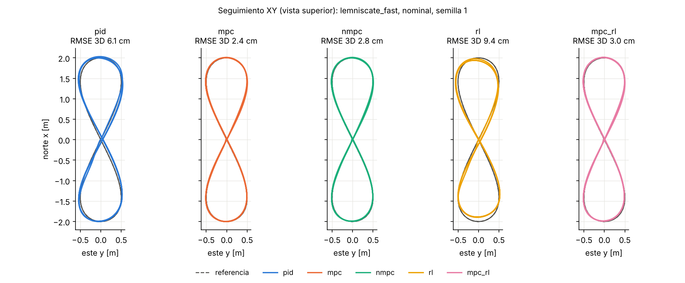
<figcaption>Figura en 8 rápida, escenario nominal, semilla 1: trayectoria horizontal de los cinco controladores sobre la referencia (banco final).</figcaption>
</figure>

<figure id="fig:err">
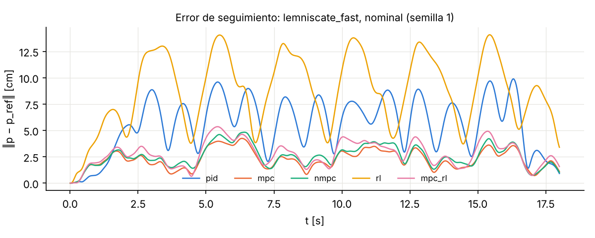
<figcaption>Norma del error de posición en la figura en 8 rápida, escenario nominal, semilla 1 (banco final).</figcaption>
</figure>

|                           | PID  | MPC  | NMPC | RL puro | MPC+RL |
|:--------------------------|:----:|:----:|:----:|:-------:|:------:|
| Sobreimpulso \[%\]        | 41.1 | 6.9  | 7.0  |   2.5   |  9.5   |
| Subida 10–90 % \[s\]      | 0.42 | 0.23 | 0.24 |  0.96   |  0.23  |
| Establecimiento 2 % \[s\] | n/d  | 1.42 | 1.34 |  1.92   |  1.54  |
| Error final \[cm\]        | 3.8  | 0.5  | 0.5  |   2.1   |  0.6   |

Trayectoria de escalones (caja de 1 m en XY y escalón de altura), escenario nominal: métricas de escalón horizontal promediadas sobre los escalones y las tres semillas. “n/d”: no queda dentro de la banda del 2 % antes del siguiente escalón.

## Lectura del banco

#### Qué permiten afirmar tres semillas.

En las filas de figura en 8 y círculo los rangos $\pm$ de MPC, NMPC y MPC+RL se solapan, de modo que la tabla, leída columna contra columna, no separa a esos tres. La comparación útil es por semilla, porque cada semilla da a todos los controladores el mismo ruido, el mismo sesgo y la misma turbulencia. Con ese criterio el MPC queda por debajo del PID en 48 de las 48 parejas (fila $\times$ semilla) y por debajo del NMPC en todas las semillas de 13 de las 16 filas; el MPC+RL queda por encima del MPC en 48 de las 48. Aun cuando las tres semillas coinciden, una prueba de signos da $p=0.25$ (bilateral): son tendencias consistentes, no diferencias estadísticamente probadas. Para probarlas harían falta más semillas. Hay además un detalle de cálculo: la validación de `docs/RL.md` usó la desviación poblacional y este banco la muestral, así que sus $\pm$ no se comparan directamente.

#### Controladores clásicos.

El MPC lineal tiene la media más baja en 15 de las 16 filas y el NMPC en 1. En la figura en 8 rápida nominal el MPC reduce el error del PID en 59 %, porque anticipa la referencia en lugar de reaccionar a ella. El NMPC cuesta unas 10 veces más cómputo que el MPC sin mejorarlo en las trayectorias suaves, por las razones de la sección anterior. Hay que recordar la asimetría de la afinación: PID, MPC y NMPC se afinaron con la semilla 1 de la figura en 8 y el círculo, que forma parte de esta tabla.

#### Interferencia magnética en maniobra rápida.

Es la fila más exigente del banco. En la figura en 8 rápida con interferencia magnética pierde la trayectoria (error máximo por encima de 1 m) el RL puro en todas las semillas. El de menor RMSE medio ahí es el NMPC, con 15.2 cm. Los demás la sostienen, y su resultado depende de una decisión de diseño del filtro de navegación. La compuerta de innovación (sección 11) rechaza una medida de posición solo si es improbable (más de 5 desviaciones estándar) *y* además grande (más de 25 cm, `gate_min_m`). Con la interferencia, el rumbo estimado se desvía y el acelerómetro se lleva al marco inercial con un rumbo equivocado, así que la predicción del filtro queda sesgada. Frente a un sensor de posición de 1 cm de ruido, una compuerta puramente estadística descartaría entonces de forma sistemática medidas correctas y el filtro derivaría: con ella, el MPC llega a 1.6 m de RMSE en esta fila; con el piso, a 16.27 cm. En las trayectorias lentas con interferencia la diferencia entre controladores es menor (el PID en la figura en 8 da 5.90 cm, frente a 3.00 cm del MPC); con los escalones de 1 m, en cambio, el PID entra en el ciclo límite descrito antes (133.44 cm).

#### Aprendizaje por refuerzo.

El RL puro no alcanza al MPC: en las 15 filas en que ni el RL puro ni el MPC pierden la trayectoria, su RMSE medio va de 1.55 a 4.40 veces el del MPC, y por semilla llega a 4.6. Tampoco es siempre el peor: supera al PID en cinco de las 16 filas (círculo con interferencia magnética; escalones en caja en los cuatro escenarios).

La causa de la brecha está, sobre todo, en la política. En su propio sustituto, sin aleatorizar, el RL puro ya comete 4.25 cm de RMSE en la figura en 8, frente a 0.14 cm del MPC (`validation_gap_ablation.json`, núcleo anterior); en esta tabla comete 4.56 cm. Casi todo el error ya existía donde se entrenó, y lo que falta en el sustituto explica el resto. Cuáles dinámicas faltantes pesan más (segundo orden del lazo de actitud, acoplamiento, ruido y retardo de la posición, vibración) es por ahora una hipótesis: la comparación entre sustituto y 6-DOF cambia todos esos factores a la vez y se hizo con el núcleo anterior, con un sustituto que hoy, re-identificado, da otros rezagos ($\approx$<!-- -->75 ms y 40 ms frente a 82.5 y 32 ms). El híbrido aumenta el RMSE del MPC entre un 0.5 y un 23 % según la fila; como se vio arriba, su residuo ya empeora al MPC dentro del sustituto.

# Barridos de parámetros y análisis de sensibilidad

Uno de los requisitos del proyecto es que los filtros también se sintonicen, como se sintoniza un PID, y que el software barra sus parámetros de forma automática. El módulo `quadsim/sweeps.py` (con `objectives.py` y `experiments/sweep_cli.py`) lo hace; el informe completo está en `docs/BARRIDOS.md`. Esta sección resume el método y los hallazgos que tocan al modelo.

## Método

Cada parámetro se nombra con una ruta de texto (`filter.rp.0.fc`, `estimator.ekf.accel_noise`, `pid.rp.rate_kd_scale`, `sensors.vib_gyro_dps`, …) que se aplica a la configuración o a la simulación viva solo con su API pública. Los diseños de experimento son grilla completa, aleatorio o hipercubo latino \[42\], con refinamiento local alrededor del mejor punto (paso exploratorio de Hooke y Jeeves \[43\]). Hay tres ingredientes que vuelven útil la comparación:

- **Números aleatorios comunes** \[44\]: la semilla depende de la réplica y no del punto, así que todos los puntos ven el mismo ruido, el mismo sesgo y la misma turbulencia; las diferencias entre puntos vienen de los parámetros, y dos réplicas ya muestran tendencias limpias.

- **Costo normalizado**, $J=\sum_kw_k\,m_k/m_k^{base}$, donde la base es la configuración por defecto con las mismas semillas ($J<1$ es mejor que el defecto), junto con el frente de Pareto de dos métricas, que es la respuesta honesta cuando hay compromiso.

- **Condiciones**: parámetros que son condiciones de operación (vibración, EMI) y no ajustes. Cada punto se corre en todas y el ranking es robusto (promedio o peor caso), para que el “mejor” punto no sea siempre el de la condición más fácil.

Los escenarios de evaluación incluyen escalones de actitud y un *doblete de tasa* de $\pm90^\circ$/s, porque el retardo de un filtro casi no se nota en el escalón de ángulo (el error de seguimiento varió entre 2.02 y $2.07^\circ$ con cortes de 20 a 200 Hz) y sí en la respuesta de tasa. El ruido que llega a los motores se mide como el RMS del acelerador por encima de 20 Hz en vuelo estacionario (`motor_hf_pct`): un motor con $T_m=20$ ms no sigue mandos más rápidos que unos 8 Hz, y esa energía se va en calor. Es un sustituto, porque el modelo de motor no tiene pérdidas eléctricas.

## Hallazgos que tocan al modelo

- **La vibración está donde dice el modelo.** En todas las corridas el tono dominante del giroscopio crudo está en 177.3–177.6 Hz, la frecuencia de paso de pala calculada.

- **Pasa-bajos: compromiso asimétrico.** Subir el corte de 80 a 200 Hz mejora el sobreimpulso de tasa 3.5 puntos pero multiplica por 13 el ruido de motor; bajarlo a 20 Hz casi no quita más ruido y dispara el sobreimpulso al 51 %. Con el mismo corte, un $Q=1.2$ atrasa menos que Butterworth.

- **Notch.** Centrado en 178 Hz con $Q=1$ reduce el ruido de motor 63 % con la mitad de retardo, y permite subir el pasa-bajos a 150 Hz. Un notch angosto ($Q=8$) descentrado 2 Hz pierde casi todo su beneficio: es la razón de los notch dinámicos ligados a las rpm.

- **El derivativo SIMC era bajo.** Con $k_d=K_c\theta/3$ el doblete de tasa tiene 20 % de sobreimpulso; con el triple, 5.3 %, con solo 7 % más de ruido de motor. Kd y corte del filtro deben moverse juntos: bajar el corte a 40–60 Hz y subir $k_d$ de 3 a 4 veces da 3–6 % de sobreimpulso con 40–70 % menos ruido.

- **Estimadores.** El EKF con $\sigma_a=\sigma_m=0.05$ estaba mal sintonizado: sin EMI, $(\sigma_a,\sigma_m)\approx(1.1,\,0.007)$ baja el error de roll/pitch y de yaw 3 y 7 veces; el punto robusto frente a EMI es $(0.5,\,0.3)$; $\beta$ de Madgwick óptimo entre 0.10 y 0.15; Mahony por defecto a 3 % de su óptimo. Con EMI ninguna ganancia arregla el rumbo: en Madgwick y Mahony el magnetómetro corrige los tres ejes y contamina roll y pitch.

- **Los barridos encuentran los huecos del costo.** Una primera versión del costo sin el tiempo de establecimiento del ángulo llevó al optimizador a bajar la ganancia de tasa y “ganar” con un dron lento; y sintonizar el filtro solo en vuelo estacionario con turbulencia lleva a un filtro excesivo (20 Hz). El escenario y el costo deben excitar la dinámica que se quiere proteger.

#### Qué transfiere al dron real.

La forma de los compromisos, no los números: la amplitud y el espectro de la vibración son supuestos. Antes de transferir una sintonía de filtros hay que medir el espectro real del giroscopio en hover, ajustar $A_g$ en el simulador hasta que el pico coincida, y repetir el barrido.

#### Qué se aplicó al núcleo.

A partir de estos barridos y de la verificación de este documento se cambiaron los valores por defecto: $k_d$ de tasa de $K_c\theta/3$ a $K_c\theta$, pasa-bajos del giroscopio de 80 a 60 Hz, ruidos del EKF a $(\sigma_a,\sigma_m)=(0.5,0.3)$, Butterworth de 30 Hz sobre el acelerómetro antes del AHRS y estimador por defecto Mahony. Para $\beta$ de Madgwick *no* se tomó el óptimo del barrido (0.10–0.15) sino 0.015: el barrido corría el estimador en sombra con el acelerómetro crudo, y en lazo cerrado con el acelerómetro filtrado un $\beta$ grande produce un ciclo límite (sección 11). Con los nuevos valores, el escenario `attitude_step` pasó de 20.1 a 5.9 % de sobreimpulso de tasa y de 0.78 a 0.43$^\circ$ de error de estimación con Madgwick (0.51$^\circ$ con Mahony); en `estimator_accuracy` el error RMS bajó de 0.70 a 0.63$^\circ$ con Mahony y de 1.14 a 0.68$^\circ$ con el EKF, cuyo error de rumbo pasó de 2.55 a 0.43$^\circ$. Las tablas de `docs/BARRIDOS.md` se produjeron con el núcleo anterior.

#### Barridos de estimadores: sombra y vuelo.

Los barridos de `madgwick_beta`, `mahony_gains` y `ekf_noise` corren el estimador candidato en sombra. Hasta la revisión de octubre de 2026 esa cadena no era la que se vuela: recibía el acelerómetro sin el Butterworth previo al AHRS y una aceleración cinemática calculada por un filtro de navegación alimentado con el estimador ideal, sin el lazo autorreferente de la sección 11.2. La revisión externa midió 1.26$^\circ$ RMS en sombra frente a 0.43$^\circ$ en el lazo para Madgwick. Hoy la sombra y el vuelo usan la misma función (`quadsim/estimation.py`); los resultados de esos barridos en `docs/BARRIDOS.md` se obtuvieron con la cadena anterior, y por eso el $\beta$ por defecto se decidió con mediciones en lazo cerrado y no con el óptimo del barrido.

# Limitaciones y trabajo futuro

Un modelo se defiende mejor declarando sus límites que escondiéndolos. Esta sección separa lo que se omitió a sabiendas, con su justificación, de lo que se detectó durante la verificación o en la revisión externa y sigue abierto, y termina con los datos del dron real que hacen falta para cerrar varios de esos puntos.

## Omisiones del modelo físico

- **Dinámica eléctrica del motor y reacción por aceleración del rotor.** El propulsor de primer orden no satura la corriente, por lo que su aceleración inicial ante un escalón es irreal y el término $-\dot{\boldsymbol{h}}_r$ se omite (sección 4.5). Un modelo con resistencia de devanado, constante $K_t$ y límite de corriente permitiría incluirlo y daría además una medida directa de calentamiento, en lugar del sustituto `motor_hf_pct`.

- **Constante de tiempo del motor.** $T_m=20$ ms viene de CopterSim, no de los motores del proyecto, y es la misma en todo punto de operación, con carga o sin ella, al acelerar y al frenar, sin límite de pendiente. El lazo de tasa es más sensible a $T_m$ que a los retardos omitidos: con 30 ms el margen de fase baja de 58.7 a 48.1$^\circ$ (sección 14).

- **Batería.** Voltaje constante: $C_R$ no cae durante el vuelo y el acelerador de hover no deriva. CopterSim trae un modelo de batería que podría portarse.

- **Aerodinámica del rotor.** No hay *blade flapping*, arrastre inducido ni pérdida de empuje en vuelo de avance, que a velocidades de varios m/s producen fuerzas horizontales y momentos de cabeceo proporcionales a la velocidad. Tampoco hay anillo de vórtices en descensos rápidos. El arrastre vertical es un supuesto y el momento del arrastre por la separación de 0.12 m entre centro aerodinámico y de masa que declara CopterSim no se modela.

- **Efecto suelo.** Escala el empuje de cada rotor pero no su par de arrastre. Es un supuesto de modelado, no una consecuencia del modelo de efecto suelo elegido.

- **Forma del empuje.** $T=C_T\Omega^2$ puro, frente al ajuste $b\Omega^2+a\Omega+c$ que Quitian Niño \[8\] encontró significativo en banco.

- **Inercia y carga.** Tensor diagonal; la carga útil no agrega productos de inercia y su desplazamiento vertical del centro de masa no produce brazo para el empuje.

- **Turbulencia.** Filtros de primer orden en los tres ejes, alineados con NED (sección 13).

- **Suelo.** Restricción simple sin fricción ni rebote.

## Omisiones de la cadena digital

- **ESC.** Por defecto responde de forma instantánea y continua a $\sigma$: no hay frecuencia de PWM, protocolo (PWM, OneShot, DShot) ni filtrado de entrada. Con PWM de 50 Hz el margen de fase del lazo de tasa caería a 39.6$^\circ$ y la ganancia admisible a 2.4 veces (tabla 14.2). Las opciones `esc_rate_hz` y `esc_pulse_delay_s` permiten estudiarlo, pero el valor real del dron del proyecto no se conoce todavía.

- **Retardo de cómputo.** Por defecto el mando se aplica en el mismo periodo en que se calcula; `compute_delay_samples` agrega uno o más periodos. Su efecto sobre los márgenes está en la sección 14.

- **Resolución del acelerador.** $\sigma$ es continuo por defecto. Con el LEDC del ESP32 a 50 Hz y 10 bits quedan unos 51 escalones útiles, que pueden generar ciclos límite; `throttle_levels` permite cuantizarlo.

- **Temporización ideal.** El lazo es perfectamente periódico: no hay *jitter* de FreeRTOS (interrupciones de la radio NRF24 o del WiFi, lecturas I2C), ni desfase entre la tasa de salida de la IMU y el lazo de 500 Hz, ni el filtro digital interno de la IMU. El retardo de 2 ms de la IMU es un supuesto sin fuente citada.

- **Barómetro.** Un ruido de 0.17 m corresponde a un modo de alta resolución del BMP180, cuya conversión limita la tasa a unos 13–33 Hz; la simulación usa 40 Hz. Falta contrastarlo con la hoja de datos y con la configuración del firmware.

- **Enlace de posición.** Además del retardo de 10 ms del sensor, `pos_link_delay_s` suma la latencia del enlace (captura de movimiento o radio, típicamente 5–30 ms). Vale 0 por defecto porque depende del sistema de posicionamiento que se use con el dron real.

Los valores por defecto de las opciones nuevas (`compute_delay_samples`, `esc_rate_hz`, `esc_pulse_delay_s`, `throttle_levels`, `pos_link_delay_s`) conservan el comportamiento con el que se identificaron los rezagos y se afinaron los controladores, para que las cifras de este documento sigan siendo reproducibles. Una sintonía hecha con ellas desactivadas es optimista en margen de fase. Antes de llevarla al dron conviene repetir el escalón de tasa con los valores reales del ESC y del firmware.

## Hallazgos de la verificación

Varios hallazgos de la verificación ya se corrigieron en el núcleo y este documento describe el estado corregido: el pasa-bajos del acelerómetro antes del AHRS, que elimina el sesgo de inclinación por rectificación de la vibración (de 1.26 a 0.54$^\circ$ con Madgwick); el arranque en el aire coherente (líneas de retardo llenas, AHRS alineado, covarianza de navegación en régimen); el filtro que se rediseña en vuelo sin transitorio; los valores por defecto de $k_d$, del filtro del giroscopio, del EKF y de $\beta$. La revisión externa de octubre de 2026 llevó a corregir además: la compensación de aceleración, que ya no se aplica sin correcciones horizontales de posición absoluta, entra en rampa, se recorta y pasa por el mismo filtro que el acelerómetro (sección 11.2); la corrección magnética de Madgwick y Mahony, que ahora solo actúa sobre el rumbo; la base de tiempo con razones no enteras entre física y control (sección 14); la línea de retardo de los sensores, que ahora admite retardo nulo y fraccional y arranca cebada; la validación de nombres de estimadores y de ganancias, que antes ignoraba sin aviso una clave mal escrita; el tope del integrador de Mahony; el registro, que ya no descarta columnas que aparecen a mitad de corrida; y una regularización adaptativa en el iLQR del NMPC. Quedan abiertos:

- **Compensación de aceleración.** Con sensor de posición sigue siendo autorreferente entre correcciones y queda un desfase de unos 17 ms entre las dos señales que se restan (sección 11.2). Sin sensor de posición queda desactivada, así que en ese modo el AHRS vuelve a equivocarse durante las aceleraciones sostenidas. La solución de fondo es un filtro de navegación con el error de actitud como estado.

- **Error de actitud en ángulos de Euler.** El lazo de ángulo resta ángulos de Euler. Es válido con el límite de 30$^\circ$, pero se degrada en maniobras agresivas y es singular cerca de $\pm90^\circ$ de cabeceo; PX4 usa el error de cuaternión.

- **Madgwick sin estimación de sesgo.** El término de compensación de deriva del artículo original no está implementado; la comparación con Mahony y el EKF, que sí estiman el sesgo, debe leerse con eso en mente.

- **Retardo de la cadena en la sintonía.** Las ganancias por defecto se calculan con la cadena nominal ($\theta=16.0$ ms); la cadena configurada, con filtros, cómputo y ESC, solo se usa con `gains_from_chain` (sección 12). Ninguna de las dos incluye el filtro del derivativo ni la fase exacta del motor.

- **Barridos de estimadores anteriores.** Las tablas de `docs/BARRIDOS.md` se obtuvieron con la cadena de sombra anterior, que no era la que se vuela (sección 16); habría que repetirlos.

- **Rezagos y políticas sin regenerar.** `DEFAULT_LAGS`, los pesos del MPC y del NMPC y las políticas de RL se obtuvieron con el núcleo anterior (Madgwick, sin filtro de acelerómetro); no se volvieron a identificar, afinar ni entrenar (sección 15). Re-identificar el sustituto hoy da otros rezagos, así que la receta de `docs/RL.md` no reproduce exactamente los archivos de `models/`.

- **Ciclo límite del PID con EMI en escalones.** Incluso con $K_{i,xy}=2$ (sección 15).

- **Exponente de la EMI.** $\sigma^{1.5}$ no se deriva del modelo de propulsor (sección 13).

- **Fusión del barómetro con el sensor de posición activo.** Inocua en la práctica, pero no intencional (sección 11).

## Alcance del banco de controladores

- **Tres semillas.** Bastan para ver tendencias consistentes, no para probar diferencias de milímetros (sección 15.10).

- **Afinación sobre el conjunto de prueba.** PID, MPC y NMPC se afinaron con la semilla 1 de la figura en 8 y el círculo, que forma parte del banco, y el integral del PID se eligió mirando el caso con EMI. El RL no tuvo esa ventaja.

- **Aprendizaje por refuerzo.** Un solo entrenamiento PPO por política, cortado cuando la curva todavía bajaba; previsión, observación, salida y límite de inclinación distintos de los del MPC; validación con trayectorias que pertenecen a la familia de entrenamiento; y un residuo elegido por costo y no por error. Las conclusiones valen para estas políticas, no para el RL en general.

## Datos pendientes del dron real

Cuatro mediciones cerrarían buena parte de lo anterior:

1.  protocolo y frecuencia de actualización del ESC del dron (PWM, OneShot o DShot, y su tasa);

2.  constante de tiempo del motor medida en banco, con escalones de acelerador y tacómetro óptico, en subida y en bajada;

3.  modo y tasa reales del BMP180 en el firmware;

4.  sistema de posicionamiento disponible (captura de movimiento, RTK o ninguno) y su latencia, que decide si la compensación de aceleración puede usarse y cuánto retardo tiene la posición.

## Trabajo futuro

El paso que más valor agrega es medir el dron real del proyecto y reemplazar los parámetros de la literatura: masa y brazo, $C_T$ y $C_M$ en banco, la recta del ESC y $T_m$ con escalones, inercias con péndulo compuesto y trifilar (el protocolo de Quitian Niño \[8\], de esta misma universidad, ya describe esos bancos), y el espectro de vibración en hover. Con esos números y los datos pendientes de arriba, el flujo que este documento verifica (identificar los rezagos, derivar ganancias SIMC, afinar en simulación con barridos y validar con el banco) se repite sobre el vehículo real. Para los controladores de aprendizaje el orden es el contrario del que sugería la edición anterior: primero mejorar la política (observaciones normalizadas, la misma previsión que el MPC, salida como corrección sobre la aceleración de referencia, selección por error de validación y varias semillas de entrenamiento) y después, con una ablación de un factor a la vez, decidir qué le falta al sustituto.

# Referencias

1.  Quan, Q. (2017). *Introduction to Multicopter Design and Control*. Springer, Singapur. (Caps. 4, 5 y 6: propulsor, marcos y modelo dinámico.)

2.  Quan, Q., Dai, X. y Wang, S. (2020). *Multicopter Design and Control Practice: A Series Experiments Based on MATLAB and Pixhawk*. Springer, Singapur. ISBN 978-981-15-3137-8.

3.  Dai, X. CopterSim, archivo `Init.m`. Repositorio `github.com/XunhuaDai/CopterSim`, commit `0d14487f` (25 de julio de 2019). Consultado el 4 de octubre de 2026.

4.  Powers, C., Mellinger, D. y Kumar, V. (2015). Quadrotor kinematics and dynamics. En K. P. Valavanis y G. J. Vachtsevanos (eds.), *Handbook of Unmanned Aerial Vehicles*, cap. 16, pp. 307–328. Springer.

5.  Phang, S. K., Li, K., Chen, B. M. y Lee, T. H. (2015). Systematic design methodology and construction of micro aerial quadrotor vehicles. En *Handbook of Unmanned Aerial Vehicles*, cap. 11, pp. 181–206. Springer.

6.  Jiřinec, T. (2011). *Stabilization and Control of Unmanned Quadcopter*. Tesis de maestría, Czech Technical University in Prague.

7.  Luukkonen, T. (2011). *Modelling and Control of Quadcopter*. Independent research project, Aalto University School of Science, Espoo.

8.  Quitian Niño, L. C. (2022). *Construcción de bancos de prueba para la medición experimental de los parámetros del modelo dinámico de drones – UAS*. Tesis de maestría, Universidad Nacional de Colombia, Bogotá.

9.  Larotta Mariño, L. A. (2024). *Control de posición para un cuadricóptero basado en un sistema de realidad virtual*. Tesis de maestría, Universidad Nacional de Colombia, Bogotá.

10. Madgwick, S. O. H., Harrison, A. J. L. y Vaidyanathan, R. (2011). Estimation of IMU and MARG orientation using a gradient descent algorithm. *IEEE International Conference on Rehabilitation Robotics (ICORR)*.

11. Mahony, R., Hamel, T. y Pflimlin, J.-M. (2008). Nonlinear complementary filters on the special orthogonal group. *IEEE Transactions on Automatic Control*, 53(5), 1203–1218.

12. Sabatini, A. M. (2006). Quaternion-based extended Kalman filter for determining orientation by inertial and magnetic sensing. *IEEE Transactions on Biomedical Engineering*, 53(7), 1346–1356.

13. Leishman, R. C., Macdonald, J. C., Beard, R. W. y McLain, T. W. (2014). Quadrotors and accelerometers: State estimation with an improved dynamic model. *IEEE Control Systems Magazine*, 34(1), 28–41.

14. Skogestad, S. (2003). Simple analytic rules for model reduction and PID controller tuning. *Journal of Process Control*, 13(4), 291–309.

15. Åström, K. J. y Hägglund, T. (2004). Revisiting the Ziegler–Nichols step response method for PID control. *Journal of Process Control*, 14(6), 635–650.

16. Mellinger, D. y Kumar, V. (2011). Minimum snap trajectory generation and control for quadrotors. *IEEE International Conference on Robotics and Automation (ICRA)*, 2520–2525.

17. Richter, C., Bry, A. y Roy, N. (2013). Polynomial trajectory planning for aggressive quadrotor flight in dense indoor environments. *International Symposium of Robotics Research (ISRR)*.

18. Cheeseman, I. C. y Bennett, W. E. (1955). The effect of the ground on a helicopter rotor in forward flight. *Aeronautical Research Council, Reports and Memoranda* No. 3021.

19. U.S. Department of Defense (1980). *MIL-F-8785C: Flying Qualities of Piloted Airplanes*.

20. U.S. Department of Defense (1997). *MIL-HDBK-1797: Flying Qualities of Piloted Aircraft*.

21. Bristow-Johnson, R. *Cookbook formulae for audio EQ biquad filter coefficients* (“Audio EQ Cookbook”). Documento técnico de amplia circulación, publicado por la W3C como nota de grupo de trabajo.

22. STMicroelectronics. *ISM330DHCX: iNEMO inertial module, 3D accelerometer and 3D gyroscope*. Hoja de datos DS13012.

23. MEMSIC. *MMC5983MA: 3-axis magnetic sensor*. Hoja de datos.

24. Bosch Sensortec. *BMP180 digital pressure sensor*. Hoja de datos BST-BMP180-DS000.

25. Brandt, J. B., Deters, R. W., Ananda, G. K., Dantsker, O. D. y Selig, M. S. *UIUC Propeller Database*. University of Illinois at Urbana-Champaign.

26. Hairer, E., Nørsett, S. P. y Wanner, G. (1993). *Solving Ordinary Differential Equations I: Nonstiff Problems*, 2.ª ed. Springer.

27. Landau, L. D. y Lifshitz, E. M. (1976). *Mechanics*, 3.ª ed. (Course of Theoretical Physics, vol. 1). Pergamon.

28. Beck, A. y Teboulle, M. (2009). A fast iterative shrinkage-thresholding algorithm for linear inverse problems. *SIAM Journal on Imaging Sciences*, 2(1), 183–202.

29. O’Donoghue, B. y Candès, E. (2015). Adaptive restart for accelerated gradient schemes. *Foundations of Computational Mathematics*, 15(3), 715–732.

30. Pannocchia, G. y Rawlings, J. B. (2003). Disturbance models for offset-free model-predictive control. *AIChE Journal*, 49(2), 426–437.

31. Maeder, U., Borrelli, F. y Morari, M. (2009). Linear offset-free model predictive control. *Automatica*, 45(10), 2214–2222.

32. Li, W. y Todorov, E. (2004). Iterative linear quadratic regulator design for nonlinear biological movement systems. *International Conference on Informatics in Control, Automation and Robotics (ICINCO)*.

33. Tassa, Y., Erez, T. y Todorov, E. (2012). Synthesis and stabilization of complex behaviors through online trajectory optimization. *IEEE/RSJ International Conference on Intelligent Robots and Systems (IROS)*.

34. Tassa, Y., Mansard, N. y Todorov, E. (2014). Control-limited differential dynamic programming. *IEEE International Conference on Robotics and Automation (ICRA)*.

35. Diehl, M., Bock, H. G. y Schlöder, J. P. (2005). A real-time iteration scheme for nonlinear optimization in optimal feedback control. *SIAM Journal on Control and Optimization*, 43(5), 1714–1736.

36. Torrente, G., Kaufmann, E., Föhn, P. y Scaramuzza, D. (2021). Data-driven MPC for quadrotors. *IEEE Robotics and Automation Letters*, 6(2), 3769–3776.

37. Sun, S., Romero, A., Foehn, P., Kaufmann, E. y Scaramuzza, D. (2022). A comparative study of nonlinear MPC and differential-flatness-based control for quadrotor agile flight. *IEEE Transactions on Robotics*, 38(6), 3357–3373.

38. Schulman, J., Wolski, F., Dhariwal, P., Radford, A. y Klimov, O. (2017). Proximal policy optimization algorithms. arXiv:1707.06347.

39. Johannink, T., Bahl, S., Nair, A., Luo, J., Kumar, A., Loskyll, M., Ojea, J. A., Solowjow, E. y Levine, S. (2019). Residual reinforcement learning for robot control. *IEEE International Conference on Robotics and Automation (ICRA)*.

40. Silver, T., Allen, K., Tenenbaum, J. y Kaelbling, L. (2018). Residual policy learning. arXiv:1812.06298.

41. Tobin, J., Fong, R., Ray, A., Schneider, J., Zaremba, W. y Abbeel, P. (2017). Domain randomization for transferring deep neural networks from simulation to the real world. *IEEE/RSJ IROS*.

42. McKay, M. D., Beckman, R. J. y Conover, W. J. (1979). A comparison of three methods for selecting values of input variables in the analysis of output from a computer code. *Technometrics*, 21(2), 239–245.

43. Hooke, R. y Jeeves, T. A. (1961). “Direct search” solution of numerical and statistical problems. *Journal of the ACM*, 8(2), 212–229.

44. Law, A. M. y Kelton, W. D. *Simulation Modeling and Analysis*. McGraw-Hill (cap. sobre técnicas de reducción de varianza: números aleatorios comunes).
