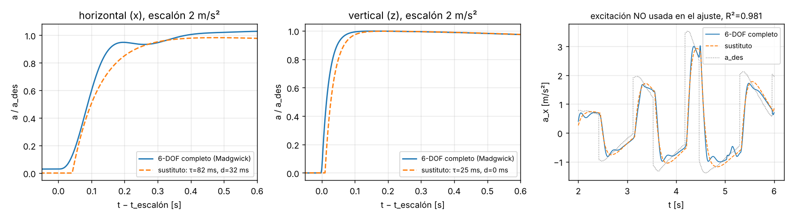
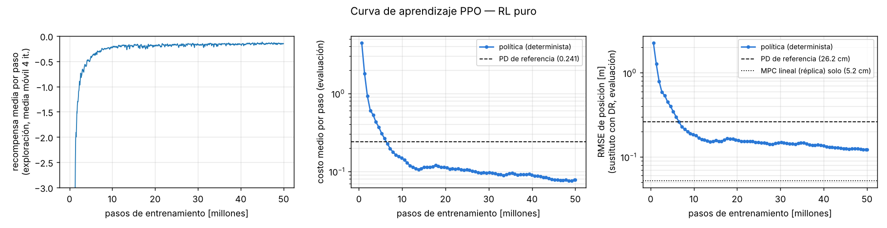
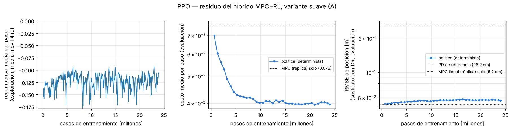
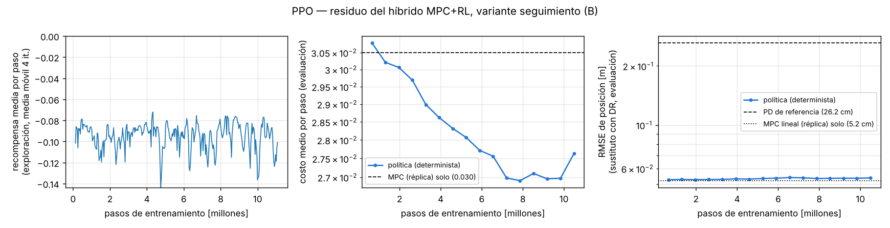
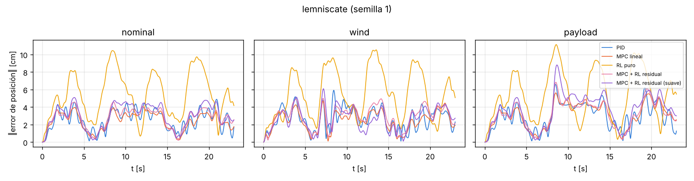
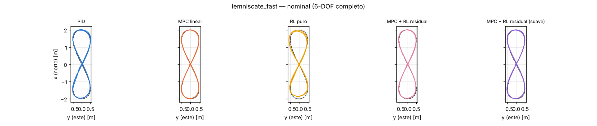

# Aprendizaje por refuerzo para el lazo de posición: RL puro y MPC + RL residual

Este documento describe los dos controladores de posición basados en aprendizaje del
simulador QuadSIM-PRIMBIO:

| clave | clase | qué entrega |
|---|---|---|
| `"rl"` | `quadsim.control.position.rl.RLPositionController` | la aceleración deseada NED sale **directamente** de una red neuronal |
| `"mpc_rl"` | `quadsim.control.position.mpc_rl.MPCRLController` | MPC lineal real + una **corrección residual** aprendida |

Ambos van **encima** del mismo lazo de actitud en cascada que usan PID, MPC y NMPC
(entregan `PositionCommand.a_des`); por eso la comparación es justa: misma planta,
mismos sensores, mismo estimador, mismo bajo nivel.

Todas las cifras de este documento salen de corridas reales; los archivos que las
contienen se indican en cada sección. Para reproducirlo todo:

```bash
PYTHONPATH=. python experiments/train_rl.py identify          # 1. identificación (≈5 s)
PYTHONPATH=. python experiments/train_rl.py surrogate         # 2. figura sustituto vs 6-DOF
PYTHONPATH=. python experiments/train_rl.py train --mode pure --steps 50000000 --lr 1e-3 --log-std-init -1.6
# híbrido, variante "suave" (A) -> se renombra a models/mpc_rl_residual_smooth.npz
PYTHONPATH=. python experiments/train_rl.py train --mode residual --steps 24000000 --lr 5e-4 --log-std-init -2.0
# híbrido, variante "seguimiento" (B, la de defecto) -> models/residual_track_best.npz,
# copiada a models/mpc_rl_residual.npz
PYTHONPATH=. python experiments/train_rl.py train --mode residual --tag residual_track \
    --steps 20000000 --lr 5e-4 --log-std-init -2.0 --w-da 0.002 --w-a 0 --w-res 0.001
PYTHONPATH=. python experiments/train_rl.py replot            # curvas de aprendizaje
PYTHONPATH=. python experiments/train_rl.py validate          # 5. validación en el 6-DOF
PYTHONPATH=. pytest -q tests/test_rl.py
```

---

## 1. Por qué RL *offline* y cómo se hizo

Uno de los requisitos de diseño del proyecto fue no entrenar nunca un RL sobre una planta
lenta: primero entrenamiento *offline* en un entorno rápido, después Sim2Real y al final
validación. El simulador 6-DOF completo corre a
≈13× tiempo real (≈1 300 pasos del lazo externo por segundo). PPO necesita del orden
de 10⁷ pasos: en el 6-DOF serían ≈2–3 horas **por millón** de pasos. Por eso:

1. **Identificación** (`quadsim/rl/surrogate.py`): se excita el simulador 6-DOF
   completo con escalones aleatorios de `a_des` y se ajusta un modelo reducido.
2. **Entorno sustituto rápido** (`quadsim/rl/env.py`): solo la dinámica traslacional
   con ese modelo, vectorizado en numpy (128 copias en paralelo), con
   **aleatorización de dominio**. El entorno solo corre a ≈1.1·10⁵ pasos/s (modo
   puro) o ≈1.3·10⁴ pasos/s (modo híbrido: incluye la réplica del MPC con previsión
   de 20 pasos). Con PPO incluido, el entrenamiento procesó ≈25 000 pasos/s (puro)
   y ≈9 000 pasos/s (híbrido), contra ≈450–700 pasos del lazo externo por segundo
   del 6-DOF con estos controladores (factor de tiempo real medido 4.5–7×): ≈40×
   (puro) y ≈20× (híbrido) más rápido.
3. **Entrenamiento PPO offline** (`quadsim/rl/ppo.py`, `experiments/train_rl.py`).
4. **Sim2Real (aquí Sim2Sim)**: la política se ejecuta **sin reentrenar** en el
   simulador 6-DOF completo (planta no lineal a 1 kHz, IMU con ruido y vibración,
   AHRS Madgwick, filtro de navegación, cascada de actitud, mezclador, ESC).
5. **Validación** (`quadsim/rl/validation.py`): banco de comparación con el mismo
   protocolo de `experiments/benchmark_controllers.py`.

> **Nota sobre torch.** El plan inicial era entrenar con PyTorch en CPU. En la máquina
> de desarrollo no fue posible instalarlo, así que PPO se implementó en **numpy puro**
> con retropropagación manual (verificada contra diferencias finitas, error
> < 3·10⁻¹⁰; test `test_numpy_mlp_gradients`). Resultó conveniente: el entrenamiento
> corre en cualquier equipo Windows o Linux sin dependencias extra. La inferencia en
> ejecución (`quadsim/rl/policy.py`) siempre fue numpy-only.

---

## 2. Modelo sustituto e identificación

### 2.1 Modelo

Visto desde el lazo de posición, todo lo que hay debajo (AHRS, cascada
ángulo→tasa→momento, mezclador, ESC+motor, dinámica de rotación) es un sistema
`a_des → a_real`. Por planitud diferencial (Mellinger y Kumar, 2011) ese sistema es,
en primera aproximación, retardo + primer orden por eje:

$$
a_{thr}(s) = \frac{e^{-d s}}{\tau s + 1}\, a_{des}(s)
\qquad
\mathbf a = g\mathbf e_3 + \frac{m_{nom}}{m}\left(\mathbf a_{thr} - g\mathbf e_3\right)
 - \frac{c_d}{m}\,\mathbf v_r\lvert\mathbf v_r\rvert,\quad \mathbf v_r = \mathbf v - \mathbf w
$$

El factor `m_nom/m` modela que el autopiloto calcula el empuje con la masa
**nominal** (no sabe de la carga); el arrastre cuadrático del fuselaje usa
`cd_quad_xy = 0.055 N/(m/s)²` del vehículo y actúa sobre la velocidad relativa al
viento `w`. Es el modelo "aceleración con rezago de primer orden" típico del MPC de
multirrotores (p. ej. Kamel et al., 2017, sec. 3.2).

### 2.2 Identificación (`experiments/train_rl.py identify`)

Excitación: escalones aleatorios de `a_des` (±2.5 m/s² horizontal, ±2 m/s² vertical,
duración 0.25–0.7 s) más un PD débil que mantiene el dron cerca del origen, 30 s,
estimador Madgwick, inicialización del banco (`scenarios.prepare_tracking_sim`).
Ajuste: rejilla (τ, d) por mínimos cuadrados sobre la aceleración verdadera
(derivada de la velocidad verdadera), descartando los 2 primeros segundos.

| parámetro | valor (`models/surrogate_id.json`) | R² del ajuste |
|---|---|---|
| τ horizontal | **82.5 ms** | 0.982 |
| retardo horizontal d | **32 ms** | |
| τ vertical | **25 ms** | 0.920 |
| retardo vertical | 0 ms | |
| c_d/m | 0.0393 1/m (del vehículo) | |

**Validación del sustituto** (figura `experiments/results/rl/surrogate_vs_6dof.png`):



* Panel derecho: excitación aleatoria con otra semilla, **no usada en el ajuste**:
  R² = **0.981** en a_x.
* Escalón de 2 m/s²: error RMS relativo 6.9 % (horizontal) y 7.1 % (vertical) en los
  0.6 s posteriores. El 6-DOF horizontal es en realidad de **segundo orden** (sube más
  rápido, joroba en 0.2 s y cola lenta por el integrador del lazo de tasa); el primer
  orden + retardo lo aproxima pero no lo copia. Esa discrepancia se cubre con la
  aleatorización de τ (±30 %) y del retardo (10–50 ms), y es una de las fuentes de la
  brecha sustituto → 6-DOF medida en la sección 6.2.
* Coherencia con la identificación del banco de control: `quadsim/identification.py` (escalones,
  otro método) da FOPDT τ = 61.8 ms + 43 ms o primer orden puro 119 ms. Las tres
  descripciones tienen el mismo "retardo equivalente" τ + d ≈ 105–119 ms; la de este
  documento se ajustó sobre excitación aleatoria (más representativa del seguimiento) y
  describe mejor ese régimen.

> **Dos versiones de la identificación.** La política pura se entrenó con una primera
> identificación (τ = 90 ms, d = 28 ms, R² = 0.951) hecha **antes** de usar la
> inicialización del banco; el AHRS arrancaba con ~9° de error y eso sesgaba el
> ajuste. La versión corregida (82.5 ms / 32 ms, R² 0.982) se usó para el híbrido.
> Ambas caen dentro del rango aleatorizado; los parámetros exactos con los que se
> entrenó cada política están guardados en su archivo (`meta["surrogate"]`) y en
> `experiments/results/rl/surrogate_id_v1_used_for_pure.json`.
>
> Las dos se hicieron con el núcleo anterior (estimador Madgwick, sin filtro del
> acelerómetro). Repetir hoy `train_rl.py identify` con el núcleo corregido da otros
> rezagos, del orden de τ = 75 ms y d = 40 ms. Para no cambiar en silencio el entorno de
> entrenamiento ni la validación, `identify` escribe ahora un archivo versionado
> (`models/surrogate_id_vN.json`) y deja intacto `models/surrogate_id.json`; promover
> una identificación nueva es una decisión explícita. Aun así, la receta del inicio de
> este documento ya no reproduce bit a bit los archivos de `models/`: para reconstruir
> las políticas publicadas hay que usar los parámetros guardados en cada `.npz`, y al
> cargar una política se registra un aviso si su sustituto difiere del vigente. La
> columna "sustituto: RL" de la sección 6.2 se calculó con el sustituto corregido
> (82.5/32 ms), no con el de la versión 1 con que se entrenó la política pura; el
> código de validación usa ahora el sustituto de cada política.

---

## 3. Formulación del MDP

Paso de decisión Δt = 10 ms (= lazo externo de 100 Hz del simulador). Episodios de
10 s (1 000 pasos) sobre referencias aleatorias.

### 3.1 Observación (`quadsim/rl/common.py: build_obs`, idéntica en entrenamiento y ejecución)

| término | dim | escala |
|---|---|---|
| e_p = p̂ − p_ref (posición **estimada**) | 3 | /1 m, recorte ±3 |
| e_v = v̂ − v_ref | 3 | /2 m/s, recorte ±3 |
| v_ref | 3 | /3 m/s |
| a_ref | 3 | /5 m/s² |
| previsión p_ref(t+0.25 s) − p_ref(t) | 3 | /1 m |
| previsión p_ref(t+0.5 s) − p_ref(t) | 3 | /1 m |
| última a_des aplicada | 3 | /6 m/s² |
| integral con fugas de e_p: İ = e_p − I/3 s, \|I\| ≤ 1 | 3 | /1 m·s |
| *(híbrido)* acción del MPC a_MPC | 3 | /6 m/s² |
| *(híbrido)* perturbación estimada por el observador del MPC d̂ | 3 | /3 m/s² |

24 entradas (puro) o 30 (híbrido). Las escalas son **fijas** (no estadísticas
aprendidas), para que el archivo `.npz` sea autocontenido. La integral con fugas le
da a la red información para cancelar sesgos lentos (carga, viento medio), como la I
de un PID.

Esta observación se queda corta frente a lo que recibe el MPC, y conviene decirlo antes
de comparar. La previsión llega a 0.5 s (el MPC ve 1 s, con `v_ref` y la
prealimentación `a_ref + τ·j_ref`). Las escalas fijas hacen que errores de pocos
centímetros entren a la red como 0.01–0.05, sin la normalización por media y
desviación móviles que recomiendan Huang et al. (2022). La salida tampoco está
estructurada como `a_ref + corrección`: la red tiene que aprender la prealimentación
por su cuenta.

### 3.2 Acción

* **Puro:** u ∈ [−1, 1]³ (media de la política pasada por tanh),
  `a_des = proy_cono30°(6 m/s² · u)`: un cono de 30° de inclinación. No es exactamente
  el límite de los demás. PID, MPC y MPC no lineal recortan con una caja por eje
  (|a_x|, |a_y| ≤ g·tan 30°), que en diagonal admite hasta atan(√2·tan 30°) ≈ 39°,
  recortados a 35° por el simulador. El RL puro tiene, entonces, algo menos de
  autoridad en maniobras diagonales.
* **Híbrido:** `a_des = clip_caja(a_MPC + R·u)`, R = 2 m/s² por eje; la caja es la del
  MPC/PID (`common.accel_limits`: |a_xy| ≤ g·tan 30° = 5.66 m/s²).

### 3.3 Recompensa

$$
c_k = w_{pl}\,\lVert\mathbf e_p\rVert + w_p\lVert\mathbf e_p\rVert^2 + w_v\lVert\mathbf e_v\rVert^2
 + w_a\lVert\mathbf a_k-\mathbf a_{ref}\rVert^2 + w_{da}\lVert\mathbf a_k-\mathbf a_{k-1}\rVert^2
 \;[+\,w_{res}\lVert R\mathbf u_k\rVert^2]
\qquad r_k = -\min(c_k, 25)
$$

con los errores **verdaderos** (información privilegiada, válida porque solo existe
durante el entrenamiento offline; la política solo ve los estimados). Si
‖e_p‖ > 5 m el episodio termina con r = −25/(1−γ). El término **lineal** w_pl‖e_p‖ es
deliberado: con solo ‖e_p‖², en una corrida de prueba la política se estancó en
RMSE ≈ 0.45 m, porque bajar de 5 a 2 cm cambiaba el costo en 2·10⁻³ por paso, por
debajo del ruido de la estimación de ventajas.

| peso | RL puro | híbrido "suave" (A) | híbrido "seguimiento" (B) |
|---|---|---|---|
| w_pl | 1.0 | 1.0 | 1.0 |
| w_p | 0.5 | 0.5 | 0.5 |
| w_v | 0.05 | 0.05 | 0.05 |
| w_a | 0.001 | 0.001 | 0 |
| w_da (suavidad) | 0.01 | 0.01 | 0.002 |
| w_res | — | 0.005 | 0.001 |

### 3.4 Distribución de referencias (`quadsim/rl/refgen.py`)

* 55 % multiseno de 1–3 componentes por eje (curvas de Lissajous y curvas suaves
  arbitrarias), amplitudes acotadas a |a| ≤ 1.2–4 m/s² y |v| ≤ 5 m/s (horizontal);
* 30 % puntos de paso: 3 cambios de hasta ±2 m (xy) y ±1 m (z), 40 % escalones duros,
  60 % perfiles de mínimo tirón de 0.5–3 s;
* 15 % vuelo estacionario puro (solo perturbaciones);
* tiempo inicial aleatorio en [0, 20] s; error inicial ±1 m / ±1 m/s (70 % de los
  episodios).

El círculo y la figura en 8 de `quadsim.trajectories` no se generan como tales en el
entrenamiento, pero no son ajenos a esta distribución: un círculo y una figura en 8 de
Gerono son casos particulares del multiseno con una componente por eje. La figura en 8
rápida queda en el borde del rango entrenado (2.51 rad/s frente al máximo de 2.5 rad/s;
3.95 m/s² en el tope de aceleración). Validar con ellas mide **interpolación dentro de la
familia**, no generalización a trayectorias de otra clase.

---

## 4. Aleatorización de dominio (puente Sim2Real)

Tobin et al. (2017); Peng et al. (2018). En cada episodio, uniforme:

| parámetro | rango | nominal |
|---|---|---|
| masa real / masa nominal | 0.85 – 1.20 | 1 |
| enganche de carga a mitad de episodio | prob. 0.3, ×1.05 – 1.25 la masa | — |
| τ (xy y z por separado) | ×0.7 – 1.3 (±30 %) | 82.5 / 25 ms |
| retardo horizontal | 10 – 50 ms (1–5 pasos) | 32 ms |
| retardo vertical | 0 – 20 ms | 0 |
| arrastre c_d | ×0.5 – 1.5 (±50 %) | 0.055 N/(m/s)² |
| viento medio (prob. 0.7) | 0 – 5 m/s, dirección uniforme | 0 |
| turbulencia Gauss-Markov (tipo Dryden de 1er orden) | σ 0 – 1.5 m/s, T_c 0.5 – 3 s | 0 |
| ráfaga 1−cos (prob. 0.5) | 0 – 5 m/s, 1 – 4 s, instante y dirección aleatorios | 0 |
| ruido de posición medida | σ 0 – 2 cm | (1 cm en el 6-DOF) |
| ruido de velocidad medida | σ 0 – 0.1 m/s | |

La política no observa ninguno de estos parámetros: tiene que ser robusta a todos.

---

## 5. Entrenamiento PPO

PPO (Schulman et al., 2017) con los detalles de implementación de Huang et al.
(2022): actor y crítico separados 2×64 tanh, inicialización ortogonal, gaussiana
diagonal con log σ independiente del estado, GAE(λ), normalización de ventajas por
minilote, escalado de recompensas por la desviación de los retornos, recorte del
gradiente, tasa de aprendizaje con decaimiento lineal, parada temprana por KL,
*bootstrap* en truncamientos por tiempo (Pardo et al., 2018). Red en float32.

| hiperparámetro | puro | híbrido |
|---|---|---|
| entornos paralelos × pasos por iteración | 128 × 256 (32 768) | 128 × 256 |
| épocas × minilote | 8 × 4 096 | 8 × 4 096 |
| tasa de aprendizaje (Adam), decae a 5 % | 1·10⁻³ | 5·10⁻⁴ |
| γ, λ, ε de recorte | 0.99, 0.95, 0.2 | igual |
| KL objetivo, norma máx. del gradiente | 0.03, 0.5 | igual |
| log σ inicial | −1.6 (σ = 0.20 → 1.2 m/s²) | −2.0 (σ = 0.14 → 0.27 m/s²) |
| ganancia de la última capa del actor | 0.01 | 0.001 (residuo ≈ 0 al inicio = MPC puro) |
| semilla | 0 | 0 |
| pasos totales / tiempo de pared | 50 M / 33 min | A: 24 M / 44 min; B: 11.1 M / 20 min (interrumpida, ver abajo) |

Selección del modelo: cada 20 iteraciones se evalúa la política **determinista** en 64
entornos con aleatorización y semilla fija (12345, distinta de la de entrenamiento),
arrancando sobre la referencia; se guarda la de menor **costo** medio. El costo incluye
esfuerzo y suavidad además del error, así que el punto guardado no es necesariamente el
de menor RMSE. En los residuos esa diferencia importa (sección 5.1).

### 5.1 Resultados del entrenamiento

Evaluación en el sustituto **con** aleatorización (64 entornos, 10 s, semilla 12345;
RMSE dominado por los escalones duros de puntos de paso, por eso es mayor que en las
trayectorias suaves). Archivos: `experiments/results/rl/train_summary_*.json`,
`learning_curve_*.csv|png`.

| política | pasos (mejor punto) | costo eval. | RMSE eval. | referencia en el mismo entorno |
|---|---|---|---|---|
| RL puro | 49.2 M | 0.076 | 12.2 cm | PD 0.241 / 26.3 cm; MPC (réplica) RMSE 5.2 cm |
| residuo A (suave) | 21.0 M | 0.040 | 5.7 cm | MPC solo: 0.076 / 5.2 cm (pesos A) |
| residuo B (seguimiento) | 7.9 M | 0.0269 | 5.3 cm | MPC solo: 0.0305 / 5.2 cm (pesos B) |





Lectura:

* **RL puro** aprende desde cero (al principio el dron se sale a >5 m) y supera al PD
  de referencia a los ≈7 M pasos. A los 50 M no había terminado: el mejor punto está en
  49.15 M, el costo bajó un 15 % en los últimos 10 M y log σ está en su piso de −3.5
  desde los ≈28 M pasos. Queda a 2.3× el RMSE de la réplica del MPC en el mismo entorno.
  No se sabe cuánto mejoraría con más pasos o con otra semilla de PPO, porque solo hubo
  un entrenamiento.
* **Residuos:** bajan el **costo** respecto del MPC solo (−48 % en A, −12 % en B),
  pero **no el RMSE**, que sube (5.2 → 5.7 cm en A, → 5.3 cm en B). En la curva de A
  se ve con claridad: entre la primera evaluación y el punto guardado el costo baja de
  0.070 a 0.040 mientras el RMSE de evaluación sube de 5.28 a 5.72 cm
  (`learning_curve_residual_smooth.csv`). Lo que la red aprende a "mejorar" es la parte
  de esfuerzo y suavidad del costo (la acción del MPC con observador de perturbación y
  ruido de velocidad es nerviosa), no el error. Como el punto se elige por costo, el
  residuo que se despliega empeora el seguimiento ya en el sustituto. Con la
  recompensa B (casi solo seguimiento) la ganancia posible resultó pequeña: el MPC
  lineal con observador ya es casi óptimo para ese costo **en el sustituto**.
* La corrida B se **interrumpió** por un reinicio de la máquina a los 11.1 M de 20 M
  pasos; el CSV se reconstruyó del log de consola (`train_log_residual_track.txt`) y
  se usa el mejor punto guardado (7.9 M). La curva ya estaba plana desde ≈4 M.
* Criterio *a priori* para la variante por defecto del híbrido (`model_idx = 0`):
  la de recompensa centrada en seguimiento (B), porque el banco mide seguimiento. Se
  fijó antes de correr la validación 6-DOF.

---

## 6. Validación en el simulador 6-DOF completo (Sim2Sim)

Protocolo idéntico al de `experiments/benchmark_controllers.py` (mismas funciones:
`make_trajectory` con `TRAJ_SPECS`, `make_controller`, `scenarios.make_tracking_sim`,
`metrics.tracking_metrics` sobre la posición **verdadera**, estimador Madgwick,
semillas 1, 2, 3). Comprobación de que el protocolo es el mismo: las cifras de PID y
MPC reproducen exactamente las del banco de comparación de controladores de ese momento (figura en 8: 2.90 y
2.75 cm; figura en 8 rápida: 7.89 y 5.26 cm). El script del banco también corre
`rl` y `mpc_rl` (se registran solos en `CONTROLLERS`); se usó un bucle propio
(`quadsim/rl/validation.py`) solo para poder pasar la variante del residuo.

Trayectorias (no generadas como tales en el entrenamiento; ver 3.4): figura en 8 de Gerono 2 m × 1 m
(periodo 10 s, 2 vueltas), círculo R = 1.5 m (10 s, 2 vueltas), figura en 8 rápida
(periodo 5 s, 3 vueltas, pico 2.8 m/s y 3.95 m/s²). Escenarios: nominal; viento
(3 m/s del norte + Dryden σ = 1 m/s + ráfaga 1−cos de 4 m/s en t = 6 s); carga (300 g
descentrada, enganchada en t = 8 s). Resultados completos:
`experiments/results/rl/validation/summary.md` y `runs.csv`.

### 6.1 RMSE 3D [cm] (media ± desviación, 3 semillas)

Cifras con el núcleo anterior (Madgwick). El ± de esta tabla es la desviación
**poblacional** (ddof = 0), que era la que calculaba entonces `quadsim/rl/validation.py`;
el banco final usa la muestral (ddof = 1), y con tres semillas la muestral es √1.5 ≈ 1.22
veces mayor, así que los ± de ambos documentos no se comparan directamente. El código de
validación ya usa la muestral. La negrita marca la media
más baja; los rangos de PID, MPC y MPC+RL se solapan en casi todas las filas.

| trayectoria / escenario | PID | MPC | **RL puro** | **MPC+RL (B)** | MPC+RL suave (A) |
|---|---|---|---|---|---|
| figura en 8 — nominal | 2.90 ± 0.46 | **2.75 ± 0.53** | 5.70 ± 0.52 | 2.99 ± 0.54 | 3.12 ± 0.55 |
| figura en 8 — viento | 2.88 ± 0.43 | **2.74 ± 0.39** | 6.13 ± 0.82 | 3.02 ± 0.58 | 2.76 ± 0.39 |
| figura en 8 — carga | 3.41 ± 0.53 | **3.24 ± 0.60** | 6.04 ± 1.08 | 3.43 ± 0.55 | 3.91 ± 0.66 |
| círculo — nominal | 2.78 ± 0.44 | **2.62 ± 0.52** | 4.81 ± 0.65 | 2.91 ± 0.55 | 3.08 ± 0.49 |
| círculo — viento | 2.84 ± 0.37 | **2.75 ± 0.37** | 5.33 ± 1.14 | 2.98 ± 0.44 | 2.95 ± 0.31 |
| círculo — carga | 3.27 ± 0.47 | **3.10 ± 0.55** | 5.54 ± 1.35 | 3.31 ± 0.54 | 3.86 ± 0.62 |
| 8 rápida — nominal | 7.89 ± 0.18 | **5.26 ± 0.33** | 12.69 ± 0.34 | 5.84 ± 0.25 | 6.20 ± 0.18 |
| 8 rápida — viento | 7.29 ± 0.25 | **4.57 ± 0.33** | 13.08 ± 1.06 | 5.25 ± 0.37 | 5.28 ± 0.20 |
| 8 rápida — carga | 8.89 ± 0.26 | **6.17 ± 0.38** | 11.79 ± 0.61 | 6.68 ± 0.31 | 7.49 ± 0.37 |

Error máximo [cm], figura en 8 nominal: PID 5.43, MPC 4.51, RL 9.51, MPC+RL 4.84,
suave 5.12. Esfuerzo (RMS ‖u‖ del lazo de actitud), figura en 8 nominal: PID 0.023,
MPC 0.038, RL 0.033, MPC+RL 0.036, **suave 0.024** (−37 % respecto del MPC).
Cómputo: RL puro ≈0.5 ms por llamada (numpy, 1 fila), MPC+RL ≈1 ms (MPC + red).




**Conclusiones** (sobre esta tabla y sobre el banco final con el núcleo corregido,
`experiments/results/benchmark_final/`):

1. **La transferencia Sim2Sim funciona en lo básico**: ambas políticas, entrenadas solo
   en el sustituto, vuelan el 6-DOF completo (sensores con ruido y vibración, AHRS,
   filtro de navegación) sin reentrenar y rechazan viento y carga. En los 27 casos de
   esta tabla ninguna divergió. En el banco final, que agrega la interferencia magnética
   y los escalones, hay una fila en que el RL puro pierde la trayectoria en las tres
   semillas: la figura en 8 rápida con interferencia magnética (139 cm de RMSE medio y
   hasta 3.7 m de error, frente a 16.3 cm del MPC y 15.2 cm del MPC no lineal). Es el
   único controlador que falla ahí.
2. **El RL puro queda por detrás del MPC en todas las filas**: ≈2× su RMSE en esta tabla
   (5.7 frente a 2.75 cm en la figura en 8; 12.7 frente a 5.3 cm en la rápida) y entre
   1.6× y 4.4× en las 15 filas del banco final en que no pierde la trayectoria (hasta
   4.6× en una semilla). Frente al PID el cuadro es mixto: en las trayectorias
   suaves sin interferencia es peor, pero en el banco final lo supera en 5 de las 16
   filas (los cuatro escenarios de escalones y el círculo con interferencia magnética).
   La conclusión vale para **esta
   política**, con su entrenamiento y su diseño (secciones 3 y 5), no para el RL en
   general. Una explicación plausible es que una política sin modelo tiene que
   "descubrir" la prealimentación y la compensación del rezago que el MPC obtiene de su
   modelo y de la previsión de 1 s, y que con 2×64 neuronas, 24 entradas sin normalizar,
   previsión de 0.5 s y una sola corrida de 50 M pasos no lo logra con precisión
   centimétrica. Es una hipótesis: no se probó variando esos factores.
3. **El híbrido MPC+RL no mejora al MPC**: B queda 0.2–0.7 cm peor en todos los casos de
   esta tabla y por encima del MPC en las 48 parejas (fila × semilla) del banco final;
   A (suave) empata en viento sobre la figura en 8 (2.76 frente a 2.74 cm) con **37 %
   menos esfuerzo**, pero es peor con carga. La ablación lo confirma (figura en 8
   nominal, semilla 1): escala del residuo 0 → 2.62 cm (idéntico al MPC, como debe ser),
   0.5 → 2.77 cm, 1.0 → 2.97 cm; en la 8 rápida 4.95 → 5.24 → 5.58 cm. El residuo ya
   empeora al MPC dentro del sustituto (sección 6.2), así que el problema empieza en la
   recompensa y en la selección del punto guardado, no solo en la brecha de modelo.
4. El residuo **no rompe** al MPC: el peor caso de esta tabla empeora el RMSE en 0.6 cm y
   el híbrido siempre supera al PID en las trayectorias rápidas. Como "capa de
   aprendizaje" encima de un controlador clásico se comporta como se espera del RL
   residual (Johannink et al., 2019): el MPC sostiene el desempeño base.

### 6.2 Brecha sustituto → 6-DOF

Misma trayectoria y controlador en el sustituto **nominal** (sin aleatorizar, sin
ruido) y en el 6-DOF nominal (RMSE 3D en cm; `validation_gap_ablation.json`):

| | sustituto: MPC | 6-DOF: MPC | sustituto: RL | 6-DOF: RL | sustituto: MPC+RL | 6-DOF: MPC+RL |
|---|---|---|---|---|---|---|
| figura en 8 | 0.14 | 2.75 | 4.25 | 5.70 | 0.48 | 2.99 |
| círculo | 0.09 | 2.62 | 3.77 | 4.81 | 0.56 | 2.91 |
| 8 rápida | 1.12 | 5.26 | 8.16 | 12.69 | 0.93 | 5.84 |

Hay que leer esta tabla controlador por controlador, porque dice cosas distintas de
cada uno.

* **RL puro.** La mayor parte de su error ya existe donde se entrenó: 4.25 cm en el
  sustituto frente a 5.70 cm en el 6-DOF en la figura en 8 (75 %), y frente a 4.56 cm
  del banco final con el núcleo corregido (93 %). Su brecha relativa es pequeña
  (×1.3–1.6), señal de que la aleatorización lo hizo robusto. Lo que lo separa del MPC
  es sobre todo la política misma, es decir, su entrenamiento y su diseño (observación,
  previsión, salida; secciones 3 y 5); la brecha de modelo explica solo el resto.
* **MPC.** En el sustituto sigue la figura en 8 a **1.4 mm**; en el 6-DOF, a 2.75 cm. Su
  error en el 6-DOF sí viene de efectos que el sustituto no contiene. Con estimador de
  actitud **ideal** baja solo a 2.12 cm (`experiments/results/benchmark_ideal_estimator`),
  así que el AHRS no es el factor principal.
* **MPC+RL.** El residuo empeora al MPC **dentro del propio sustituto**: 0.48 frente a
  0.14 cm en la figura en 8 y 0.56 frente a 0.09 cm en el círculo. No es que corrija
  errores del sustituto que el 6-DOF no tiene; deja de seguir tan bien en ambos. La
  causa más probable está en la recompensa, donde el esfuerzo y la suavidad pesan frente
  al error, y en que el punto guardado se eligió por costo (sección 5.1).

¿Qué dinámicas del 6-DOF faltan en el sustituto? Hay candidatos: la dinámica de segundo
orden del lazo de actitud con su cola lenta (figura de la sección 2.2), el acoplamiento
entre ejes y el empuje en giros, el ruido de 1 cm y el retardo del sensor de posición
filtrados por el KF de navegación, y la vibración. Son **hipótesis**. Esta comparación
cambia a la vez la planta, el ruido, el AHRS, la navegación, el acoplamiento y la
vibración, y se corrió con el núcleo anterior; no aísla ninguna causa. Para hacerlo
haría falta una ablación de un factor a la vez con el núcleo actual (estimador ideal,
posición sin ruido, sin vibración, lazo de actitud ideal de primer orden dentro del
6-DOF), que queda pendiente.

---

## 7. De Sim2Sim a Sim2Real: cómo llevarlo al dron real

Lo hecho aquí es el ensayo general (Sim2Sim): entrenar en un modelo barato y
desplegar sin cambios en uno más rico. Para el dron real, el mismo flujo:

1. **Identificar en el dron real** el mismo modelo (τ, retardo, arrastre) con el
   mismo ensayo de escalones aleatorios de `a_des` (registro de actitud + posición
   de mocap/RTK a ≥100 Hz). `quadsim/rl/surrogate.py: fit()` funciona igual con
   datos reales (entrada: a_cmd, velocidad medida).
2. **Centrar la aleatorización** en esos valores, con rangos que cubran la
   incertidumbre del ajuste y lo que cambia entre vuelos (batería, carga, viento).
3. **Mejorar la política y el sustituto.** Para la política: normalizar las
   observaciones, igualar la previsión con la del MPC, estructurar la salida como
   corrección sobre `a_ref`, elegir el punto guardado por RMSE de validación y entrenar
   varias semillas de PPO. Para el sustituto, los candidatos de la sección 6.2 (modelo de
   segundo orden del lazo de actitud, ruido y retardo de la medición de posición con el
   mismo filtro de navegación, acoplamiento empuje-inclinación), una vez la ablación diga
   cuáles pesan. Alternativa más barata: **entrenar (o afinar) el residuo con datos del
   6-DOF** usando el sustituto solo como preentrenamiento; el 6-DOF corre a ~5× tiempo
   real y permite ~10⁶ pasos por hora.
4. **Desplegar en el bucle de 100 Hz** del lazo externo (la red cuesta ≈13 µs de
   cómputo puro; en un ESP32 un MLP 30-64-64-3 en float32 son ≈6 200
   multiplicaciones-suma, compatible con 100 Hz), con el MPC como respaldo:
   `residual_scale` permite empezar en 0 (MPC puro) y subir gradualmente en vuelo,
   con un límite de seguridad sobre el residuo (ya acotado a ±2 m/s² por diseño).
5. **Validar** con el mismo banco (mismas trayectorias, métricas y escenarios) en
   vuelo real, comparando contra el MPC y el PID sintonizados en el simulador.

---

## 8. Limitaciones

* **El RL puro no alcanza al MPC** en este problema (≈2× el RMSE en la sección 6; entre
  1.6× y 4.4× en el banco final, en las filas en que no pierde la trayectoria). La mayor parte de ese error ya está en el sustituto
  (sección 6.2), así que la causa principal es la política y no la brecha de modelo.
  Mejoras posibles no probadas: más pasos (la curva seguía bajando a 50 M), más
  previsión en la observación (hoy 0.25 y 0.5 s, el MPC usa 1 s), observaciones
  normalizadas, red mayor, currículo de dificultad, prealimentación estructural
  a_des = a_ref + red.
* **Sustituto de primer orden + retardo**: no captura la dinámica de segundo orden del
  lazo de actitud ni el acoplamiento entre ejes. Explica parte de la brecha del MPC entre
  sustituto y 6-DOF; cuánto, no se ha medido (la comparación de 6.2 está confundida por
  varios factores a la vez).
* **Residuo elegido por costo.** El punto guardado del híbrido minimiza un costo que
  premia esfuerzo y suavidad; el RMSE de evaluación empeora durante el entrenamiento y
  el residuo empeora al MPC ya en el sustituto. Elegir por RMSE de validación es un
  cambio pendiente.
* **Una sola semilla de entrenamiento** por política (semilla 0): la variabilidad
  entre semillas de PPO no se midió. El "±" de las tablas cubre solo las semillas del
  simulador, no la variación entre entrenamientos.
* **Asimetría en la afinación.** PID, MPC y MPC no lineal se afinaron con una rejilla
  sobre la figura en 8 y el círculo, escenario nominal, semilla 1, que es también una
  de las semillas reportadas; el integral horizontal del PID se eligió mirando el caso
  con interferencia magnética. Al RL no se le dio esa ventaja. Una comparación sin
  sesgo afinaría todos los controladores en semillas y trayectorias de validación
  distintas de las de prueba.
* **Diferencias de protocolo con el RL puro**: previsión más corta, observaciones sin
  normalizar, salida no residual sobre `a_ref` y límite de inclinación en cono de 30°
  frente a la caja por eje de los demás (secciones 3.1 y 3.2).
* **Validación por interpolación.** Círculo y figura en 8 pertenecen a la familia de
  referencias de entrenamiento (sección 3.4); faltan pruebas con trayectorias de otra
  clase.
* Corrida B interrumpida a los 11 M pasos (curva ya plana desde ≈4 M).
* La política pura se entrenó con la primera identificación (τ = 90 ms, d = 28 ms);
  el híbrido con la corregida (82.5 ms, 32 ms). Ambas dentro del rango aleatorizado y
  ambas con el núcleo anterior; re-identificar con el núcleo actual da otros valores
  (sección 2.2), así que la receta del inicio no reproduce exactamente `models/`.
* El resumen de `quadsim/rl/validation.py` rotulaba el estimador como Madgwick aunque
  corriera con el valor por defecto de `SimConfig` (hoy lee el nombre del estimador que
  realmente voló); las tablas de la sección 6 sí se produjeron con Madgwick, que era el
  defecto en ese momento.
* La réplica del MPC en el entorno coincide con el MPC real a 10⁻¹³ mientras el QP no
  tiene cotas activas (test `test_mpc_replica_matches_real_mpc_when_unconstrained`);
  con cotas activas (escalones duros) difiere, porque recorta la solución sin
  restricciones en vez de resolver el QP.
* PPO en numpy (sin GPU ni torch): funciona y está verificado, pero es ≈2–3× más lento
  que una implementación en torch con varios hilos.
* La recompensa usa el error **verdadero** (información privilegiada del simulador);
  es legítimo para entrenar offline, pero significa que el entrenamiento no puede
  hacerse tal cual con datos reales sin posición de referencia externa (mocap/RTK).

---

## Referencias

* Schulman, J., Wolski, F., Dhariwal, P., Radford, A., Klimov, O. (2017). *Proximal
  Policy Optimization Algorithms*. arXiv:1707.06347.
* Schulman, J., Moritz, P., Levine, S., Jordan, M., Abbeel, P. (2016). *High-Dimensional
  Continuous Control Using Generalized Advantage Estimation*. ICLR.
* Huang, S., Dossa, R., Raffin, A., Kanervisto, A., Wang, W. (2022). *The 37
  Implementation Details of Proximal Policy Optimization*. ICLR Blog Track.
* Pardo, F., Tavakoli, A., Levdik, V., Kormushev, P. (2018). *Time Limits in
  Reinforcement Learning*. ICML.
* Johannink, T., Bahl, S., Nair, A., Luo, J., Kumar, A., Loskyll, M., Ojea, J. A.,
  Solowjow, E., Levine, S. (2019). *Residual Reinforcement Learning for Robot Control*.
  ICRA.
* Silver, T., Allen, K., Tenenbaum, J., Kaelbling, L. (2018). *Residual Policy
  Learning*. arXiv:1812.06298.
* Tobin, J., Fong, R., Ray, A., Schneider, J., Zaremba, W., Abbeel, P. (2017). *Domain
  Randomization for Transferring Deep Neural Networks from Simulation to the Real
  World*. IROS.
* Peng, X. B., Andrychowicz, M., Zaremba, W., Abbeel, P. (2018). *Sim-to-Real Transfer
  of Robotic Control with Dynamics Randomization*. ICRA.
* Hwangbo, J., Sa, I., Siegwart, R., Hutter, M. (2017). *Control of a Quadrotor with
  Reinforcement Learning*. IEEE RA-L 2(4).
* Kaufmann, E., Bauersfeld, L., Loquercio, A., Müller, M., Koltun, V., Scaramuzza, D.
  (2023). *Champion-level drone racing using deep reinforcement learning*. Nature 620.
* Mellinger, D., Kumar, V. (2011). *Minimum Snap Trajectory Generation and Control for
  Quadrotors*. ICRA.
* Kamel, M., Stastny, T., Alexis, K., Siegwart, R. (2017). *Model Predictive Control for
  Trajectory Tracking of Unmanned Aerial Vehicles Using Robot Operating System*. En
  Robot Operating System (ROS), Springer.
* Borrelli, F., Bemporad, A., Morari, M. (2017). *Predictive Control for Linear and
  Hybrid Systems*. Cambridge University Press.
* Flash, T., Hogan, N. (1985). *The coordination of arm movements*. J. Neurosci. 5(7).

---

## Estado frente al núcleo actual (5 de octubre de 2026)

El núcleo del simulador se corrigió después de este trabajo:

* estimador por defecto Mahony, con un Butterworth de 30 Hz sobre el acelerómetro antes
  del AHRS;
* arranque en el aire coherente;
* Kd de tasa `kc·θ` y giroscopio filtrado a 60 Hz;
* EKF con R = (0.5, 0.3) y Madgwick con β = 0.015;
* `ki_xy` del PID de posición de 7.56 a 2.0.

**Las tablas y curvas de este documento se produjeron con el núcleo anterior**
(estimador Madgwick). Las políticas (`models/*.npz`) y el sustituto identificado **no**
se reentrenaron: en el banco final actúan sin cambios sobre el núcleo corregido. Las
cifras vigentes de los cinco controladores están en
`experiments/results/benchmark_final/`, y las conclusiones de la sección 6 ya las tienen
en cuenta (la divergencia del RL puro con interferencia magnética, las filas en que
supera al PID y la lectura pareada por semilla).
